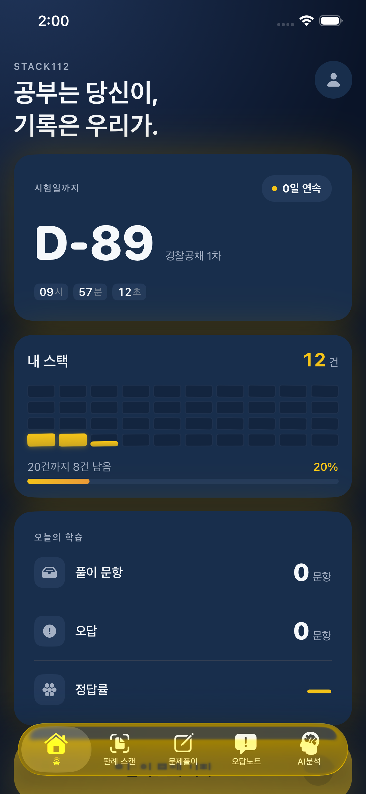
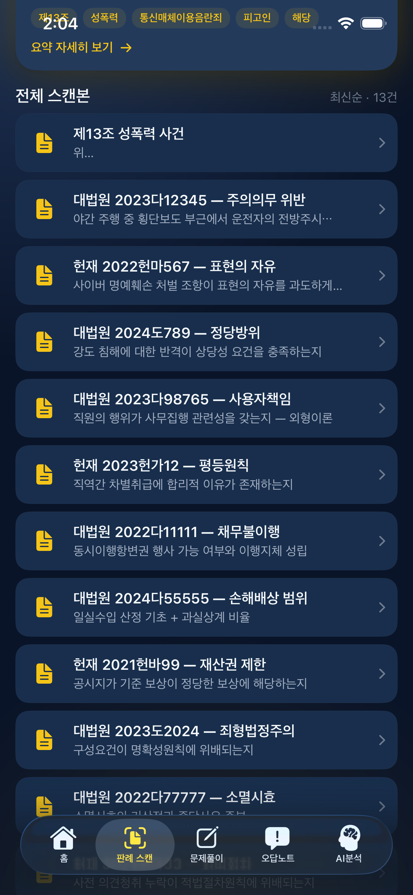
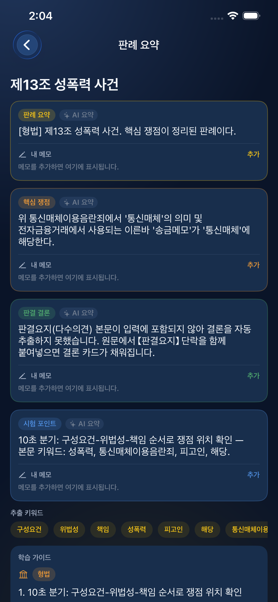
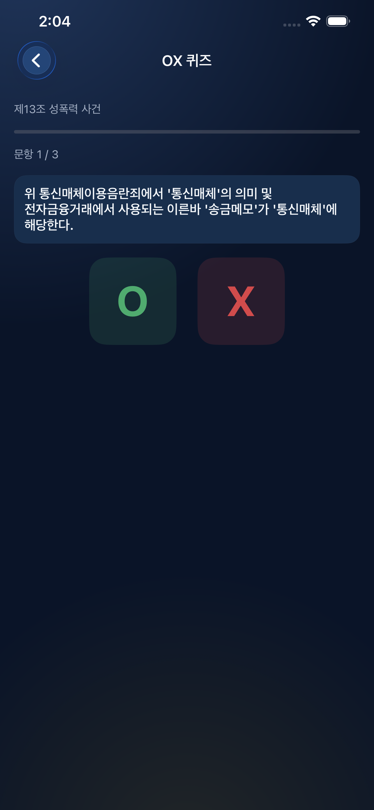
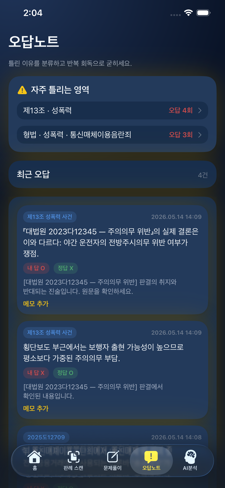
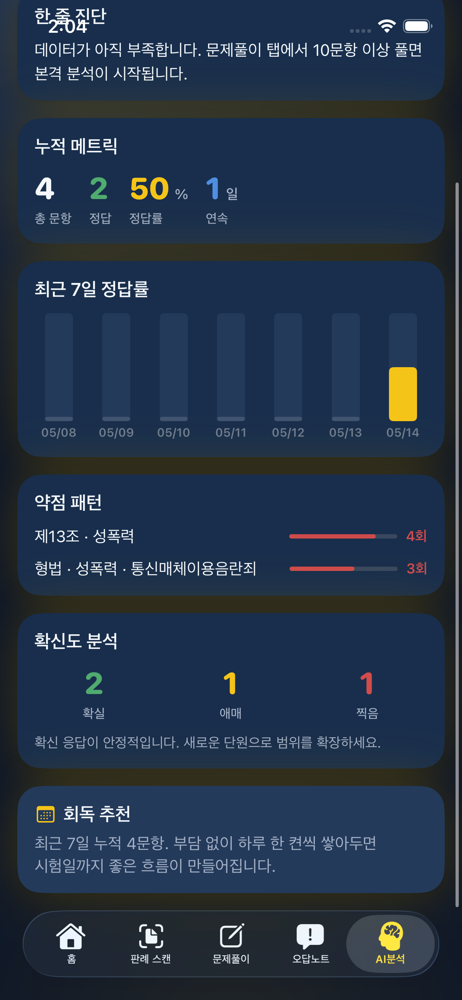
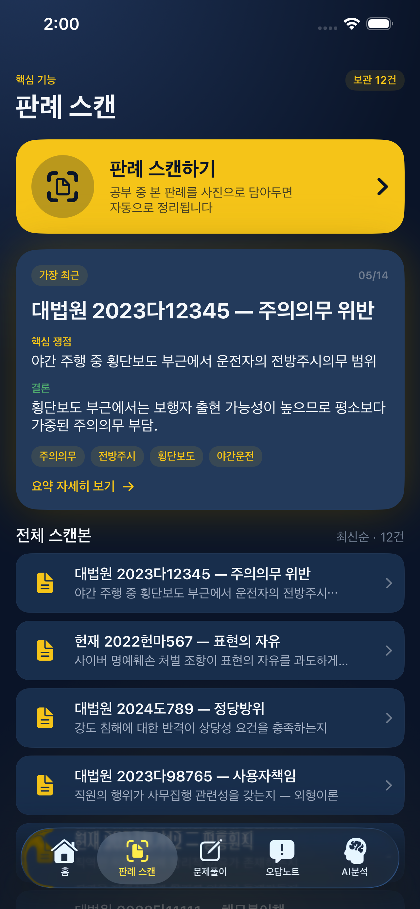
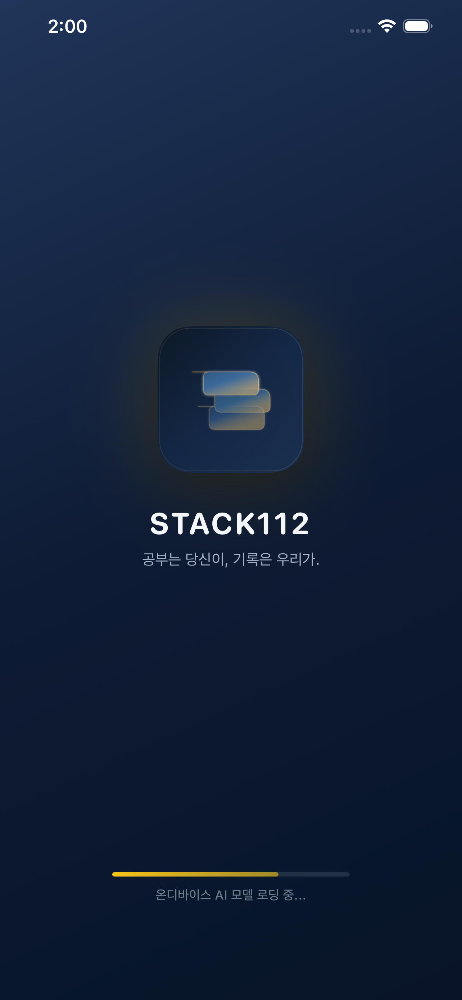

# AI_SYS iOS (SwiftUI)

최종 업데이트: 2026-11-02
현재 상태: 완전 온디바이스(Backend-free) 동작. 기존 배포판은 iPhone 12 mini(A14, 4GB) 실기기 검증 및 심사 제출 완료. 이번 RAG 변경은 아래 테스트 범위와 별도로 실기기 재검증이 필요합니다.

> **2026-05-14 요약**
> - OX placeholder/시험 포인트 텍스트 오염 방지, 판시사항 평서문 정제, 카드 halo 디자인 적용.
> - Release 빌드/실기기 설치/Archive/ASC 업로드까지 검증했고 심사 제출을 완료했습니다.
> - App Store 메타데이터와 Privacy/App Review 입력값은 `APPSTORE_METADATA.md`, `APPSTORE_PRIVACY_NUTRITION.md` 기준으로 정리했습니다.

## 앱 화면 미리보기

| 홈 | 스캔 라이브러리 | AI 요약 | OX 퀴즈 |
|---|---|---|---|
|  |  |  |  |

| 오답 노트 | AI 분석 | 사건 스캔 진입 | 스플래시 |
|---|---|---|---|
|  |  |  |  |

이 폴더는 `xcodegen`으로 생성되는 iOS SwiftUI 프로젝트입니다.

## 빠른 실행

```bash
cd code/ios
xcodegen generate
open AISYS.xcodeproj
```

Xcode에서 `AISYSApp` 스킴을 선택한 뒤 iPhone Simulator로 실행하면 됩니다.

실기기(iPhone) 실행 시에는 Xcode에서 `Signing & Capabilities`의 Team을 본인 Apple ID 팀으로 1회 선택하면 바로 실행됩니다.

## 로컬 LLM 모델 파일 안내

- 저장소는 `*.gguf`를 커밋하지 않도록 유지합니다.
- 배포 빌드는 번들 리소스 또는 `Documents/models/` 경로에서 사용 가능한 GGUF 모델을 탐색합니다.
- 필요 시 `Info.plist`의 `LLAMA_MODEL_FILE` 값을 원하는 파일명으로 지정할 수 있습니다.
- 모델이 없으면 LlamaCpp 엔진 로드가 실패하고, 앱은 Rule-based fallback 엔진으로 동작합니다.

### 실기기 모델 배치 절차

1. Xcode에서 앱을 실기기에 1회 실행해 앱 컨테이너를 생성합니다.
2. Finder에서 iPhone을 선택한 뒤 파일 공유(File Sharing)에서 `AI_SYS` 앱을 엽니다.
3. 앱 내부 `Documents/models/` 폴더를 만들고 GGUF 파일을 복사합니다.
4. 파일명이 기본값(`Llama-3.2-1B-Instruct-Q4_K_M.gguf`)과 다르면 Xcode Target Build Settings의 `LLAMA_MODEL_FILE` 값을 동일하게 맞춥니다.
5. 앱을 완전히 종료 후 재실행해 모델 로딩을 확인합니다.

### 로딩 검증 체크리스트

1. 앱 시작 직후 LLM 상태가 `loading`에서 `ready`로 전환되는지 확인
2. Search 상세 화면에서 요약 생성 시 fallback 문구가 아닌 실제 생성 응답이 나오는지 확인
3. 모델 파일명을 변경한 경우 `LLAMA_MODEL_FILE` 값과 정확히 일치하는지 확인
4. 모델 파일이 `Documents/models/` 하위에 있고 확장자가 `.gguf`인지 확인

### 트러블슈팅

- 증상: "GGUF 모델 파일을 찾을 수 없습니다"
  - 조치: `Documents/models/` 경로, 파일명, `LLAMA_MODEL_FILE` 값을 순서대로 점검
- 증상: 앱이 즉시 fallback 엔진으로 전환됨
  - 조치: 실기기 저장공간/파일 손상 여부 확인 후 모델 재복사
- 증상: 시뮬레이터에서는 동작하지만 실기기에서 실패
  - 조치: 앱 재설치 후 모델 재복사, Team/Signing 설정 재확인

## 온디바이스 RAG

기존 카드 경로는 서버나 벡터 DB 없이 **사용자가 기기에 저장한 판례**를 키워드 검색해 참고 자료를 붙입니다. 아래의 별도 연구 경로만 승인된 E5 임베딩 모델을 추가로 사용합니다. 앱 실행 중 모델이나 판례 데이터를 다운로드하지 않습니다.

전체 흐름은 [인터랙티브 RAG 동작 지도](../../docs/architecture/OnDevice_RAG_Map_2026-11-02.html) 또는 [정적 SVG](../../docs/images/ondevice-rag-map.svg)에서 확인할 수 있습니다. 주입 요약 보존·캐시 적중·근거 조립·로컬 생성·복구 경로를 구분했습니다.

- [RootTabView](AISYSApp/Sources/RootTabView.swift)의 SwiftData 쿼리가 앱 진입 및 저장·수정·삭제 때 [LocalCaseStore](AISYSApp/Sources/LocalCaseStore.swift)를 동기화합니다. 개수가 같은 수정도 검색 필드가 바뀌면 반영합니다.
- [LocalCaseSearchEngine](AISYSApp/Sources/LocalCaseSearchEngine.swift)은 본문과 법률 키워드 확장으로 검색합니다. 현재 판례가 미등록 상태이거나 `OCR-*` 사건번호여도 검색하며, 자신·같은 실제 사건번호의 중복을 제외합니다.
- 검색용 OCR 발췌와 화면 표시 자료는 분리합니다. 검색 결과와 판례별 참고 근거는 같은 스냅샷의 표시 자료로 변환해 원문 덧붙임이 그대로 노출되지 않게 합니다.
- [LLMService](AISYSApp/Sources/LLMService.swift)의 메모리 캐시는 입력 판례 전체, 코퍼스 변경 번호, 모델 로드 번호를 키로 사용합니다. 빈 검색 결과도 자료 추가 후 다시 검색합니다.
- [PromptTemplates](AISYSApp/Sources/PromptTemplates.swift)는 고정 예시 대신 현재 판례·참고 판례·출력 형식을 구분합니다. 길면 필드 발췌와 참고 개수를 줄이되, 참고 자료가 있는 경우 최소 한 건의 사건번호와 발췌를 남깁니다.
- [LlamaCppEngine](AISYSApp/Sources/LocalLLMEngines.swift)의 실제 토크나이저로 **chat template까지 포함한 입력**이 실제 할당된 컨텍스트의 입력 예산에 들어가는지 확인합니다. 출력 토큰 여유도 확보합니다. 요약 입력은 이 검증 후 전달하므로 엔진의 후단 prefix 절단에 의존하지 않습니다.
- 판례마다 KV 메모리를 초기화해 이전 판례의 추론 상태가 섞이지 않게 합니다. 규칙 기반 엔진도 현재 판례 구간만 읽어 참고 판례의 결론을 현재 결론으로 사용하지 않습니다.
- 최소 발췌도 입력 예산에 들어가지 않으면 근거를 몰래 삭제하지 않습니다. 로그와 `lastLoadMessage`에 실패를 남기고 현재 판례 원문 기반 카드를 표시합니다.

### 기존 카드 경로의 한계

- 선택적인 `seed_cases.json`은 여전히 없으므로 새 설치에서 다른 판례를 검색하려면 자료를 먼저 저장해야 합니다. 검색 결과가 없으면 참고 근거 블록을 만들지 않습니다.
- 검색 색인은 기존과 같이 OCR 앞 1,500자 및 추출 필드를 사용합니다. 문장 단위 청킹·벡터 검색·검색 평가셋·구조화 인용 검증은 아직 없습니다.
- 작은 컨텍스트에서는 발췌가 짧아집니다. 입력 보존 테스트가 법률 판단의 정확성이나 충분한 근거를 보장하지는 않습니다.
- 유효한 요약이 ViewModel에 주입되어 있고 OCR/스캔 문서 조건을 만족하면 해당 요약을 보존합니다. 단순히 저장된 요약이 있다는 이유로 생성을 생략하지는 않습니다. 활성 스캔 라이브러리의 기본 상세 진입은 새 ViewModel을 사용하므로 요약 생성 또는 메모리 캐시 경로를 탑니다. 캐시 개선은 SwiftData 저장 요약의 일괄 재생성이 아닙니다.
- 현재 판례 요약의 후처리는 원 판례 필드를 우선합니다. 참고 판례를 넣었다는 이유로 다른 판례의 결론을 현재 판례의 사실로 채택하지 않습니다.

### 별도 원문 근거 분석과 논문용 평가

기존 카드를 바꾸지 않는 **별도 경로**입니다. 판례 상세의 `원문 근거 분석 · RAG`에서 질문·검색 방식을 선택합니다.

- [RAGCore](AISYSApp/Sources/RAGCore.swift): 원문 전체의 위치·해시 보존 청킹, 사건번호/키워드 + E5 의미 검색 순위 융합, 문장별 근거 ID와 기초 근거 검사.
- [GGUFEmbeddingProvider](AISYSApp/Sources/GGUFEmbeddingProvider.swift): 한국어를 지원하는 multilingual-e5-base Q8_0(약 289.1 MiB), 원본과 호환되는 SentencePiece 토크나이저, mean pooling, L2, query/passage 접두사, 가중치 SHA-256 검증과 메모리 벡터 캐시.
- [RAGResearch](AISYSApp/Sources/RAGResearch.swift): 원시 생성·실패·추론 시간·프로세스 표본 메모리 기록, 검색 없음/키워드/하이브리드 비교, 평가셋 검증과 JSON 내보내기.
- [RAGResearchViews](AISYSApp/Sources/RAGResearchViews.swift): 실제 전달 근거와 원문 대조, 사람 검수, 데이터 가져오기, 실기기 전용 평가 실행.
- 생성 작업의 `근거 기반 OX 초안`은 같은 원문·검색 근거로 문항/정답/해설을 만들고 형식을 검사합니다. 기존 OX와 분리된 검수 전 초안입니다.
- [합성 평가셋](AISYSApp/Resources/rag_synthetic_v1.json): 가상 문서 8개/질문 3개. **실제 판례 정답 자료가 아닙니다.** 앱에서 내보내 자체 평가셋 양식으로 쓸 수 있습니다.
- 의미 벡터를 사용할 수 없으면 실제 모드를 키워드로 기록합니다. 모델 부재·생성/인용 실패를 규칙 기반 성공으로 대체하지 않습니다.
- 메모리는 앱 프로세스의 50ms 표본 최대이며 모델 전용/절대 최대가 아닙니다. 시뮬레이터 결과는 실기기 성능 집계에서 제외합니다.

정확한 지표 정의, 데이터 스키마, 실험 절차와 아직 필요한 실제 자료는 [논문 평가 프로토콜](../../docs/research/OnDevice_RAG_Protocol.md)을 확인하세요. 기존 OX 퀴즈는 기존 경로를 유지하며 새 연구 결과와 혼합 집계하지 않습니다.

새 체크아웃에서는 저장소 루트에서 `bash scripts/fetch_rag_embedding.sh`를 실행한 뒤 `code/ios`에서 `xcodegen generate`를 실행하세요. 앱은 번들 또는 `Documents/models/`의 고정 파일을 로드하며 다운로드를 수행하지 않습니다. 원본 MIT 고지는 번들 및 근거 분석 화면에 포함됩니다. 임베딩 가중치는 요약용 모델 탐색에서 제외됩니다.

## 테스트 실행

1차 기존 요약 RAG 검증: Xcode 26.1.1 / iPhone 17 Simulator / iOS 26.1에서 빌드 및 서로 다른 **15개 테스트 통과**. 전체 14개 실행 후 활성 루트 동기화 테스트를 추가하고 긴 입력 검사를 강화해 2개를 추가 실행했습니다(1개 중복).

연구 확장 검증: 최신 회귀 36개(기존 14 + 연구 17 + 실제 임베딩 5), 실제 E5 → 실제 GGUF 인용 생성 E2E 1개 통과. 앞서 실제 토크나이저/연속 추론 1개까지 포함하면 서로 다른 **38개 검사**를 실행했습니다. 한국어 관련/무관 순위, 원문 범위, 모드·해시, 캐시, 모델 손상, 모델 역할 분리, 실패·취소, JSON과 지표를 확인했습니다. **시뮬레이터 기능 검사이며 논문용 성능·법률 정확도 결과가 아닙니다.**

새 실제 임베딩 검사에는 설치 스크립트로 준비한 E5 가중치가 필요하고, 실제 생성 E2E에는 기존 생성 GGUF도 필요합니다. 빠른 회귀에서는 실제 생성 테스트 두 개를 제외할 수 있으며, 릴리스 전 별도로 실행해야 합니다.

- 기존 저장 관련 2개 + 온디바이스 RAG 관련 13개입니다.
- SwiftData를 연결한 실제 RootTabView를 호스팅해 초기 자료·같은 개수의 수정·삭제가 검색 저장소에 반영되는지 검사했습니다.
- 번들 GGUF로 실제 토큰 예산 검사와 2회 연속 추론을 수행했습니다. 법률 답변 정답률이나 실기기 성능을 측정한 결과는 아닙니다.
- 모델이 없는 환경에서는 실제 GGUF 검증 1개가 명시적으로 skip되며 나머지는 모델 없이 실행됩니다.

```bash
cd code/ios
xcodegen generate
xcodebuild test \
  -project AISYS.xcodeproj \
  -scheme AISYSApp \
  -destination 'platform=iOS Simulator,name=iPhone 17' \
  CODE_SIGNING_ALLOWED=NO CODE_SIGNING_REQUIRED=NO
```

빠른 회귀 검사만 필요하면 위 명령에 `-skip-testing:AISYSAppTests/AISYSAppTests/testRealTokenizerPreservesEvidenceAndRepeatedInferenceWorks`를 추가합니다. 전체 검증에서는 생략하지 마세요.

iOS 시뮬레이터가 없으면 Mac Catalyst로도 테스트할 수 있습니다.

```bash
cd code/ios
xcodegen generate
xcodebuild test \
  -project AISYS.xcodeproj \
  -scheme AISYSApp \
  -destination 'platform=macOS,variant=Mac Catalyst,name=My Mac' \
  CODE_SIGNING_ALLOWED=NO CODE_SIGNING_REQUIRED=NO
```

## iPhone 바로 실행 체크리스트

1. Xcode > Settings > Accounts에서 Apple ID 로그인
2. 프로젝트 타깃 `AISYSApp` 선택
3. `Signing & Capabilities`에서 Team 선택 (Automatically manage signing 체크)
4. 상단 실행 타깃을 연결된 iPhone 또는 iPhone Simulator로 선택 후 Run

디바이스 이름이 다르면, 아래로 목록을 확인 후 변경하세요.

```bash
xcrun simctl list devices
```

## 최근 검증 상태 (2026-05-14)

- `AISYSAppTests.testSaveWrongAnswerAddsItemToTop` 통과
- `AISYSAppTests.testSaveWrongQuizRecordReturnsId` 통과
- Release build / 실기기 설치 / Archive / App Store Connect 업로드 성공
- App Store 제출용 스크린샷 선별본은 `code/ios/appstore_screenshots/` 에 정리

## App Store 참고 문서

- `APPSTORE_METADATA.md` — 메타데이터, 리뷰 메모, ASC 입력값
- `APPSTORE_PRIVACY_NUTRITION.md` — App Privacy / Export Compliance / Content Rights 답변지
