# 실행 로그 기반 성능·안정성 분석

> **추가 측정:** E5 단독을 포함한 B1/S/H 검색 전용 비교는 [15절](#15-e5-단독을-포함한-검색-구성-분해-실험)에 있다. 기존 14절의 9개 생성 요청과 후속 36회 검색 측정을 구분한다.
>
> **장문 요약:** 현재 판례 내부의 근거 선택과 실제 요약 12회 평가는 [16절](#16-장문-판례-요약-성능-평가)에 있다. 핵심 정보 누락과 생성 오류를 따로 측정한다.
>
> STACK112 온디바이스 iOS RAG · 분석일: 2026-11-03
>
> **이 문서의 시간은 시뮬레이터 관측이다. iPhone 실기기 응답 시간이나 자원 성능 결과가 아니다.**
> 1~13절은 기존 로그 분석과 평가 설계다. **14절은 실제 판례 3건의 검색·LLM 출력 품질 파일럿, 15절은 E5 단독을 포함한 후속 검색 전용 실험, 16절은 장문 요약 평가**다. 각 자료의 표본과 측정 경계·결론을 섞지 않는다.

## 약어·실험 표기 안내

이 문서의 질문 ID, 비교 조건, 근거 ID는 서로 다른 분류다. 원자료의 ID·모드명은 유지하고 다음과 같이 해석한다.

| 표기 | 풀어쓴 의미·문서 내 역할 |
| --- | --- |
| L1 | 14절 첫 번째 파일럿 질문: 재산분할의 액수·방법에 기여도와 쌍방 사정을 어떻게 참작하는가 |
| L2 | 14절 두 번째 파일럿 질문: 97므1486을 명시하고 현재 판례와 공통 판단 기준을 묻는 사건번호 대조 질문 |
| L3 | 14절 세 번째 파일럿 질문: 면접교섭 이행명령으로 새 조건을 부가할 수 있는가. 관련 참고 없음이 기대값 |
| B0 · `currentOnly` | 현재 판례 근거 E0만 사용하는 기준 조건. 참고 검색을 하지 않지만 ‘근거 없는 LLM’은 아님 |
| B1 · `keyword` | 현재 판례 + 키워드·사건번호 검색 참고를 사용하는 비교 조건 |
| S · `semantic` | 15절 후속 실험의 E5 단독 검색 조건. 키워드·사건번호 가산·RRF 없이 코사인으로 정렬 |
| H · `hybrid` | Hybrid, 현재 판례 + 키워드·E5 의미 검색을 RRF로 융합한 제안 조건 |
| B2 | 사용하지 않는 표기. 기존 생성 파일럿은 B0/B1/H, 후속 검색 실험은 B1/S/H이며 B2라는 실행은 없음 |
| F / K | 16절 장문 요약의 구조화 필드 기준 / 현재 판례 내부 키워드 근거 선택. 14~15절의 B0/B1과 다름 |
| O · Oracle-evidence | 전문가가 고른 정답 발췌를 직접 주는 후속 진단 조건. 미구현·미실행이며 9개 요청에 포함되지 않음. OX 정답의 O와 다름 |
| E0 | Evidence 0, 현재 판례에서 선택한 근거 청크·전달 발췌의 ID |
| E1 | Evidence 1, 첫 번째 참고 청크·전달 발췌의 ID |
| E2 | Evidence 2, 두 번째 참고 청크·전달 발췌의 ID. E1과 같은 문서의 다른 부분일 수 있음 |
| RAG / LLM | Retrieval-Augmented Generation, 검색 증강 생성 / Large Language Model, 대규모 언어모델. 여기서는 로컬 근거 검색과 Llama 생성을 결합 |
| E5 | multilingual-e5-base라는 검색 임베딩 모델 이름. 근거 번호 E0·E1·E2와 무관 |
| RRF | Reciprocal Rank Fusion, 역순위 융합. 키워드·의미 검색 순위를 결합 |
| P@3 | Precision at 3. 문서 ID 중복 제거 후 상위 최대 3문서 중 관련 문서 수를 3으로 나눈 값. 앱 구현의 분모는 고정 3 |
| R@3 / Recall@3 | Recall at 3. 같은 상위 문서에서 찾은 관련 문서 수 / 질문의 전체 관련 정답 문서 수 |
| MRR@3 | Mean Reciprocal Rank at 3. 같은 상위 문서에서 첫 관련 문서 순위의 역수를 질문별로 구해 평균. 정답이 있으나 못 찾으면 해당 값은 0 |
| L2 정규화 | 벡터를 유클리드 길이로 나눠 길이 1로 만드는 처리. 질문 ID L2와 전혀 다른 수학 표기 |
| GGUF / Q4_K_M·Q8_0 | 모델 저장 형식 / 가중치 양자화 방식 표기. Llama 생성 파일은 Q4_K_M, E5 검색 파일은 Q8_0 |
| KV / BOS | Key·Value, 생성 시 재사용하는 어텐션 정보 / Beginning of Sequence, 입력 시작 토큰. 런타임 로그 용어 |
| E2E / OCR | End-to-End, 정해진 전체 경로 검사 / Optical Character Recognition, 이미지 문자 인식 |
| CSV·JSON / PNG·SVG | 집계·원자료 데이터 형식 / 래스터·벡터 이미지 형식 |

**E는 Evidence(근거)이지 Embedding(임베딩)이 아니다.** 임베딩은 검색에 쓰는 숫자 벡터이고 E0·E1·E2는 텍스트 인용 ID다. 같은 실행에 E1·E2가 모두 없을 수 있고, ID는 실행마다 다시 붙인다. **L1·H**는 ‘질문 L1을 조건 H로 실행’, **[E0,E1]**은 ‘그 실행의 현재 근거와 첫 참고 근거 인용’을 뜻한다.

검색 정답 집합이 비면 Recall·MRR는 **미측정**이며, 별도로 ‘참고 없음 판정’을 평가한다. 이 지표나 인용 형식 통과율을 법률 정답률로 바꾸어 읽지 않는다.

## 1. 먼저 읽는 결론

1. **실제 모델을 사용하는 검사가 테스트 비용의 큰 부분을 차지했다.** 최종 36개 회귀 검사에서 E5 관련 실제 모델 검사 3개의 시간 합은 15.276초로, 개별 검사 시간 합의 **63.3%**였다.
2. **실제 검색부터 생성까지 연결한 검사는 통과했지만 가볍지는 않았다.** 가상 문서에 대한 실제 E5 → GGUF → 인용 출력 E2E 검사는 **97.987초** 걸렸다. 단 한 번의 복합 검사이며, 이를 앱의 순수 생성 시간이나 일반적인 사용자 대기 시간으로 해석하면 안 된다.
3. **최종 회귀는 36개 모두 통과했다.** E5-base 전환 후 36개 배치의 suite 시간은 24.105초, 런타임 revision 고정 후에는 24.244초였다. 두 실행만으로 최적화 효과나 통계적 안정성을 판단하지 않는다.
4. **임베딩은 단순히 빨리 실행되는 것보다 올바른 검색 순서를 만드는 것이 먼저였다.** 초기 소형 변환본은 무관한 문서에 더 높은 점수를 주었다. 최종 base 변환본은 관련 문서가 더 높다는 검사를 통과했다. 실제 판례에 대한 첫 소규모 관측은 14절에 있으며 일반적인 법률 검색 정확도는 아직 확정하지 못했다.
5. **메모리 피크·초당 토큰·실기기 지연은 이 로그만으로 계산할 수 없다.** 버퍼 선언은 있지만 앱 프로세스 메모리 계측 JSON과 토큰 처리량 로그는 없다. 해당 값은 0이 아니라 **미측정**이다.

이 수치를 좋음·나쁨·정확함·모호함 같은 표현으로 해석하는 기준은 **10절**에 정리했다. 이는 로그에 근거한 해석이며, 사용성 조사나 법률 전문가의 정성 평가를 수행했다는 의미는 아니다.

**LLM 출력 품질은 테스트할 수 있다.** 현재 검사가 어디까지 확인했는지, 어떤 모델·RAG 구성을 비교해야 하는지와 최고 성능 판정 조건은 **11절**에 명시했다. 아직 출력 품질 비교의 우승 모델은 정해지지 않았다.

**새 실험의 핵심:** 관련 선례를 상위에 찾는 것과 비관련 판례를 제외하는 것은 달랐다. B1/H 모두 양성 질문 2개에서 관련 선례를 1위로 찾았지만, 참고가 없어야 할 질문에서는 비관련 판례를 실제 생성 입력에 넣었다. 실제 생성 9건은 모두 텍스트를 반환했으나 앱의 인용 출력 형식 검사를 통과한 것은 **0/9**였다. 원시 출력·입력 발췌와 해석은 **14절**에 있다.

## 2. 분석 자료와 방법

### 2.1 자료 범위

- 원본: 세션에 보존된 iOS `xcodebuild test` 로그 **11개**. 다운로드·문서 lint·패키지 해석 로그는 성능 집계에서 제외했다.
- 환경: 로그의 명시적 `platform=iOS Simulator` 실행 조건. 기존 검증 환경은 Xcode 26.1.1 / iOS 26.1 / iPhone 17 Simulator다.
- 반복 실행을 포함한 완료 테스트 관측: **236건**. 통과 232건, 실패 4건이며 실패 assertion 기록은 8개다.
- 역사적 메서드명은 39개다. 현 소스에는 없는 Apple 의미 검색 가용성 검사 1개가 포함되어 있다. 기존 3개 검사 파일의 메서드 **38개**는 모두 로그에 대응하며 각각의 마지막 관측 상태는 통과다. 뒤에 추가한 실제 판례 파일럿 검사는 14절에서 별도로 다룬다.
- 여러 버전·여러 선택 실행을 합친 이력이다. 현재 바이너리로 38개를 한 배치에서 재실행했다는 의미는 아니다.
- 분석 도구: **Python 3.12.2, pandas 2.3.0, matplotlib 3.9.2**. 분석 시점 소스 기준 커밋은 `d4104e7`이다.

누적 통과 232건을 전체 236건으로 나눈 수치는 개발 중 서로 다른 검사를 반복한 결과일 뿐이다. 이를 앱 안정성 확률, RAG 출력 성공률, 법률 정답률로 사용하지 않았다.

### 2.2 pandas 처리 절차

[분석 스크립트](../../scripts/analyze_rag_logs.py)는 다음 순서로 처리한다.

1. 각 원본 로그의 SHA-256·바이트 수·행 수를 기록한다.
2. XCTest 시작/종료, 최종 summary, Xcode observer 시간, 실패 assertion, 네이티브 버퍼·경고를 추출한다.
3. `DataFrame`으로 변환한 뒤 `groupby`, `agg`, `merge`, `drop_duplicates`, `value_counts`로 집계한다.
4. 개별 테스트 수를 마지막 suite summary와 대조한다. 중첩 suite가 같은 summary를 반복하는 것을 중복 합산하지 않는다.
5. **실패한 테스트 수와 실패 assertion 수를 구별한다.** 한 테스트에서 assertion 5개가 실패해도 실패한 테스트는 1개다.
6. 로그 출력이 섞인 두 경우를 명시적으로 복원·기록한다. 클래스명 안에 진행 표시 점이 들어간 경우는 유일한 활성 테스트와 대조하고, 네이티브 로더 문구 뒤에 붙은 XCTest 줄은 원래 행 번호를 유지한다. 모호한 연결이나 누락은 오류로 중단한다.
7. 집계 CSV·JSON과 그래프 PNG·SVG를 생성한다. 모든 테스트 관측과 실패·진단에 원본 행 번호를 남긴다.

원본 해시는 [sources.csv](log-analysis-2026-11-03/sources.csv), 개별 결과는 [test_cases.csv](log-analysis-2026-11-03/test_cases.csv), 현재/과거 테스트 구분은 [test_method_coverage.csv](log-analysis-2026-11-03/test_method_coverage.csv)에 있다. 기존 [평가 프로토콜](OnDevice_RAG_Protocol.md)의 실기기 성능 집계와는 다른, 개발 로그의 사후 분석이다.

### 2.3 서로 다른 세 가지 시간

| 시간 | 의미 | 이 문서에서의 사용 |
| --- | --- | --- |
| 개별 XCTest case 시간 | 해당 검사 함수의 실행 비용. 모델 로드·해시 확인·검색·검증·정리 등이 포함될 수 있음 | 어떤 검사가 오래 걸렸는지 비교 |
| XCTest suite elapsed | 로그 마지막 `Executed ... in A (B) seconds`의 **B** | 선택된 검사 묶음의 경과 시간 |
| Xcode observer elapsed | `Testing started completed`에 기록된 구간 | 테스트 작업 구간과 suite의 차이를 관찰 |

observer와 suite의 차이는 계산할 수 있지만 설치·기동·대기·정리 등으로 각각 분해할 수는 없다. **이 차이를 전부 빌드 시간이나 모델 로딩 시간이라고 부르지 않는다.** observer는 셸 명령 전체의 경과 시간도 아니다.

## 3. 전체 실행 이력

시간 단위는 초다. 이 표는 개발 경과이며, 행 사이의 속도 우열 비교가 아니다.

| 원본 로그 | 테스트 수 | 실패 테스트 | 실패 assertion | suite 시간 | observer 시간 |
| --- | --- | --- | --- | --- | --- |
| `ondevice-rag-tests.log` | 14 | 0 | 0 | 236.072 | 371.297 |
| `ondevice-rag-root-tests.log` | 2 | 0 | 0 | 3.502 | 129.499 |
| `rag-research-tests.log` | 27 | 0 | 0 | 7.384 | 218.168 |
| `rag-research-tests-final.log` | 30 | 0 | 0 | 297.200 | 380.183 |
| `rag-research-tests-regressions.log` | 31 | 0 | 0 | 8.379 | 68.261 |
| `rag-e5-tests.log` | 36 | 3 | 7 | 13.115 | 145.704 |
| `rag-e5-focused.log` | 6 | 1 | 1 | 6.314 | 116.717 |
| `rag-e5-base-tests.log` | 36 | 0 | 0 | 24.105 | 107.544 |
| `rag-real-e2e.log` | 1 | 0 | 0 | 97.992 | 190.532 |
| `rag-pinned-final-tests.log` | 36 | 0 | 0 | 24.244 | 112.550 |
| `rag-ui-metadata-final.log` | 17 | 0 | 0 | 9.169 | 102.829 |

원자료: [runs.csv](log-analysis-2026-11-03/runs.csv). 원본 summary·observer 행 번호도 이 파일에 있다.

**주의:** 30개 검사 배치의 약 297초가 이후 약 24초로 줄었다고 해서 앱이 12배 빨라졌다고 해석할 수 없다. 30개 배치에는 실제 토크나이저·2회 연속 생성 검사가 포함되어 있고 이 검사 하나가 290.187초였다. 빠른 36개 회귀에서는 해당 검사를 제외했다. 초기 같은 이름의 실제 생성 검사 관측은 234.867초였으나 코드·프롬프트·환경이 통제되지 않아 그 차이도 성능 회귀로 확정하지 않는다.

## 4. 성능 관찰 ①: 최종 회귀의 시간은 어디에 쓰였는가

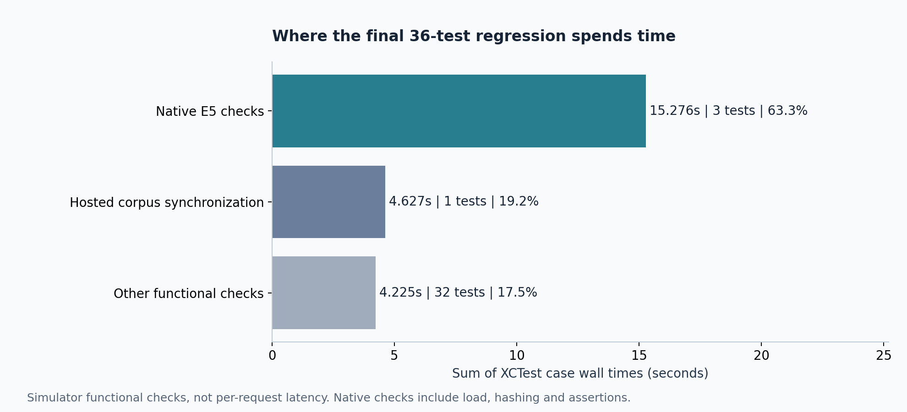

`rag-pinned-final-tests.log`의 36개 개별 검사 시간을 합산했다.

| 검사 종류 | 개수 | 시간 합 | 비중 |
| --- | --- | --- | --- |
| 실제 E5 관련 검사 | 3 | 15.276초 | 63.3% |
| 루트 화면·원문 코퍼스 동기화 통합 검사 | 1 | 4.627초 | 19.2% |
| 나머지 기능·실패 처리·지표 검사 | 32 | 4.225초 | 17.5% |
| 합계 | 36 | 24.128초 | 100.0% |

표의 합은 각 case에서 소수점 3자리로 출력한 시간을 더한 값이다. XCTest 자체의 case 합 표시는 24.129초이며 0.001초 차이는 출력 반올림 범위다. suite elapsed 24.244초와도 측정 범위가 다르다.

**쉽게 말하면:** 이 회귀 묶음에서는 문자열·지표 검사보다 실제 모델을 불러와 벡터를 계산하는 검사가 더 비쌌다. 다만 “실제 E5 검사”에는 여러 요청, 모델 로드, 해시 확인과 assertion이 포함된다. **앱의 검색 요청 하나에서 임베딩이 전체 지연의 63.3%라는 뜻은 아니다.** 루트 통합 검사도 UI 호스팅·동기화·대기를 포함하므로 판례 갱신 자체가 4.627초라고 해석하지 않는다.

집계표: [final_group_timings.csv](log-analysis-2026-11-03/final_group_timings.csv).

## 5. 성능 관찰 ②: 실제 모델 검사에 걸린 시간

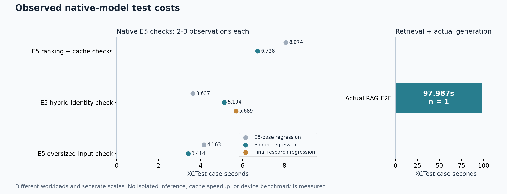

올바른 base 변환본을 사용한 세 로그에서 같은 검사 이름의 관측만 모았다.

| 검사 | 관측 수 | 관측 시간 | 포함 범위 |
| --- | --- | --- | --- |
| 한국어 순위·벡터 재사용 검사 | 2 | 6.728~8.074초 | 첫 벡터 계산, 동일 입력 재요청, 수정 문서 재계산과 검사 |
| 실제 하이브리드·모델 신원 검사 | 3 | 3.637~5.689초 | 작은 코퍼스 검색, 모델 해시·실제 검색 모드 확인 |
| 초과 입력 거절 검사 | 2 | 3.414~4.163초 | 모델 준비와 긴 입력의 명시적 거절 확인 |
| 실제 RAG 검색→생성 E2E | 1 | 97.987초 | 실제 E5와 생성 GGUF, 근거 구성, 출력 형식·전달 근거 확인 |

그래프의 좌우 축 범위는 다르다. 모든 수치는 **해당 XCTest case 전체 시간**이다. n=2 또는 3을 충분한 반복 표본으로 보지 않으며 p50/p95·신뢰구간을 만들지 않았다.

**캐시는 동작했지만 얼마나 빨라졌는지는 모른다.** 순위·캐시 검사는 같은 입력의 벡터 재사용, 3개 적중/0개 미스, 본문 수정 시 재계산을 확인한다. 그러나 cold/warm 호출별 시간이 출력되지 않아 “캐시로 몇 배 빨라졌다”는 결론은 낼 수 없다.

**E2E는 단 한 번이다.** 짧은 가상 표식 문서와 질문으로 실제 모델 연결과 인용 출력의 통과를 확인했을 뿐이다. 검색·해시·로드·생성·검증을 분리한 `RAGRunRecord` JSON은 로그에 출력하지 않았기 때문에 97.987초에서 순수 추론 시간을 역산할 수 없다.

관련 코드: [실제 임베딩·E2E 검사](../../code/ios/AISYSAppTests/GGUFEmbeddingTests.swift), [연구 경로 검사](../../code/ios/AISYSAppTests/RAGResearchTests.swift). 집계: [native_check_observations.csv](log-analysis-2026-11-03/native_check_observations.csv).

## 6. 성능 관찰 ③: 작업 시간이 길다고 답변이 그만큼 늦은 것은 아니다

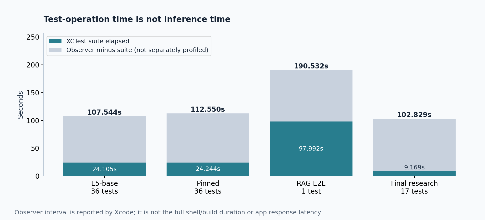

| 실행 | suite elapsed | observer elapsed | 차이 |
| --- | --- | --- | --- |
| E5-base 36개 | 24.105초 | 107.544초 | 83.439초 |
| revision 고정 후 36개 | 24.244초 | 112.550초 | 88.306초 |
| 실제 RAG E2E 1개 | 97.992초 | 190.532초 | 92.540초 |
| 마지막 연구 경로 17개 | 9.169초 | 102.829초 | 93.660초 |

**쉽게 말하면:** 테스트 도구가 끝날 때까지 기다린 시간과 테스트 함수가 실행된 시간은 다르다. 특히 빠른 회귀에서는 suite 바깥의 구간이 크다. 이것은 앱이 100초 동안 답변을 생성했다는 증거가 아니다.

현재 로그만으로 설치/시뮬레이터/앱 기동/정리 중 어느 구간이 얼마나 차지했는지는 확정할 수 없다. 더 나아가 observer 구간 밖의 컴파일까지 포함한 전체 CLI 시간도 이 값으로 대체할 수 없다.

## 7. 안정성·검색 타당성: 실패도 분석에서 제외하지 않았다

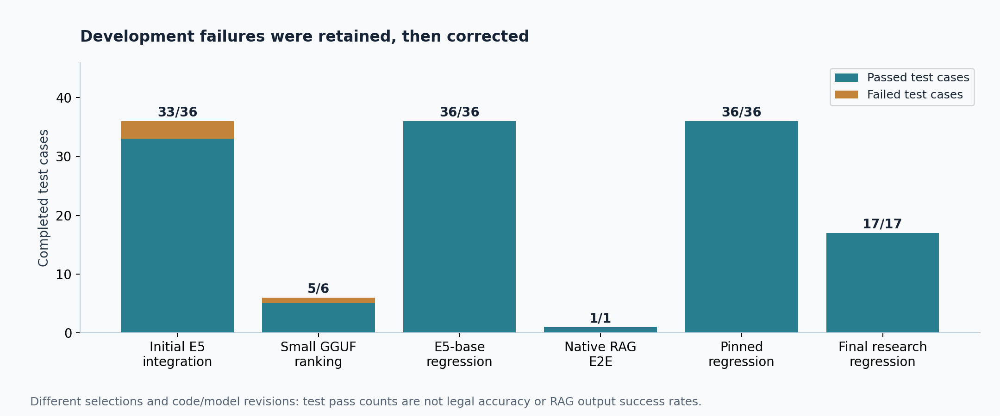

### 7.1 초기 모델 통합 실패

`rag-e5-tests.log`는 36개 중 3개 테스트가 실패했다. summary의 7 failures는 실패한 테스트 7개가 아니라 assertion·예외 보고 수다.

- 모델 검증 단계에서 `384차원 E5 인코더 모델이 아닙니다.`라는 예외 2건이 기록되었다.
- 실제 하이브리드 검사에서는 의미 점수가 없고 실제 모드가 `keyword`인 상태 등이 5개 assertion 실패로 드러났다.
- 이것은 “실패했지만 빨랐던 좋은 실행”이 아니다. **잘못된 실행 경로가 성공한 하이브리드로 숨겨지지 않았다는 증거**다.

이후 구현에서는 llama.cpp의 모델 처리 API·비인과 decode와 실제 메타데이터에 맞춰 통합을 수정했다. 초기 예외 문구만으로 임베딩 차원 자체가 원인이라고 확정해서는 안 된다.

### 7.2 소형 변환본의 잘못된 한국어 순위

`rag-e5-focused.log` 1018행에는 다음 점수가 남아 있다.

| 문서 | 코사인 점수 |
| --- | --- |
| 질문과 관련된 체포 요건 문서 | 0.959129 |
| 무관한 음식 문서 | 0.961596 |

무관한 문서가 더 높은 순위였으므로 검사는 실패했다. 높은 코사인 값 자체를 검색 정확도의 증거로 사용하면 안 된다는 사례다.

이후 base 변환본에서는 관련 문서 점수가 더 크다는 검사가 통과했다. 그러나 **통과한 실행의 실제 두 점수는 출력되지 않았다.** 따라서 개선 폭·정확도 상승률을 수치로 만들지 않았다. 이 결과는 해당 변환본과 테스트 입력에 관한 것으로, 소형 원본 모델 전체의 성능 결론이 아니다.

전체 실패 근거: [failure_evidence.csv](log-analysis-2026-11-03/failure_evidence.csv).

## 8. 메모리와 네이티브 진단: 알 수 있는 것과 없는 것

### 8.1 기록된 것은 버퍼 용량이지 앱의 최대 메모리가 아니다

실제 E2E 로그에 등장한 대표 버퍼 선언은 다음과 같다.

| 구분 | 선언된 용량 | 원본 행 예 |
| --- | --- | --- |
| 큰 모델 CPU_Mapped model | 762.81 MiB | 719 |
| 큰 모델 CPU_REPACK model | 762.55 MiB | 720 |
| 작은 모델 CPU_Mapped model | 280.19 MiB | 996 |
| 작은 모델 CPU_REPACK model | 86.06 MiB | 997 |
| CPU KV | 16.00 MiB | 1258 |
| CPU compute | 12.76 / 64.63 MiB | 1104 / 1278 |

값의 규모는 각각 생성 모델과 E5의 버퍼 구성에 대응한다. 다만 모델 로그가 섞이고 같은 선언이 반복되므로 [원본 이벤트 CSV](log-analysis-2026-11-03/native_buffer_events.csv)는 모델별 실제 상주량으로 묶지 않고 발생 행 그대로 보관한다.

**이 숫자를 더해서 “앱의 피크 메모리가 약 몇 GB”라고 계산하지 않는다.** 메모리 매핑과 실제 resident 페이지는 다르고, 재패킹·해제·중복 로드의 수명 및 동시 상주 여부도 이 출력만으로 결정할 수 없다. 같은 용량이 두 번 출력되었다고 메모리 누수나 두 배 상주를 단정할 수도 없다.

앱에는 [프로세스 표본 계측 코드](../../code/ios/AISYSApp/Sources/RAGResearch.swift)가 있지만 분석한 로그에는 해당 실행의 `sampledPeakMB` 등 구조화된 측정값이 없다. 따라서 현재 표의 단위는 **버퍼 선언 MiB**이며 **프로세스 최대 사용량이 아니다.**

추후 JSON을 확보하더라도 50ms 간격의 표본 최대는 절대 피크가 아니다. MainActor의 긴 동기 구간에서는 표본을 놓칠 수 있으므로 정확한 추세는 Instruments로 보완해야 한다.

### 8.2 확인된 경고와 실행 조건

- E2E 로그에는 GPU offload가 `0/17`, `0/13`, `0/17`로 출력되었다. 시뮬레이터에서 레이어 GPU offload가 0인 실행이므로 이 결과를 물리 iPhone의 Metal 처리량으로 옮길 수 없다.
- 중복 BOS 경고는 11개 로그에서 총 14회, E2E 로그에서 2회 기록되었다. 테스트 통과와 별개로 채팅 템플릿·토크나이저의 특수 토큰 조합을 점검할 필요가 있다. 품질·속도에 미친 영향은 미측정이다.
- 네이티브 출력이 XCTest 줄과 섞이는 사례가 있어 원본을 변경하지 않고 파서에서 근거를 기록했다. 로그를 단순 문자열 분할로만 집계하면 테스트 이름을 잘못 세거나 누락할 수 있다.

위 기록은 [diagnostics.csv](log-analysis-2026-11-03/diagnostics.csv)에 보존했다. 이번 작업에서는 앱 로직을 수정하지 않았다.

## 9. 이 로그로는 보고할 수 없는 성능

| 항목 | 현재 상태 | 필요한 추가 자료 |
| --- | --- | --- |
| iPhone 검색·생성 p50/p95 | 미측정 | 물리 기기의 동일 조건 반복 실행 JSON |
| 순수 prefill/decode 시간·tokens/s | 로그 없음 | 단계별 시간과 실제 입력/출력 토큰 수 |
| cold/warm·캐시 속도 향상 | 기능 확인만 있음 | 호출별 시간, 캐시 적중, 모델 준비 상태를 함께 기록 |
| 앱 프로세스 메모리 최대 | 버퍼 선언만 있음 | `phys_footprint` 표본과 Instruments 보완 |
| 실제 판례 P@3·Recall·MRR | 정답셋 평가 없음 | 독립적인 실제 판례 관련성 정답과 실행 결과 |
| 법률 근거성·정답률 | 가상 문서 기능 검사만 있음 | 블라인드 법률 검수, 미검수·실패 비율 |
| 배터리·발열·장시간 안정성 | 미측정 | 기기별 장시간 반복 실행과 환경 기록 |

네이티브 token-performance 패턴 및 구조화된 RAG 계측 필드의 값 출력은 선택한 로그에서 각각 0건이었다. **측정값 0초·0MiB·0tokens/s라는 뜻이 아니라 필요한 데이터가 없다는 뜻이다.**

## 10. 정량 지표를 정성적으로 해석하면 무엇이 좋은가

### 10.1 수치에서 판단으로 넘어가는 기준

정량 지표는 정성적으로 해석할 수 있다. 다만 **측정된 사실 → 평가하려는 품질 → 판단 범위 → 남은 불확실성**을 연결해야 한다. 시간이 작다는 이유만으로 좋은 시스템이거나, 코사인이 높다는 이유만으로 정확한 답변인 것은 아니다.

이 절에서는 판단을 다음과 같이 구분한다.

- **확인:** 로그와 테스트가 직접 확인한 제한된 특성.
- **조건부 해석:** 가능한 사용자·운영상의 의미. 추가 조건을 확인해야 한다.
- **판단 유보:** 현재 자료로 좋음·나쁨을 정할 수 없는 특성. 나쁜 결과나 0점으로 취급하지 않는다.

아래 평가는 표준 등급이나 자동 산출한 품질 점수가 아니다. 아직 사용자·전문가 면담, 블라인드 검수, 과업 수행 평가를 진행하지 않았다.

| 정량 관찰 | 정성적 해석 | 좋은 점 또는 우려 | 판단 범위 |
| --- | --- | --- | --- |
| 최종 회귀 36개 모두 통과, 현재 메서드 38개의 마지막 관측도 통과 | **확인: 검사한 기능의 연결과 명시적 요구 충족** | 원문·검색·인용·실패 처리를 다시 검사할 수 있는 회귀 근거가 있다 | 실사용 오류가 없거나 법률 답변이 정확하다는 뜻은 아님 |
| 초기 의미 검색 실패 때 실제 모드가 `keyword`로 드러나 관련 assertion 실패 | **확인: 잘못된 실행을 구별하는 진단 가능성** | 검색이 실행됐다는 사실만으로 하이브리드 성공으로 오인하지 않게 한다 | 실패 표시·모드 추적의 장점이지 검색 품질 자체의 우수성은 아님 |
| 최종 회귀에서 실제 E5 검사 3개가 시간 합의 63.3% | **확인: 이 검사 구성에서는 실제 모델 검사가 상대적으로 비쌈** | 모델 준비·벡터 계산을 세분화해 관찰할 우선순위를 제시한다 | 선택한 검사 수와 내용에 의존하며 앱 요청의 병목 비중은 아님 |
| E2E 검사 97.987초, 1회 | **확인: 실제 연결 검사의 실행 비용이 큼. 체감 속도는 유보** | 기능 연결은 통과했지만 이 값만으로 빠른 상호작용을 입증할 수 없다 | 같은 수준의 대기가 실기기 사용자 요청에서도 발생한다면 즉시 확인 흐름을 방해할 가능성이 있으나, 현재는 그 조건을 측정하지 않음 |
| E5 검사 시간 범위 3.637~5.689초 등, 관측 수 2~3회 | **판단 유보: 응답의 일관성·예측 가능성** | 반복별 차이는 보이지만 충분한 통제·반복이 없다 | 안정적·불안정적이라는 등급이나 지연 분포로 일반화하지 않음 |
| 동일 입력 재요청에서 캐시 3개 적중·0개 미스 확인 | **확인: 중복 벡터 계산을 피하는 기능적 재사용** | 같은 입력을 다시 처리하는 계산 경로를 줄일 수 있다 | 실제 지연·배터리 절감이나 수정 후 검색 품질의 개선 폭은 미측정 |
| 소형 변환본에서 관련 문서 0.959129, 무관 문서 0.961596 | **확인: 이 질문에서는 좋지 않은 검색 순서** | 높은 점수를 관련성의 보증으로 삼으면 잘못된 참고 문서를 우선할 수 있다 | 해당 변환본·입력의 실패이며 모든 소형 임베딩에 대한 평가가 아님 |
| base 변환본에서 관련 문서 우선 순위 검사 통과 | **확인: 이 입력의 최소 관련성 조건은 충족** | 이전에 실패한 순서 조건을 만족하는 구현으로 바뀌었다 | 일반적인 법률 검색 정확도가 더 높거나 개선 폭이 크다는 결론은 유보 |
| 실제 E2E에서 인용 형식·전달 근거 검사 통과 | **확인: 형식상 인용 가능. 정확성·명료성은 유보** | 원문과 답변을 연결해 검수할 수 있는 출발점이다 | 문장이 법률적으로 맞거나 읽기 쉽고 모호하지 않다는 판정은 아님 |
| 모델 버퍼 선언과 중복 BOS 경고 존재, 프로세스 피크·영향 측정 없음 | **판단 유보: 가벼움·배포 적합성·경고의 심각도** | 계측과 토큰 구성 점검이 필요하다는 단서는 있다 | 버퍼 합계로 메모리 부족을, 경고 횟수만으로 답변 품질 저하를 확정하지 않음 |

여기서 “base가 더 좋다”는 말은 **문제가 된 한국어 테스트 입력에서 관련 문서 우선 조건을 충족했다**는 범위에서만 가능하다. “실제 판례 전반에서 더 정확하고 빠르다”는 비교 결론은 아직 낼 수 없다.

### 10.2 앞으로 확보할 지표는 어떻게 읽어야 하는가

다음 표는 후속 실험의 해석 기준이며, 현재 로그에서 해당 성능 수치를 얻었다는 뜻은 아니다. 높음·낮음은 사전에 정한 과업 요구나 **동일 조건의 비교 방식**에 대한 상대 표현이다. 보편적인 합격선으로 사용하지 않는다.

| 지표가 보이는 방향 | 연결할 수 있는 정성적 특성 | 함께 확인할 반례·상충 관계 |
| --- | --- | --- |
| P@3가 높음 | 상단 참고 목록에 불필요한 문서가 적어 선택 부담이 낮을 가능성 | 중요한 근거를 놓쳤다면 높은 정밀도만으로 충분하지 않음 |
| Recall@3가 높음 | 주석된 관련 근거를 상위 결과에서 더 많이 확보 | 실제 정답셋의 완전성에 의존하고, 근거가 많아도 반대 결론을 잘못 적용할 수 있음 |
| MRR@3가 높음 | 첫 관련 문서를 더 앞에서 찾는 검색 편의성 | 다른 핵심 근거의 누락이나 답변의 타당성은 설명하지 못함 |
| 출력 성공률이 높음 | 시스템이 요구한 형식으로 결과를 제공하는 일관성 | 잘못된 주장을 올바른 인용 형식으로 출력할 수 있음 |
| 인용·숫자·문구 검사 통과율이 높음 | 표면적으로 근거와 연결되고 일부 이상 징후가 적음 | 부정·예외·조건을 뒤집어도 단어가 많이 겹칠 수 있음 |
| 사람 검수의 지지 문장 비율이 높음 | 평가한 문장이 제공 근거의 지지를 더 많이 받음 | 원문 자체가 오래됐거나 틀렸을 수 있으며, 핵심 누락·설명 명료성도 별도 평가 필요 |
| 동일 품질에서 전체 응답 시간과 p95가 낮음 | 기다림이 짧고 긴 대기가 드물어 상호작용이 수월할 가능성 | 근거를 과도하게 줄이거나 실패를 빨리 반환해 시간을 줄인 것은 개선이 아님 |
| 동일 조건에서 프로세스 메모리와 종료가 감소 | 대상 기기의 자원 여유·실행 지속 가능성이 나아질 가능성 | 저장 파일 크기와 다르며, 모델 축소로 정확성이 나빠졌는지 함께 봐야 함 |

**정확함과 명료함은 구분한다.** 예를 들어 가상 근거가 “A일 때만 B”인데 답변이 “언제나 B”라면 단어 겹침이 높고 문장이 매끄러워도 조건을 누락한 부정확한 설명이다. 반대로 조건을 모두 보존했더라도 지시 대상이나 현재 판례·참고 판례의 구분이 불분명하면 모호한 설명일 수 있다. 인용 ID와 코사인만으로 두 문제를 판별할 수는 없다.

### 10.3 정확성·모호함을 직접 평가하기 위한 검수 기준

아래는 **앞으로 사용할 수 있는 검수안**이다. 현재 평가 결과나 이미 구현된 자동 채점 기능이 아니다. 기존 앱의 검수자·지지 문장 수 기록만으로 이 항목들이 모두 수집되지는 않는다. 원문과 원시 답변을 함께 검토하고 별도 주석으로 보완해야 한다.

| 평가 항목 | 양호로 판단할 관찰 | 미흡으로 판단할 관찰 |
| --- | --- | --- |
| 내용 정확성 | 사건의 조건·판단·예외를 독립 정답 및 검수 기준과 일치하게 설명 | 조건을 바꾸거나 예외를 삭제하고 결론을 잘못 일반화 |
| 근거 충실성 | 인용한 실제 발췌가 해당 문장을 지지하고 현재/참고 판례를 구별 | 인용은 있으나 무관하거나 다른 사건의 판단을 현재 사건으로 바꿈 |
| 설명 명료성 | 무엇을 어떤 조건에서 판단하는지 분명하고 질문에 직접 답함 | “이 경우”, “위와 같다”의 대상이 불분명하거나 답이 질문을 회피 |
| 핵심 정보의 충분성 | 질문에 필요한 조건과 제한을 포함 | 맞는 문장만 있으나 중요한 조건·반대 근거를 빠뜨림 |
| 불확실성 표현 | 제공 근거로 확인할 수 없는 부분을 구체적으로 구분 | 근거 부족에도 확정하거나, 근거가 충분한 부분까지 이유 없이 모호하게 회피 |
| 사용자 과업 적합성 | 사용자가 출처를 찾고 문제에 적용하는 과업을 적절한 시간에 수행 | 설명을 대조·적용하지 못하거나 대기·표시가 과업을 방해 |

평가는 항목별로 `양호 / 미흡 / 판단 불가`를 기록하고, 원문 위치·문제 문장·판정 이유를 남기는 방식으로 시작할 수 있다. 판단 불가는 미흡이나 0점으로 바꾸지 않고 별도 보고한다. 이는 본 프로젝트의 제안 기준으로, 검증된 표준 사용성 척도는 아니다.

법률 항목은 최소 2인의 독립 검수와 불일치 조정 절차를 권장한다. 사용자 과업은 대상 사용자에게 별도로 평가받아야 한다. 검수자 일치 정도, 미검수·판단 불가 수, 출력 실패를 함께 보고하고, 항목을 임의 가중합해 단일 “전체 품질 점수”로 만들지 않는다.

### 10.4 현재 상태를 쉬운 말로 요약하면

- **잘된 점:** 검사한 범위에서 원문·검색·생성·인용이 연결되었고, 잘못된 검색 모드와 일부 실패를 발견하고 추적할 수 있다.
- **문제가 확인된 점:** 이전 소형 변환본은 특정 질문에서 참고 문서 순서를 잘못 매겼다. 큰 코사인 점수만으로 “정확하다”고 판단할 수 없었다.
- **비용 측면의 관찰:** 실제 모델이 포함된 검사는 비용이 컸다. 다만 어떤 단계가 사용자 대기를 지배하는지는 분리 계측이 필요하다.
- **아직 평가하지 못한 점:** 실제 법률 정확성, 설명의 명료성, 사용자가 느끼는 속도, 저메모리 iPhone의 안정성과 학습 효과다.

발표·논문에서는 다음 수준으로 표현하는 것이 타당하다.

> 정량 로그는 실제 모델 연결과 오류 탐지 기능이 검사 조건을 충족했음을 보여준다. 또한 모델을 사용하는 검사의 실행 비용이 크고, 초기 변환본에서 관련성 순위 오류가 발생했음을 확인했다. 따라서 기능 연결·진단 가능성은 긍정적으로 평가할 수 있지만, 법률적 정확성·설명 명료성·실기기 사용성의 우수성은 아직 입증되지 않았다. 이러한 정성적 품질은 실제 판례 정답과 독립 검수, 사용자 과업 및 실기기 반복 측정으로 추가 확인해야 한다.

## 11. LLM 출력 품질 평가와 비교 모델

### 11.1 품질 검사가 불가능한 것이 아니라 정답·검수 자료가 부족하다

이 문서에서 실행 속도와 구분해 사용하는 **추론 품질**은 답변이 질문에 맞고, 원문의 조건·예외·결론을 보존하며, 적절한 근거를 제시하는지를 뜻한다. 이를 평가하는 데 물리 iPhone이 반드시 필요한 것은 아니다. 시뮬레이터에서도 실제 모델의 원시 출력과 근거를 수집해 정답·검수 기준과 대조할 수 있다.

다만 동일 가중치라도 양자화, 토크나이저, 채팅 템플릿, 문맥 제한, 샘플링과 실행 환경 차이로 출력이 달라질 수 있다. 실기기와 품질이 완전히 같다고 가정하지 말고 최종 배포 구성에서 재확인해야 한다. 속도·메모리·발열·배터리 주장은 여전히 실기기 측정이 필요하다.

현재의 [실제 E2E 검사](../../code/ios/AISYSAppTests/GGUFEmbeddingTests.swift)는 하이브리드 사용, 실제 GGUF 사용, 생성 실패 없음, 인용 형식과 근거 수를 확인한다. **생성 문장이 정답 의미와 일치하는지는 판정하지 않는다.** 따라서 “실제 모델로 테스트했다”와 “LLM 출력 품질을 검증했다”를 구별해야 한다.

구체적으로 현재 구현에서 부족한 부분은 다음과 같다.

- [평가 질문 스키마](../../code/ios/AISYSApp/Sources/RAGResearch.swift)는 `question`과 `relevantDocumentIDs`를 갖지만 모범 답변·필수 주장·금지 주장·정답 근거 구간은 갖지 않는다. 검색 관련성 정답만으로 생성 답변의 정답률을 계산할 수 없다.
- 인용·숫자·문구 검사는 자동화되어 있으나 법률적 함의·조건 누락·명료성 판정기는 아니다. 사람 검수 기록도 주로 지지 문장 수이며 정확성·충분성·명료성을 모두 수집하지 않는다.
- 기존 콘솔 로그에는 성공 시의 원시 답변과 독립적인 정답 비교가 없다. 시간이 적힌 로그를 pandas로 다시 처리해 의미 정확도까지 복원할 수는 없다.
- 시뮬레이터 UI의 제한은 **성능 평가 배치 버튼**에 적용된다. 개별 원문 근거 분석과 XCTest를 통한 실제 생성 품질 검사가 원리적으로 불가능하다는 뜻은 아니다.

### 11.2 가능한 품질 검사의 수준

| 수준 | 검사 방법 | 확인할 수 있는 것 | 현재 상태 |
| --- | --- | --- | --- |
| 형식·연결 | 실제 생성 후 인용 ID·OX 구조·실패 여부 검사 | 요구한 출력 구조와 모델 연결 | 일부 실제 모델 검사 수행 |
| 제한된 정답 과제 | 사람이 독립적으로 만든 가상 규칙·고정 질문·정답과 실제 출력 대조 | 정해진 범위의 조건·부정·수치 판단 | 정답 기반 실제 출력 비교는 미수행 |
| 실제 판례 품질 | 실제 판례 질문에 대한 독립 정답·문장별 법률 검수 | 사실·법리 정확성, 근거 충실성, 핵심 누락 | 14절에서 소규모 AI 원문 대조 수행. 독립 법률 전문가 검수 미수행 |
| 설명·과업 품질 | 모드를 가린 사용자·전문가 평가 | 명료성, 모호함, 출처 확인·문제 적용 가능성 | 미수행 |

가상 규칙의 정답을 프로그램으로 채점할 때도 답의 의미를 평가할 수 있는 제한된 구조를 정해야 한다. 자유 서술의 단어 포함률이나 ROUGE 같은 문자열 유사도를 법률 정답률로 대체하지 않는다. 특히 조건부 문장을 무조건적 결론으로 바꾸거나 부정을 뒤집은 답변을 잡을 수 있어야 한다.

고정 OX 진술의 판정 과제와 **모델이 새 문항·정답·해설을 모두 만드는 OX 초안 생성**도 다르다. 후자는 모델이 만든 정답을 다시 정답으로 삼으면 순환 평가가 된다. 생성 문항의 타당성과 해설을 별도로 검수해야 한다.

### 11.3 현재 프로젝트의 제안 모델과 비교 대상: 이름을 고정한다

RAG는 단일 모델명이 아니라 **검색기 + 근거 구성 + 생성 모델**의 조합이다. E5는 검색용 임베딩 모델이지 답변 생성 LLM이 아니다. 현재 검증 로그에서 사용한 조합은 다음과 같다.

- 생성 LLM: **Meta Llama-3.2-1B-Instruct**, GGUF **Q4_K_M**. 로그 파일명은 `Llama-3.2-1B-Instruct-Q4_K_M.gguf`다. 이후 실험에서도 이름뿐 아니라 실제 파일 SHA-256을 기록해야 한다.
- 의미 검색기: **intfloat/multilingual-e5-base**, GGUF **Q8_0**, 768차원. 변환 revision과 해시는 [모델 manifest](../../code/ios/AISYSApp/Resources/rag_embedding_model.json)에 고정되어 있다.
- 제안 검색 방법: 기존 키워드·사건번호 검색 + E5 의미 검색의 **RRF 융합**, 정확한 사건번호 가산.
- 생성 입력: 현재 판례 E0 + 참고 발췌 최대 2개. 실제 토큰 예산에 맞춘 발췌를 사용한다.

| 실험 ID·표기명 | 생성 모델 | 참고 근거 검색 | 비교 목적 | 구현·검증 상태 |
| --- | --- | --- | --- | --- |
| B0 · Current-only Llama | Llama-3.2-1B-Instruct Q4_K_M | 없음. 현재 판례 E0만 제공 | 참고 검색이 없는 기준 조건 | `currentOnly` 구현됨. 14절 실제 판례 파일럿 수행 |
| B1 · Keyword-RAG Llama | 위와 동일 | 기존 키워드·사건번호 검색 | 문자 기반 참고 검색의 기여 | `keyword` 구현됨. 14절 실제 판례 파일럿 수행 |
| H · Hybrid E5-RAG Llama | 위와 동일 | 키워드 + multilingual-e5-base Q8_0, RRF | 의미 검색 추가가 답변 품질에 기여하는지 검증하는 **제안 방식** | `hybrid` 구현됨. 14절 실제 판례 파일럿 수행, 품질 우승 미확정 |
| O · Oracle-evidence Llama | 위와 동일 | 전문가가 고른 정답 발췌를 직접 제공 | 검색 실패와 생성 실패를 구별하는 진단 대조군 | 추가 평가 harness·정답 발췌 필요. 현재 배치 모드 아님 |

B0도 현재 판례 원문을 제공하므로 “아무 근거 없는 closed-book LLM”이라고 부르면 안 된다. B1의 검색기는 현재 코드의 키워드 검색이며 **BM25를 구현했다고 표기하지 않는다.** O는 정답 근거 제공 조건이지만 생성 변동·문맥 효과가 있어 항상 최고 점수인 수학적 상한은 아니다.

이 비교는 **서로 다른 LLM 세 개의 비교가 아니라 같은 LLM의 RAG 구성 비교**다. RAG의 효과를 확인할 때 생성 모델까지 동시에 바꾸면 성능 차이의 원인을 분리하기 어렵다. 기존 학습 카드는 원문 우선 후처리가 있으므로 주된 원시 생성 품질 대조군으로 사용하지 않는다. 초기 실패한 E5-small 변환본도 호환성·순위 검증을 통과한 정상 대조군으로 취급하지 않는다.

**현재 명시할 수 있는 답:** H가 본 프로젝트의 제안 RAG 구성이며, 주 비교 대상은 B0와 B1이다. H가 최고 품질이라는 결과는 아직 없다.

#### 검색 구성의 비교: 고정한 것과 바꾼 것

비교 대상은 E1이라는 근거 ID와 H라는 조건이 아니라 **B1의 키워드 검색 구성과 H의 하이브리드 검색 구성**이다. 서로 다른 생성 LLM의 비교가 아니라, **같은 생성 모델에 어떤 검색 경로로 근거를 선택해 주는가**를 비교한다.

| 구성 요소 | B1 · 키워드 | H · 하이브리드 |
| --- | --- | --- |
| 검색 질의 | 사용자 질문 + 현재 판례 제목 | B1과 동일 |
| 후보·청킹 | 현재 문서·동일 사건·논리적 중복 제외, 최대 320자·64자 겹침 | B1과 동일 |
| 문자 검색 | 키워드·부분문자열 매칭, 법률 용어 확장, 제목·본문 등의 가중치로 순위 산출 | B1과 동일 |
| 의미 검색 | 사용하지 않음 | multilingual-e5-base로 질문·후보 청크를 벡터화하고 코사인으로 순위 산출 |
| 후보 채택 | 키워드 순위가 있는 청크 | 키워드 순위가 있거나, 코사인 0.30 초과로 의미 순위가 있는 청크 |
| 최종 정렬 | 키워드 순위 역수 점수 + 코드 조건에 맞는 사건번호 가산 | 키워드·의미 순위 역수 합산(RRF) + 같은 사건번호 가산 정책 |
| 반환 제한 | 상위 3청크, 문서당 최대 2청크 | B1과 동일 |
| 생성 근거 | 같은 방식으로 선택한 현재 근거 E0 + 검색 상위 2청크의 발췌 | 근거 구성·발췌 규칙은 동일하되 선택 청크가 달라질 수 있음 |
| 생성 모델·예산 | Llama-3.2-1B-Instruct Q4_K_M, 이번 실행 문맥 512토큰·근거당 96자 | B1과 동일 |

```text
B1: 질문·현재 제목 → 키워드 순위 ───────────────────→ 상위 청크 → 발췌 → 같은 Llama
H : 질문·현재 제목 → 키워드 순위 + E5 의미 순위 → RRF → 상위 청크 → 발췌 → 같은 Llama
```

코드의 최종 점수는 다음과 같다. 순위가 없는 항은 0으로 처리한다.

```text
B1 score = 1 / (60 + keywordRank) + exactCaseNumberBonus
H  score = 1 / (60 + keywordRank) + 1 / (60 + semanticRank) + exactCaseNumberBonus
```

- H에서 점수가 커지는 것은 항이 추가된 계산식의 결과다. **B1보다 RRF 점수가 높다는 사실을 검색 품질 향상으로 해석하지 않는다.** 코사인과 RRF 점수도 다른 값이다.
- 사건번호 가산은 코드의 정규화·인식 조건에 맞을 때만 적용된다. 번호를 질문에 썼다는 사실만으로 모든 청크에 가산이 적용됐다고 가정하지 않는다.
- H는 B1에 **의미 검색과 융합을 함께 추가한 구성**이다. 이 비교만으로 E5 자체의 효과와 융합의 효과를 분리할 수 없다.
- 동일한 샘플링 규칙을 사용하지만 seed 고정·반복은 없다. 같은 입력에서 생성 문장이 달라졌다는 것만으로 검색 효과라고 판단하지 않는다.

구현 근거: [RAGRetriever](../../code/ios/AISYSApp/Sources/RAGCore.swift), [문자 검색 엔진](../../code/ios/AISYSApp/Sources/LocalCaseSearchEngine.swift), [질의·근거 구성](../../code/ios/AISYSApp/Sources/RAGResearch.swift). 실제 청크·입력 차이는 아래 14.2절에 따로 제시한다.

**검색 비교의 확장:** 기존 14절 생성 파일럿에는 B1과 H만 있었고 E5 단독은 없었다. 이후 `semantic` 모드를 추가해 **B1/S/H 검색 전용 실험을 실제 실행했으며 결과는 15절**에 있다. B0는 참고 검색을 생략한 생성 기준 조건이지 E5 단독 검색의 대체군이 아니다.

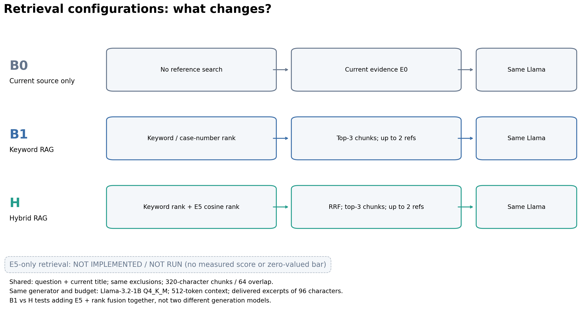

[구성도 PNG](legal-case-pilot-2026-11-03/04-retrieval-configurations.png) · [확대용 SVG](legal-case-pilot-2026-11-03/04-retrieval-configurations.svg). 이 그림은 **기존 생성 파일럿 시점**의 구성이다. 당시 E5 단독의 미측정을 0점으로 표시하지 않았다. 후속 세 검색 구성의 최신 그림은 [새 구성도](retrieval-ablation-2026-11-03/01-configurations.png)를 사용한다.

### 11.4 출력 품질을 비교하는 구체적인 실험

1. **정답을 먼저 고정한다.** 질문별 모범 답변, 필수 조건·예외, 금지 주장, 지지 근거 구간, 답변 불가 여부를 생성 결과와 독립적으로 주석한다. 현재 앱 JSON에 이 필드가 있는 것은 아니므로 우선 `queryID`로 연결한 별도 정답·검수 자료가 필요하다.
2. **B0/B1/H를 같은 질문으로 실행한다.** 생성 GGUF·양자화·hash, 실제 토큰 예산, 작업, 공통 지시문, 샘플링 설정을 고정하고 원시 출력·실제 전달 발췌를 저장한다. 검색 결과와 예산 때문에 발췌가 달라진 내용도 함께 평가한다.
3. **랜덤성과 반복을 기록한다.** 현재 샘플러는 temperature 0.4, top-k 40, top-p 0.9, 반복 penalty 1.1과 `LLAMA_DEFAULT_SEED`를 사용한다. 낮은 temperature만으로 결정적인 출력이 보장되지 않는다. seed를 명시적으로 고정·기록하는 평가 harness 또는 변동을 평가하는 반복 설계를 마련해야 한다. 고정 seed 비교는 현재 완성된 기능이 아니다.
4. **출력을 가린 채 항목별로 판정한다.** 모드·모델명을 가리고, 정확성·근거 충실성·핵심 조건 보존·명료성·적절한 거절을 독립 검수한다. 인용 원문을 지지하는지와 외부 법률 정답이 맞는지는 따로 본다.
5. **실패를 분모에서 빼지 않는다.** 전체 요청 대비 ‘유효 출력이면서 정답’인 비율을 보고하고, 생성 성공 후의 조건부 정답률은 보조로 표시한다. 답변 불가 질문의 올바른 거절과 답할 수 있는 질문의 과잉 거절도 구분한다.
6. **검색과 생성의 원인을 나눈다.** R@3가 높아도 실제 전달 발췌에서 조건이 잘렸다면 생성 입력 문제다. O에서도 틀리면 생성 모델·지시문·문맥 해석의 한계를 의심할 수 있지만, 단일 사례만으로 원인을 확정하지 않는다.
7. **쌍을 맞춰 비교한다.** 같은 질문에서 B0/B1/H의 정답·실패·검수 판정을 나란히 비교하고 불일치 사례를 설명한다. 반복 표본은 독립 질문처럼 부풀리지 않는다. 충분한 질문 수를 확보한 뒤 질문 단위의 불확실성과 효과 크기를 보고한다.

한국어 품질에 관한 추가 주의도 있다. Meta의 [Llama 3.2 공식 모델 카드](https://github.com/meta-llama/llama-models/blob/main/models/llama3_2/MODEL_CARD.md)는 공식 지원 언어 8개에 한국어를 포함하지 않는다. 한국어 출력 자체가 불가능하다는 뜻은 아니지만, 다국어 E5를 붙였다고 **생성 LLM의 한국어 법률 표현 능력까지 보장되는 것은 아니다.** 한국어 어색함·조건 해석·법률 용어 오류를 독립 평가해야 한다.

### 11.5 ‘최고 성능’이라는 표현을 사용할 조건

**현재 자료로 세계 최고 RAG나 프로젝트 내부 우승 모델을 선정할 수 없다.** RAG 성능은 코퍼스·질문·언어·생성 모델·검색 설정·토큰 예산·자원 제약에 따라 달라진다. 일반 공개 벤치마크 1위도 이 앱의 한국어 판례·4GB 기기에서 최고라는 근거가 되지 않는다.

논문에서는 먼저 다음을 정한 후 결과로 승자를 판단한다.

- **최고 출력 품질:** 사전에 정한 주 지표, 예를 들어 전체 요청 기준의 독립 검수 정답률을 기준으로 비교한다. 근거 지지·중대 오류·거절·명료성은 보조 지표로 함께 보고한다.
- **최고 배포 효율:** 사전에 정한 대상 기기의 지연·메모리·안정성 제약을 만족하는 구성 중 품질을 비교한다. 품질 최고 구성과 다를 수 있다.
- **결론의 강도:** 차이가 작거나 불확실하면 “관측 평균이 높았다” 또는 “우열을 확인하지 못했다”고 쓴다. 통과한 테스트 수나 단일 E2E 성공으로 “최고”를 선언하지 않는다.

현재 보고서·발표에서 사용할 표기는 **“제안 방식 H: Hybrid E5-RAG Llama / 비교군 B0: Current-only Llama, B1: Keyword-RAG Llama / 실제 판례 소규모 파일럿 수행, 최고 출력 품질 미확정”**이다.

### 11.6 다른 모델과 비교하고 싶다면: 후속 후보와 평가 도구

현재 구현과 구분하기 위해 다음을 **미도입·미검증 후보**로 명시한다. 최신 순위나 최고 성능을 보증하는 목록이 아니며, 이번 작업에서 모델을 다운로드하거나 앱을 교체하지 않았다.

| 비교 축 | 명시적 후보 | 무엇을 고정해 비교하는가 | 추가 확인 사항 |
| --- | --- | --- | --- |
| 생성 LLM | [Qwen/Qwen3-1.7B](https://huggingface.co/Qwen/Qwen3-1.7B) | 같은 질문·실제 근거 발췌를 주고 현재 Llama-3.2-1B-Instruct와 출력 품질 비교 | 다국어·thinking/non-thinking 지원 모델. 작은 문맥 실험은 non-thinking을 명시할 수 있으나 별도 조건임을 기록. 모델별 채팅 템플릿·토큰화·호환 GGUF·고정 runtime·4GB 메모리 검증 필요 |
| 검색 임베딩 | [BAAI/bge-m3](https://huggingface.co/BAAI/bge-m3) | 생성 Llama와 코퍼스를 유지하고 E5와 검색 관련성·후속 답변 품질 비교 | dense/sparse/multi-vector를 지원하지만 어느 방식을 평가하는지 명시. dense만 쓰면 전체 BGE-M3 기능을 시험했다고 할 수 없음. 현재 E5 전용 로더에 파일만 바꿔 넣을 수 없음 |
| 자동 평가 방법 | [Ragas](https://arxiv.org/abs/2309.15217), [ARES](https://arxiv.org/abs/2311.09476) | 생성 결과의 근거성·응답 관련성 등을 보조 평가 | 둘 다 답변 생성 RAG 모델이 아닌 평가 프레임워크. 프로젝트에 설치·실행하지 않았고 심사 모델의 오류·한국어 법률 적합성을 검증해야 함 |

Qwen3는 모델 카드에서 다국어와 thinking/non-thinking 모드를 설명하고, BGE-M3는 다국어와 여러 검색 방식을 설명한다. 이 사실만으로 두 후보가 현재 구성을 이긴다고 주장하지 않는다. 각 실험에서는 한 축만 바꾸고, 모델별 양자화·템플릿과 출력 예산을 기록한다. 모델이 달라질 때 토큰 수가 같다고 정보량까지 같은 것은 아니므로 실제 전달 발췌도 확인한다.

Ragas의 참조 정답 없는 평가나 LLM-as-a-judge도 **정답이 없어도 법률적 진실을 인증한다는 뜻은 아니다.** ARES는 인간 주석을 이용한 보정도 포함하는 방법이다. 전문가 표본 검수로 심사 오류를 확인하고, 실제 자료는 로컬에서 처리한다. 별도 승인 없이 비공개 원문을 외부 심사 API에 보내지 않는다.

외부 자료 확인일: 2026-11-03. 위 링크는 이론·모델 기능 확인용이며, 본 프로젝트가 해당 공개 논문의 평가 수치를 재현했다는 의미는 아니다.

## 12. 다음 성능 검증의 우선순위

1. **실기기 계측 JSON 확보:** 14절에서 시뮬레이터 원자료는 확보했다. 다음에는 실기기에서 동일 질문에 현재 판례만/키워드/하이브리드를 실행하고 `retrievalMS`, `modelPreparationMS`, 실제 생성 시간, 전체 시간, 실패를 함께 내보낸다.
2. **실기기·cold/warm 분리:** 임베딩 모델 최초 로드/해시와 재사용 실행을 분리한다. 벡터 캐시 재사용 효과는 같은 코퍼스·질문에서 개별 호출 시간으로 확인한다.
3. **독립 메모리 실험:** 새 앱 세션에서 단일 모드로 측정하고 4GB 기기에서 두 모델 동시 상주·메모리 종료·발열을 확인한다. 버퍼 합계로 대신하지 않는다.
4. **실행 경로 점검:** 중복 BOS 경고와 모델 로드/컨텍스트 생성 횟수를 요청 ID에 연결해 확인한다. 중복 선언만으로 병목·누수라고 단정한 최적화는 하지 않는다.
5. **실제 판례 효과 평가:** 속도만 줄이는 대신 관련성·인용 지지·실패율을 함께 비교한다. 초기 임베딩 실패처럼 빠르지만 잘못된 결과를 성능 개선으로 채택하지 않는다.

현재의 가장 정확한 결론은 **“실제 모델을 연결한 기능 검증은 성공했고, 모델을 포함한 검사 비용이 상당했지만, 실제 서비스 지연과 실기기 자원 비용은 추가 측정이 필요하다”**이다.

## 13. 재현과 산출물

저장소 루트에서, 원본 로그 11개를 보관한 디렉터리를 지정한다.

```bash
python3 scripts/analyze_rag_logs.py \
  --logs-dir "$HOME/.copilot/session-state/cfeb734a-9843-48eb-a5ff-c76382537235/files" \
  --output-dir docs/research/log-analysis-2026-11-03

python3 -m unittest discover -s scripts -p test_analyze_rag_logs.py -v
```

원본 로그는 위 로컬 세션 위치에 있으며 저장소에 복사하지 않았다. 다른 환경에서 재실행하려면 동일한 로그 파일을 준비해야 한다. 입력 해시는 [sources.csv](log-analysis-2026-11-03/sources.csv)와 비교할 수 있다. 새 실행을 추가하려면 스크립트의 `RUNS` 목록과 분석 범위를 갱신해야 한다.

환경 버전과 핵심 결과는 [analysis_summary.json](log-analysis-2026-11-03/analysis_summary.json)에 있다. 해당 11개 로그의 기존 3개 검사 파일을 소스 코호트로 고정하고 그 해시를 포함한다. 이후 추가한 파일럿을 과거 로그의 미실행 검사로 혼합하지 않는다. 분석에는 이미 설치된 pandas·matplotlib를 사용했으며 앱 의존성은 추가하지 않았다.

| 산출물 | 위치 |
| --- | --- |
| 재현 가능한 pandas 분석 | [analyze_rag_logs.py](../../scripts/analyze_rag_logs.py) |
| 파서 검증 7개 | [test_analyze_rag_logs.py](../../scripts/test_analyze_rag_logs.py) |
| 전체 집계·원본 추적 | [분석 폴더](log-analysis-2026-11-03/) |
| 회귀 시간 구성 | [PNG](log-analysis-2026-11-03/01-final-regression-cost.png) · [SVG](log-analysis-2026-11-03/01-final-regression-cost.svg) |
| 실제 모델 검사 시간 | [PNG](log-analysis-2026-11-03/02-native-check-observations.png) · [SVG](log-analysis-2026-11-03/02-native-check-observations.svg) |
| 측정 구간 비교 | [PNG](log-analysis-2026-11-03/03-timing-boundaries.png) · [SVG](log-analysis-2026-11-03/03-timing-boundaries.svg) |
| 실패·수정 이력 | [PNG](log-analysis-2026-11-03/04-development-validation.png) · [SVG](log-analysis-2026-11-03/04-development-validation.svg) |

파서는 11개 로그 모두에서 테스트 시작/종료 수, 실패 근거 수, 최종 summary, 시간 합계를 대조했다. 검사 수·결과 모순이나 로그 누락은 성공값으로 대체하지 않고 오류로 처리한다. 그래프는 같은 pandas 집계에서 생성했고, 작은 표본과 서로 다른 작업 범위를 제목·축·주석으로 구분했다.

## 14. 실제 판례 3건 검색·LLM 출력 품질 파일럿

### 14.1 실제로 실행한 범위

2026-11-03, iPhone 16 Simulator / iOS 26.1에서 사용자 제공 판례 3건으로 **3질문 × B0/B1/H × 1회 = 9개 요청**을 실제 실행했다. 규칙 기반 답변이나 가상 의미 점수로 대체하지 않았다. 검색·생성 앱 코드는 수정하지 않고 현재 설정을 관찰했다.

자료는 테스트 번들에서 읽어 앱의 동일한 `RAGResearchService.run`에 문서 배열로 전달했다. 이번 검사는 RAG 검색·발췌·생성 경로의 실험이며 OCR, SwiftData 저장·재실행, 화면 조작까지 포함한 신규 판례 등록 E2E는 아니다.

- 생성: **Llama-3.2-1B-Instruct Q4_K_M**, 엔진 `llama.cpp`. 실제 파일 SHA-256은 `6f85a640a97cf2bf5b8e764087b1e83da0fdb51d7c9fab7d0fece9385611df83`.
- 검색 임베딩: **multilingual-e5-base Q8_0**. 실제 해시는 기존 manifest와 일치한다.
- native 생성 context: **512토큰**. 실제 전달 발췌는 모든 실행에서 근거 하나당 **96자**였다.
- [실험 검사](../../code/ios/AISYSAppTests/LegalCasePilotTests.swift)는 **1219.988초, 약 20.3분**에 완료되었다. 이는 모델 로드·검색·9개 생성·후속 코사인 진단을 포함한 복합 검사 시간이지 1회 응답 지연이 아니다.
- 각 질문에서 B0 → B1 → H 순서로 한 번씩 실행했다. seed 고정·반복·무작위화는 없다. 속도 우열·통계적 유의성·배포 효율을 판단하지 않는다.
- 사용자 제시 관련/비관련 관계와 원문 기반 질문·정답 초안을 **실행 전에 고정**했다. 아래 의미 평가는 Copilot의 원문 대조이며 독립 법률 전문가 평가가 아니다.

입력·질문·잠정 정답은 [데이터 안내](datasets/family-law-retrieval-v1/README.md), 실행 조건은 [experiment.json](legal-case-pilot-2026-11-03/experiment.json), 코드·입력 해시는 [frozen_source_sha256.txt](legal-case-pilot-2026-11-03/frozen_source_sha256.txt)에 있다.

| 질문 | 현재 판례 | 기대한 참고 | 검증 목적 |
| --- | --- | --- | --- |
| L1 | 2024므16033, 16040 | 97므1486, 1493 | 기여도·쌍방 사정에 관한 일반 법리 검색. 면접교섭 결정 제외 |
| L2 | 2024므16033, 16040 | 97므1486, 1493 | 인용 사건번호를 명시한 양성 대조. 순수 의미 검색 평가 아님 |
| L3 | 2026으552 | 없음 | 참고 후보가 재산분할 판례뿐일 때 현재 결정만 분석하는지 |

### 14.2 검색: 관련 선례를 찾았지만 비관련 제외는 실패했다

다음 표는 중복 청크를 문서 단위로 합친 결과다. B1과 H는 이 질문들의 **검색 문서 집합·문서 순서가 같았다.** 선택 청크까지 모두 같았다는 뜻은 아니다.

| 질문 | B0 검색 결과 | B1·H 검색 결과, 문서 순 | 실제 LLM에 전달한 참고 |
| --- | --- | --- | --- |
| L1 | 없음 | 97므1486 → 2026으552 | B1/H 모두 97므1486의 청크 2개 |
| L2 | 없음 | 97므1486 → 2026으552 | B1/H 모두 97므1486의 청크 2개 |
| L3 | 없음 | 2024므16033 → 97므1486 | B1/H 모두 2024므16033의 청크 2개 |

- **관련 선례 발견:** B1/H 모두 L1·L2의 관련 판례를 문서 순위 **1위, 2/2**로 검색했다. L2는 번호가 명시된 쉬운 대조 조건임을 함께 본다.
- **비관련 검색 후보 제외:** B1/H 모두 L1·L2의 검색 상위 3청크에 면접교섭 결정이 1청크씩 섞였다. 다만 생성에는 상위 2청크만 쓰므로 이 두 질문에서는 그 결정이 실제 LLM 입력에 들어가지는 않았다.
- **참고 없음 판정:** L3에서는 B1/H 모두 관련성이 없는 재산분할 판례를 검색했고, 실제 입력에도 넣었다. 기대했던 ‘관련 참고 없음 → 현재 결정만 분석’ 전환은 **각각 0/1**이었다.
- **B0 해석:** B0는 원래 참고 검색을 하지 않는다. L3에서 참고가 없는 것은 자동 관련성 판별에 성공한 것이 아니며, 이를 B0의 검색 우승으로 평가하지 않는다.

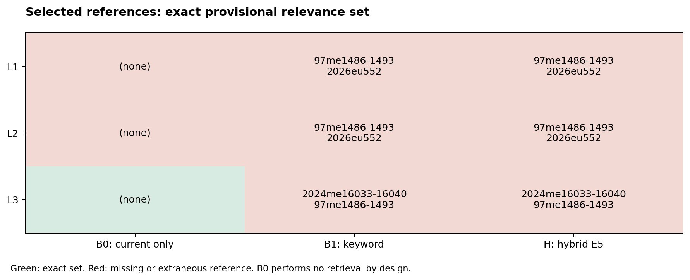

녹색은 잠정 참고 정답 집합과 정확히 일치, 적색은 관련 문서 누락 또는 불필요한 문서 추가다. 색은 답변 정답률이 아니다. 실제 생성에 전달된 문서는 [samples.csv](legal-case-pilot-2026-11-03/samples.csv)의 `reference_evidence_ids`로 별도 확인한다.

#### 실제 구성 차이가 검색 결과에 반영됐는가?

**문서 수준에서는 같았지만 청크 수준에서는 차이가 있었다.** 아래는 기존 원시 실행 JSON을 대조한 것으로, 새로운 모델 실행이나 설정 변경 결과가 아니다.

문서 별칭은 A = 2024므16033, 16040, B = 97므1486, 1493, C = 2026으552다. `B[141,461)`은 B 원문에서 UTF-16 시작 141·끝 461인 청크를 뜻한다. 끝 위치는 포함하지 않으며 이 숫자는 순위·임베딩 차원이 아니다.

| 질문 | 최종 순위 | B1의 검색 청크 | H의 검색 청크 | 청크 일치 |
| --- | --- | --- | --- | --- |
| L1 | 1 | B[141,461) | B[141,461) | 같음 |
| L1 | 2 | B[1408,1682) | B[1618,1938) | 다름 |
| L1 | 3 | C[3958,4274) | C[4418,4704) | 다름 |
| L2 | 1 | B[0,205) | B[0,205) | 같음 |
| L2 | 2 | B[1874,2129) | B[1874,2129) | 같음 |
| L2 | 3 | C[2524,2783) | C[4418,4704) | 다름 |
| L3 | 1 | A[3675,3987) | A[3675,3987) | 같음 |
| L3 | 2 | A[4693,4952) | A[5567,5786) | 다름 |
| L3 | 3 | B[0,205) | B[0,205) | 같음 |

원자료: [L1 B1](legal-case-pilot-2026-11-03/raw/L1-keyword.json) · [L1 H](legal-case-pilot-2026-11-03/raw/L1-hybrid.json) · [L2 B1](legal-case-pilot-2026-11-03/raw/L2-keyword.json) · [L2 H](legal-case-pilot-2026-11-03/raw/L2-hybrid.json) · [L3 B1](legal-case-pilot-2026-11-03/raw/L3-keyword.json) · [L3 H](legal-case-pilot-2026-11-03/raw/L3-hybrid.json).

예를 들어 L1의 B[1618,1938)은 키워드 순위 3위·의미 순위 2위로, H에서 최종 2위에 선택됐다. B1의 최종 2위는 다른 청크인 B[1408,1682)였다. 즉 **순위 융합은 실제 선택 청크를 바꾸었지만**, 관련 문서 B를 찾았다는 문서 지표에는 이 차이가 나타나지 않았다.

#### 검색 차이가 실제 생성 입력까지 전달됐는가?

검색 상위 3청크 중 참고로 전달하는 것은 상위 2청크뿐이므로, 검색 차이와 생성 입력 차이도 구분한다.

| 질문 | 상위 3청크 중 공통 청크 수 | B1의 실제 E2 발췌 | H의 실제 E2 발췌 | 실제 근거 입력 차이 |
| --- | --- | --- | --- | --- |
| L1 | 1/3 | B[1408,1504) | B[1618,1714) | E2가 바뀜. E0·E1은 같음 |
| L2 | 2/3 | B[1874,1970) | B[1874,1970) | E0·E1·E2의 텍스트·위치·ID 모두 같음 |
| L3 | 2/3 | A[4693,4789) | A[5567,5663) | E2가 바뀜. E0·E1은 같음 |

따라서 **3질문 모두 검색 상위 청크 구성이 달라졌고, 2질문에서는 실제 참고 발췌도 달라졌다.** 이는 구성 변경이 동작에 반영됐다는 기술적 관측이지 개선율이 아니다. 특히 L2는 바뀐 3위 청크가 생성에 전달되지 않아, 생성 내용의 차이를 다른 참고 근거 선택의 효과로 설명할 수 없다.

#### 검색 품질 지표와 선택 변화 지표를 분리한 비교

아래 검색 품질 값은 [전체 실행 JSON](legal-case-pilot-2026-11-03/raw/report.json)의 `relevance` 필드와 대조했다. 관련성은 잠정 정답이며 독립 전문가 검수 결과가 아니다.

| 평가 항목 | 평가 표본·단위 | B1 | H |
| --- | --- | --- | --- |
| 문서 P@3 평균 | 전체 3질문, 문서 중복 제거·분모 고정 3 | 2/9 ≈ 0.222 | 2/9 ≈ 0.222 |
| 문서 Recall@3 평균 | 관련 정답이 있는 L1·L2만 | 1.000 | 1.000 |
| 문서 MRR@3 | 관련 정답이 있는 L1·L2만 | 1.000 | 1.000 |
| 참고 없음 판정 성공 | 관련 정답이 없는 L3, 1질문 | 0/1 | 0/1 |
| 실제 입력에 비관련 참고가 포함된 요청 | 전체 3요청 | 1/3 | 1/3 |

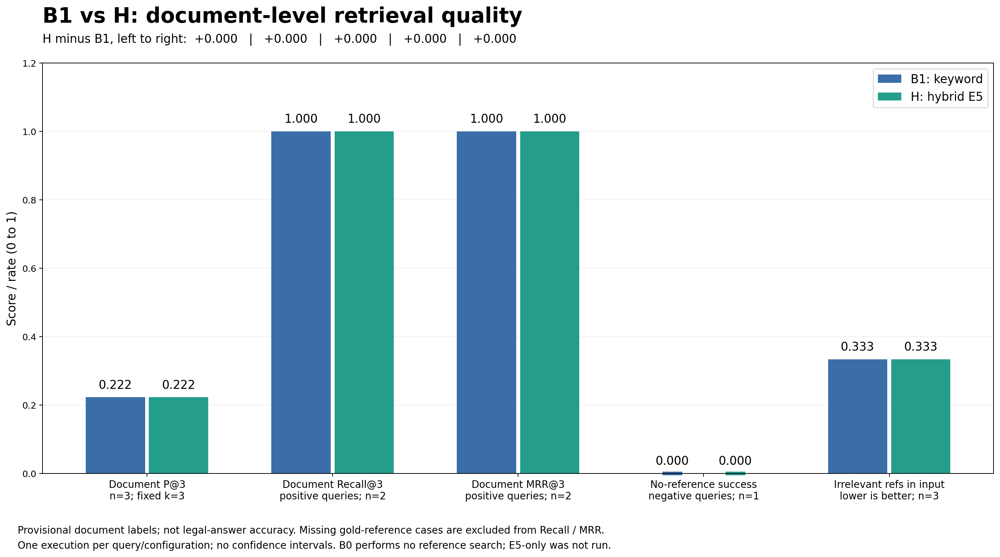

[품질 비교 PNG](legal-case-pilot-2026-11-03/05-retrieval-quality-comparison.png) · [확대용 SVG](legal-case-pilot-2026-11-03/05-retrieval-quality-comparison.svg) · [구성별 지표 CSV](legal-case-pilot-2026-11-03/retrieval_mode_summary.csv).

파랑은 B1, 초록은 H이며 두 구성의 막대 높이가 모든 항목에서 같다. 그래프 상단에는 H−B1 차이도 표시했다. 마지막 ‘실제 입력의 비관련 참고 포함률’만 **낮을수록 좋고**, 나머지는 높을수록 좋다. 참고 없음 판정의 0은 실제 실패율의 반대인 성공률 0/1이며, 미측정값이 아니다. 오차 막대는 반복이 없어 그리지 않았다.

P@3는 반환된 고유 문서가 2개여도 현재 앱 구현의 분모가 3이므로 L1·L2가 각각 1/3, L3가 0이다. Recall·MRR는 정답 집합이 빈 L3를 0으로 채우지 않고 미측정으로 제외했다. 이 값들을 전체 법률 정확도로 해석하지 않는다.

**이 비교의 결론:** 검색 경로·선택 청크·일부 실제 입력의 차이는 확인했다. 그러나 문서 관련성 지표는 동일했고, 선택된 청크의 법리·조건·예외 충족 여부는 독립적으로 주석하지 않았으므로 **청크가 바뀌었다는 사실을 더 좋은 근거를 찾았다는 주장으로 바꿀 수 없다.** 후속 실험은 문서 관련성뿐 아니라 실제 전달 근거의 충분성까지 평가해야 한다.

#### 구성별 검색 경로 시간: 품질과 별개인 관측 비용

원자료의 `run.retrievalMS`를 초로 변환했다. 이 값은 검색 태스크 디스패치 등을 포함한 검색 경로 벽시계 시간이며, 이후의 Llama 준비·생성 시간과는 분리된다. 새로운 벤치마크가 아니라 **기존 단일 실행의 시간 기록을 재집계**한 것이다.

| 질문 | B1 검색 경로 시간(초) | H 검색 경로 시간(초) | H의 E5 캐시 적중/미스 | H `warmBeforeSearch` |
| --- | --- | --- | --- | --- |
| L1 | 0.033251 | 80.510091 | 2 / 41 | false |
| L2 | 0.031964 | 0.860417 | 42 / 1 | true |
| L3 | 0.027228 | 48.777424 | 17 / 27 | true |

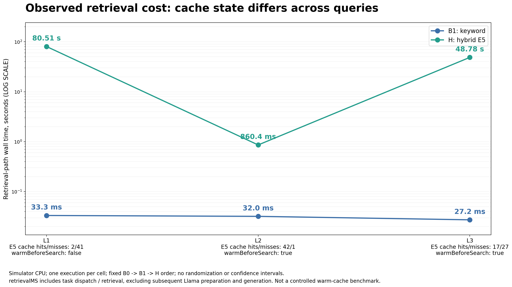

[시간 비교 PNG](legal-case-pilot-2026-11-03/06-retrieval-latency.png) · [확대용 SVG](legal-case-pilot-2026-11-03/06-retrieval-latency.svg) · [시간·캐시 CSV](legal-case-pilot-2026-11-03/retrieval_timings.csv).

- 시간 차이가 커서 **세로축은 초 단위 로그 축**을 사용했다. 점 옆의 ms·s 표시는 같은 시간을 읽기 쉽게 바꾼 것이며, 선은 반복에 따른 추세나 통계적 추정이 아니라 질문별 관측을 연결한 것이다.
- 이번 실행에서는 H의 검색 경로 시간이 B1보다 모두 컸다. 다만 L1은 E5가 검색 전 준비되지 않았고, L2는 대부분 벡터를 재사용했으며, L3는 새 후보에 대한 캐시 미스가 많았다. `warmBeforeSearch=true`가 모든 청크 벡터의 캐시 적중을 뜻하지 않는다.
- 고정 B0 → B1 → H 순서·질문별 1회·시뮬레이터 CPU 결과다. **통제된 cold/warm 성능 비교나 실기기 지연, 일반적인 배수 차이로 주장하지 않는다.** 분포·오차·통계적 유의성도 산출하지 않는다.
- B0는 참고 검색을 하지 않으므로 해당 경로의 디스패치 시간을 검색기 성능으로 비교하지 않았다. E5 단독은 이 기존 생성 파일럿에는 없으며 후속 15절에서 검색만 따로 측정했다.

현재 관측은 **문서 품질 지표 차이는 없고, 검색 경로 시간과 선택 청크에는 차이가 있었다**로 요약한다. 검색 모델 준비·벡터 구축 비용과 캐시 적중 이후 비용을 분리한 실기기 반복 측정이 후속 과제다.

### 14.3 실제 코사인: 0.30은 이번 자료의 비관련 문서를 거르지 못했다

생성 배치가 끝난 후 실제 provider로 같은 질문·후보 청크의 코사인을 별도 수집했다. 앞선 검색 결과를 바꾸는 재선택·사후 임계값 조정은 하지 않았다.

| 질문 | 후보 문서 | 잠정 역할 | 청크 수 | 실제 코사인 최솟값~최댓값 |
| --- | --- | --- | --- | --- |
| L1 | 97므1486 | 관련 | 16 | 0.7899~0.8852 |
| L1 | 2026으552 | 비관련 | 26 | 0.7942~0.8384 |
| L2 | 97므1486 | 관련 | 16 | 0.8167~0.8861 |
| L2 | 2026으552 | 비관련 | 26 | 0.8094~0.8549 |
| L3 | 2024므16033 | 비관련 | 27 | 0.7503~0.8117 |
| L3 | 97므1486 | 비관련 | 16 | 0.7611~0.8162 |

**127개 질문-청크 관측 모두 현재 기준 0.30을 넘었다.** 관련 선례의 최고점이 더 높은 경우에도 분포가 겹쳤고, L3의 비관련 자료도 모두 통과했다. 점수 0.8은 ‘관련성 80%’나 ‘정답 확률 80%’가 아니다.

또한 현재 코드는 키워드 순위가 있는 후보를 별도로 받아들이므로 코사인 임계값만 올린다고 비관련 후보가 전부 차단되는 구조도 아니다. 향후에는 별도 개발셋으로 **최종 참고 채택·거절 기준**을 검증해야 한다. 이 세 사례에 맞춰 숫자를 사후 조정한 결과를 성능 개선으로 보고하지 않는다.

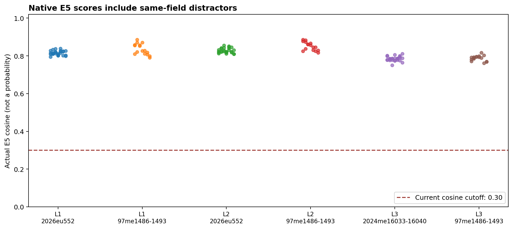

### 14.4 생성: 텍스트 반환 9/9, 유효 인용 출력 0/9

| 항목 | B0 | B1 | H |
| --- | --- | --- | --- |
| 실제 요청·생성 텍스트 반환 | 3/3 | 3/3 | 3/3 |
| 요청 모드와 실제 검색 모드 일치 | 3/3 | 3/3 | 3/3 |
| 앱 인용 출력 형식 통과 | **0/3** | **0/3** | **0/3** |
| AI 원문 대조: 필수 내용이 일부만 충족 | 1/3 | 0/3 | 1/3 |
| AI 원문 대조: 전체 답변을 정답으로 승인 | 0/3 | 0/3 | 0/3 |

9개 모두 생성 엔진은 실행되었고 각 1회 시도에서 텍스트가 반환되었다. 그러나 요구한 `[E0] 내용` 형식을 지키지 않아 앱이 **형식 실패로 명시적으로 처리**했다. 오류가 난 답변을 정상 학습 결과라고 집계하지 않았다.

이 때문에 문장별 기초 근거 검사 평균은 **미측정(null)**이다. 형식 통과 0/9를 근거성 0%나 전문가 법률 정답률 0%로 바꾸어 쓰지 않는다.

실제 원시 출력에서 확인된 예:

1. **L1·B1 — 원문에 없는 분할 유형:** `현물분할, 분당분할, 공수분할`을 열거했다. 필요한 기여도·쌍방 사정 기준을 완결하지 못했고, 뒤 두 유형은 제공된 원문에 없다.
2. **L2·H — 날짜·근거 표기 혼동:** 공보의 `1998.3.15`를 선고일처럼 설명하고, 제공하지 않은 `E3:` 표기를 생성했다. 이는 파싱 전 원시 출력의 관측이며 앱의 ‘알 수 없는 인용 ID 검사’까지 정상 진행되었다는 뜻은 아니다.
3. **L3·B0 — 원문 결론과 반대 방향:** `면접교섭 허용 의무 이행명령은 확정된 판결에 없던 새로운 조건을 추가할 수 있는 경우에만 적용된다.`라고 출력했다. 제공된 전체 원문의 새 의무 창설·실질적 변경 금지 취지와 반대다.
4. **L3·H — 다른 판례의 내용으로 답변:** 면접교섭 질문에 `원심의 판단에는 재산분할 방법에 관한 법리를 오해하여…`라고 답했다. 실제 참고 입력에 재산분할 판례가 들어간 상태에서 쟁점 혼합이 관측되었다.
5. **L3·B1/H — 지시문을 법리처럼 설명:** 시스템의 `판례 혼합 금지`라는 생성 지시를 법률 원칙처럼 서술했다. 원문 법리와 모델 운영 지시의 구분도 지켜지지 않았다.

원시 출력은 편집하지 않고 [전체 실행 JSON](legal-case-pilot-2026-11-03/raw/report.json)에 남겼다. 출력 SHA-256으로 연결한 [AI 검수 기록](legal-case-pilot-2026-11-03/quality_reviews.csv)은 부분 충족 2건·오류 7건이며, **독립 전문가의 정답률 통계가 아니다.**

### 14.5 원인 해석: 검색·발췌·생성을 분리해야 한다

#### 관측으로 확인한 것

- 관련 판례를 순위에 올리는 능력과 비관련 판례를 배제하는 능력이 같지 않았다.
- 모든 근거가 96자로 발췌되었고, 문장 중간부터 시작하거나 제목·판시사항 도중에 끝난 입력이 있었다.
- L3의 E0는 결정 제목의 `…다른 내용을 추가하는`에서 끝났다. **허용 불가라는 핵심 결론이 실제 생성 입력에 없었다.**
- L2의 E0도 원심의 143억 원 지급 판단과 `3. 대법원의 판단`까지만 담겨 공통 판단 기준을 충분히 전달하지 못했다.
- 생성기는 인용 형식·질문 적합성·원문 충실성을 안정적으로 지키지 못했다.

#### 아직 확정할 수 없는 것

- 실패 전부가 Llama의 한국어 능력 때문이라는 인과관계. 불완전한 발췌·512토큰 문맥·지시문 해석·검색 혼입이 함께 작용할 수 있다.
- E5 추가가 출력 품질을 개선했다는 결론. 이 표본에서 B1/H의 문서 순서는 같았고 유효 출력도 모두 실패했다.
- 한국어 법률 전반의 정확도, 최고 모델, 사용자 학습 효과. 3문서·3질문·1회씩이며 별도 LLM 비교와 독립 검수가 없다.

따라서 현재 결론은 **“관련 선례 검색은 일부 작동했지만, 비관련 참고 거절과 충분한 근거 전달, 신뢰할 수 있는 학습 설명 생성까지는 검증을 통과하지 못했다”**이다. 앱의 형식 검사는 부적합 출력을 성공으로 오인하지 않게 막았지만, 그것이 답변 품질 문제 자체를 해결한 것은 아니다.

### 14.6 결과 재현과 다음 검증

프로젝트 루트에서 원자료를 pandas로 다시 집계한다.

```bash
python3 scripts/analyze_legal_case_pilot.py \
  --raw docs/research/legal-case-pilot-2026-11-03/raw \
  --output docs/research/legal-case-pilot-2026-11-03 \
  --reviews docs/research/legal-case-pilot-2026-11-03/quality_reviews.csv

python3 -m unittest discover -s scripts -p 'test_analyze*.py' -v
```

실제 모델 실행 명령은 [데이터 안내](datasets/family-law-retrieval-v1/README.md)에 있다. XCTest 통과는 **9개 요청과 원자료 수집의 완료**를 뜻하며 내용 정답을 의미하지 않는다. 11개 기존 로그의 회귀 통과 수와도 합쳐 법률 정답률로 쓰지 않는다.

| 산출물 | 위치 |
| --- | --- |
| 실행 조건·고정 소스 | [experiment.json](legal-case-pilot-2026-11-03/experiment.json) · [SHA-256](legal-case-pilot-2026-11-03/frozen_source_sha256.txt) |
| 원시 출력·실제 전달 발췌·실패 | [전체 보고서](legal-case-pilot-2026-11-03/raw/report.json) · [개별 실행](legal-case-pilot-2026-11-03/raw/) |
| 네이티브 코사인 원자료 | [cosines.json](legal-case-pilot-2026-11-03/raw/cosines.json) |
| pandas 집계 | [samples.csv](legal-case-pilot-2026-11-03/samples.csv) · [mode_summary.csv](legal-case-pilot-2026-11-03/mode_summary.csv) · [cosine_summary.csv](legal-case-pilot-2026-11-03/cosine_summary.csv) |
| 검색 구성별 품질·시간 | [retrieval_mode_summary.csv](legal-case-pilot-2026-11-03/retrieval_mode_summary.csv) · [retrieval_timings.csv](legal-case-pilot-2026-11-03/retrieval_timings.csv) |
| AI 원문 대조 | [quality_reviews.csv](legal-case-pilot-2026-11-03/quality_reviews.csv) |
| 그래프 | [검색 PNG](legal-case-pilot-2026-11-03/01-reference-selection.png) · [SVG](legal-case-pilot-2026-11-03/01-reference-selection.svg) · [코사인 PNG](legal-case-pilot-2026-11-03/02-actual-chunk-cosines.png) · [SVG](legal-case-pilot-2026-11-03/02-actual-chunk-cosines.svg) |
| 검색 구성 비교 그림 | [구성 PNG](legal-case-pilot-2026-11-03/04-retrieval-configurations.png) · [SVG](legal-case-pilot-2026-11-03/04-retrieval-configurations.svg) · [품질 PNG](legal-case-pilot-2026-11-03/05-retrieval-quality-comparison.png) · [SVG](legal-case-pilot-2026-11-03/05-retrieval-quality-comparison.svg) · [시간 PNG](legal-case-pilot-2026-11-03/06-retrieval-latency.png) · [SVG](legal-case-pilot-2026-11-03/06-retrieval-latency.svg) |
| 재집계 코드 | [analyze_legal_case_pilot.py](../../scripts/analyze_legal_case_pilot.py) · [검증 9개](../../scripts/test_analyze_legal_case_pilot.py) |
| 검사 완료 근거 | [native_test_summary.txt](legal-case-pilot-2026-11-03/native_test_summary.txt) |

전체 xcodebuild 로그와 xcresult는 로컬 세션의 `files/legal-case-pilot-xcodebuild.log`, `files/legal-case-pilot.xcresult`에 보존했다. 로그 해시는 [native_log_sha256.txt](legal-case-pilot-2026-11-03/native_log_sha256.txt)에 있다.

다음 개선 실험은 **비관련 참고의 최종 거절**, **법리·조건·예외를 보존하는 발췌**, **질문별 인용 출력의 안정성**을 따로 검증해야 한다. 개선 전 원자료는 유지하고, 별도 개발셋에서 조정한 뒤 고정 테스트셋으로 재평가해야 한다. 이번에는 실패를 숨기기 위한 임계값·프롬프트·모델 교체를 하지 않았다.

## 15. E5 단독을 포함한 검색 구성 분해 실험

### 15.1 검색 전용 실험을 별도로 실행한 이유

“E5만 써도 되는가?”, “결합이 실제로 도움이 되는가?”, “추가 비용이 가치 있는가?”를 확인하기 위해 **B1·S(E5 단독)·H를 실제 native 검색으로 재측정**했다. 사용자가 선택한 범위는 검색 전용이다. 생성 LLM은 실행하지 않았으며, 기존 9개 생성 요청의 출력·실패·원자료를 수정하지 않았다.

입력은 14절과 같은 세 문서·세 질문·잠정 관련 정답이다. 공통 제외·청킹·top-k 규칙은 유지했다. 새 S는 코사인 0.30 초과·코사인 내림차순이며 키워드 점수·사건번호 가산·RRF를 쓰지 않는다. 임베딩 전체를 사용할 수 없으면 명시적으로 실패하고 키워드로 대체하지 않는다. 기존 B1/H의 선택 청크 ID는 과거 파일럿과 모두 같았다.

질문·구성마다 새 provider의 최초 검색 1회, 이후 문서 벡터를 유지하고 질문 벡터만 제거한 검색 3회를 측정했다. **9회 최초 검색 + 27회 warm 검색 = 36회**, 품질 표본은 구성당 3질문이다. 질문별 모드 순서는 회전했다. OS 파일 캐시를 비우거나 실기기에서 실행한 것은 아니다.

### 15.2 검색 품질 비교

| 항목 | B1 | S · E5 단독 | H | 표본 |
| --- | --- | --- | --- | --- |
| 문서 P@3 | 0.222 | 0.222 | 0.222 | 전체 3질문, 분모 고정 3 |
| 문서 Recall@3 | 1.000 | 1.000 | 1.000 | 양성 2질문 |
| 문서 MRR@3 | 1.000 | 1.000 | 1.000 | 양성 2질문 |
| 참고 없음 판정 성공 | 0/1 | 0/1 | 0/1 | 음성 L3 |
| 상위 2참고 후보에 비관련 문서가 섞인 요청 | 1/3 | 1/3 | 1/3 | 전체 3질문 |

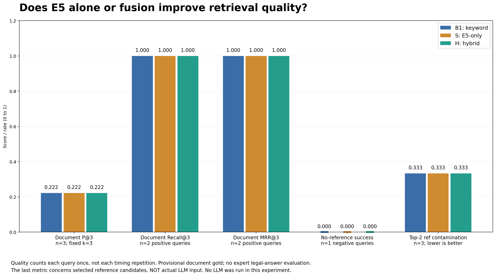

S도 두 양성 질문에서 관련 문서를 1위로 찾았으나 L3에서 비관련 B→A를 반환했다. B1/H는 L3에서 A→B를 반환했다. **순서·청크는 달라도 참고 없음 거절 실패는 같았다.** S/H의 공통 상위 청크는 L1 2/3, L2 1/3, L3 1/3이다. 선택 변화가 더 충분한 법률 근거라는 뜻은 아니다.

이 실험은 생성하지 않았다. 마지막 지표는 참고 **후보**의 비관련 포함 비율이며 ‘실제 LLM 입력 오염률’이나 답변 정답률이 아니다. 시간 반복을 품질 표본으로 중복 계산하지 않았다.

### 15.3 최초 검색과 재사용 후 비용

문서 벡터는 재사용하되 질문은 매번 인코딩한 세 측정의 중앙값이다.

| 질문 | B1(초) | S · E5 단독(초) | H(초) |
| --- | --- | --- | --- |
| L1 | 0.062458 | 0.711322 | 0.741826 |
| L2 | 0.024940 | 0.808611 | 0.839862 |
| L3 | 0.022734 | 0.525825 | 0.545408 |

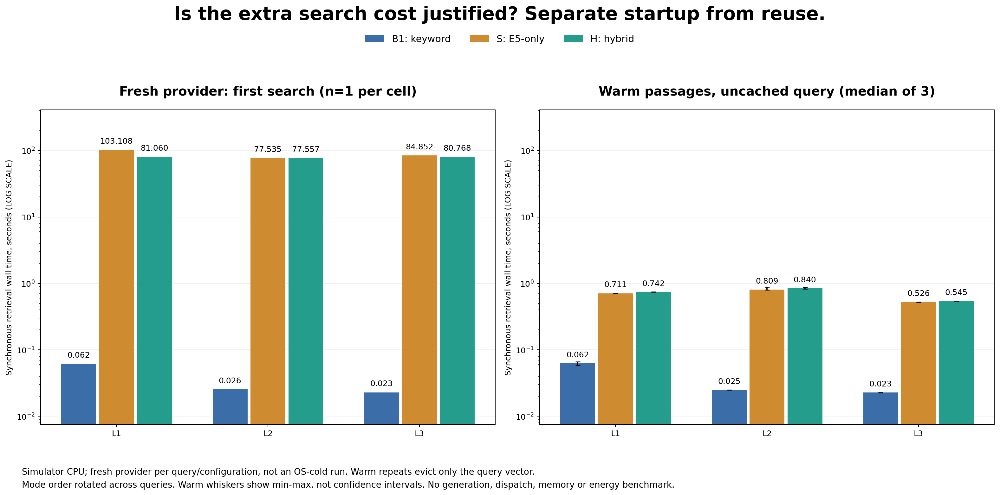

새 provider의 최초 검색에서는 S가 77.535~103.108초, H가 77.557~81.060초였다. 모델 로드·문서 벡터 구축 비용이 여기에 포함된다. warm에서 비용이 크게 줄었지만 B1보다 여전히 길었고, H의 warm 중앙값은 S보다 약 20~31ms 컸다.

로그 축과 숫자 라벨을 함께 사용했고 warm의 오차 막대는 세 측정의 min–max다. 최초 값은 조건당 1회이므로 H가 S보다 짧았던 최초 측정을 융합의 속도 우위로 해석하지 않는다. warm에서도 시간 범위가 겹쳐 통계적 우열을 주장하지 않는다. 동기 검색 시간이라 14절의 Task 디스패치를 포함한 시간과 직접 합쳐 평균 내지 않는다.

### 15.4 연구 질문에 대한 관측 결론

1. **E5만 써도 되는가?** 양성 2질문의 관련 문서 발견에는 가능했다. 하지만 참고 없음 거절에 실패했으므로 신뢰할 수 있는 참고 선택 전체에 충분하다고 할 수 없다.
2. **결합이 도움이 되는가?** 청크·순위는 바뀌었지만 S 대비 H의 측정 품질 향상은 없었다. 독립적인 청크 충분성·법률 답변 품질은 미측정이다.
3. **추가 비용이 가치 있는가?** 이번 지표에서는 B1 대비 S/H의 추가 시간에 상응하는 이득이 없었다. **현재 파일럿의 품질 대비 시간 효율은 B1이 가장 유리했다.**

이 결과로 모든 한국어 법률 질문에서 B1이 우월하다거나 E5·하이브리드가 무용하다고 결론 내리지 않는다. 세 질문뿐이고 양성 하나는 사건번호 질의이며, 시뮬레이터·작은 코퍼스·전문가 미검수다. 앱의 기본 검색 설정은 자동 변경하지 않았다.

### 15.5 원자료·재현

상세 방법·청크 표·초기 비용·세 질문에 대한 답은 [독립 실험 보고서](retrieval-ablation-2026-11-03/README.md)에 있다.

| 산출물 | 위치 |
| --- | --- |
| 실제 결과·36개 체크포인트 | [raw/report.json](retrieval-ablation-2026-11-03/raw/report.json) · [raw/](retrieval-ablation-2026-11-03/raw/) |
| 품질·시간·청크 | [품질 CSV](retrieval-ablation-2026-11-03/quality_summary.csv) · [시간 CSV](retrieval-ablation-2026-11-03/timing_summary.csv) · [hits.csv](retrieval-ablation-2026-11-03/hits.csv) |
| native 실행·소스 해시 | [검사 완료](retrieval-ablation-2026-11-03/native_test_summary.txt) · [고정 해시](retrieval-ablation-2026-11-03/frozen_source_sha256.txt) |
| 분석·회귀 검사 | [analyze_retrieval_ablation.py](../../scripts/analyze_retrieval_ablation.py) · [test_analyze_retrieval_ablation.py](../../scripts/test_analyze_retrieval_ablation.py) |

검색 전용 XCTest는 518.674초에 완료되었고, 관련 native 검사 22개가 모두 통과했다. 전체 XCTest 563.529초는 개별 검색 시간이나 실제 iPhone 응답 지연이 아니다.

## 16. 장문 판례 요약 성능 평가

같은 세 장문 판례에서 현행 필드 기준 F, 문서 내부 키워드 K, E5 단독 S, 하이브리드 H를 비교했다. **각 구성 3개씩 실제 로컬 Llama 요약 12회**를 생성하고, 출력 관찰 전에 고정한 원문 핵심 항목 18개로 입력과 출력을 대조했다. 외부 참고·UI 후처리·규칙 기반 폴백은 제외했으며 독립 법률 전문가 정확도가 아닌 **원문 대조 AI 예비검수**다.

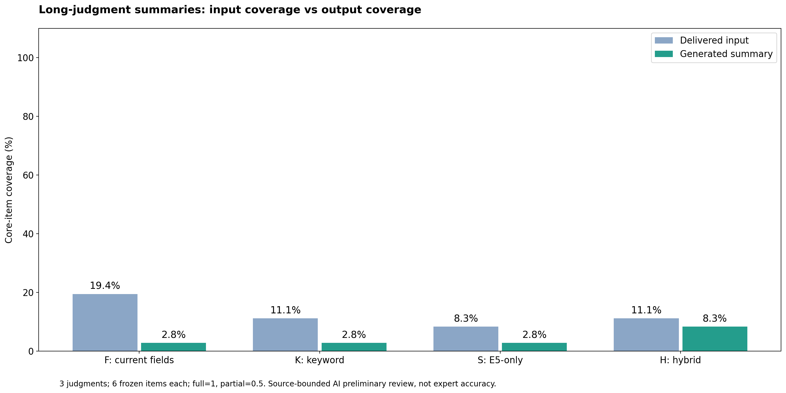

| 구성 | 입력 핵심 포함률 | 출력 핵심 포함률 | 완전 보존 항목 | 주문 완전 보존 |
| --- | ---: | ---: | ---: | ---: |
| F · 현행 필드 기준 | 19.4% | 2.8% | 0/18 | 0/3 |
| K · 내부 키워드 | 11.1% | 2.8% | 0/18 | 0/3 |
| S · 내부 E5 단독 | 8.3% | 2.8% | 0/18 | 0/3 |
| H · 내부 하이브리드 | 11.1% | 8.3% | 0/18 | 0/3 |

부분 포함은 0.5점이며, 이 수치를 질문 정답률로 읽지 않는다. H의 차이는 판례 C의 부분 항목 2개에서 발생했지만 **그 셀의 K와 H는 실제 전달 프롬프트가 같았다.** 따라서 단일 확률적 생성 차이를 H의 검색 우월성으로 해석할 수 없다.

주요 관측은 두 가지다. 첫째, 최대 96자부터 줄이는 기존 필드 발췌가 핵심 법리·조건·주문을 입력에서 누락했다. 둘째, F/C에서는 입력의 변경·창설 가능 여부 **(소극)**을 출력이 **“변경할 수 있다”**로 반전했다. 입력 손실과 생성기의 부정 보존 실패가 함께 있으므로 E5 교체만으로 해결된다고 볼 수 없다.

총 요청 시간의 세 판례 중앙값은 F 113.0초, K 113.2초, S 137.3초, H 168.6초다. S/H는 셀마다 새 E5 provider의 초기 비용을 포함하며 생성 모델 최초 로드 42.702초는 별도다. 이전 warm 검색 시간과 혼합하거나 실기기 지연으로 일반화하지 않는다.

[상세 결과와 네 시각화](long-summary-evaluation-2026-11-03/RESULTS.md) · [사전 방법](long-summary-evaluation-2026-11-03/README.md) · [12개 원시 생성](long-summary-evaluation-2026-11-03/raw/report.json) · [항목별 점수](long-summary-evaluation-2026-11-03/items.csv) · [출력 단위 검수](long-summary-evaluation-2026-11-03/claims.csv).

장문 생성 검사는 1706.981초에 완료되었고 관련 native 검사 21개가 통과했다. 모든 셀에서 원시 텍스트가 반환되었으나 엄격한 요약 형식 파싱은 0/12였다. 수집 검사 통과를 요약 품질 합격으로 집계하지 않는다. 앱 기본 모드는 변경하지 않았다.

## 17. 문자 제한·생성을 통제한 판례 C 후속 실험

2026-11-04 후속 실험은 사용자 요청으로 40회에서 **24개 완료 출력**으로 축소했다.
기존 제한/제한 없음 × F/K/S/H × greedy 두 번·seed 42 한 번이다.
[범위 변경 기록](long-summary-controlled-2026-11-04/AMENDMENT.md)을 보존했으며
단일 seed이므로 여러 seed의 평균·표준편차·변동을 측정했다고 쓰지 않는다.

| 구성 | 입력 포함률: 제한 있음 → 없음 | seed 42 출력 포함률 | Greedy 출력 포함률 |
| --- | ---: | ---: | ---: |
| F | 16.7% → 50.0% | 8.3% → 8.3% | 16.7% → 16.7% |
| K | 16.7% → 50.0% | 0.0% → 8.3% | 16.7% → 8.3% |
| S | 8.3% → 33.3% | 0.0% → 0.0% | 0.0% → 0.0% |
| H | 16.7% → 50.0% | 0.0% → 8.3% | 16.7% → 8.3% |

여덟 greedy 쌍이 모두 재현됐고, 두 문자 정책에서 동일 입력인 K/H도
같은 디코더·seed를 적용하면 같은 출력이었다. K/H를 독립적인 검색 개선 증거로 세지 않는다.
입력 토큰은 잘림 없이 272–1,311개 전달됐고 공통 컨텍스트/출력 예산은 8,192/128토큰이다.
seed 42의 제한 해제 후 생성 비용은 약 2.1–4.2배였지만 품질 변화는 디코더 간 일관되지 않았다.
원시 형식 통과와 주문 완전 보존은 각각 0/24다. 점수는 원문 대조 AI 예비검수이지 전문가 정확도가 아니다.

완료 생성 시간 합계는 4,654.111초다. 24번째 저장 후 원래 40회 XCTest를 의도적으로 종료하여
해당 전체 실행은 실패/중단 상태이며 **40회 테스트 통과로 기록하지 않는다**.
원시 체크포인트 24개를 보존해 분석용 report를 조립했고, 미측정 본실험 로딩 시간은 null이다.
기존 기능 검사 35개·사전검증 3개·축소 실행기 재빌드 후 검사 2개와 Python 검사 13개는 별도로 통과했다.

[상세 결과·다섯 그래프](long-summary-controlled-2026-11-04/RESULTS.md) ·
[원시 집계](long-summary-controlled-2026-11-04/raw/report.json) ·
[항목별 판정](long-summary-controlled-2026-11-04/items.csv) ·
[Greedy 재현성](long-summary-controlled-2026-11-04/greedy_reproducibility.csv).

### 판례 원문·실제 출력 대조 문서

[원문·검색 구성별 출력 비교](RAG_Original_Output_Comparison_2026-11-04.md)에
판례 전문 3건, 구성별 본문 요약 12개, 통제 실험 출력 24개,
초기 질의응답 9개를 실험별로 분리해 정리했다.
실제 입력도 함께 확인할 수 있으며, 생성 오류·미완성 문장·실패 사유를 보정하지 않고 보존했다.
