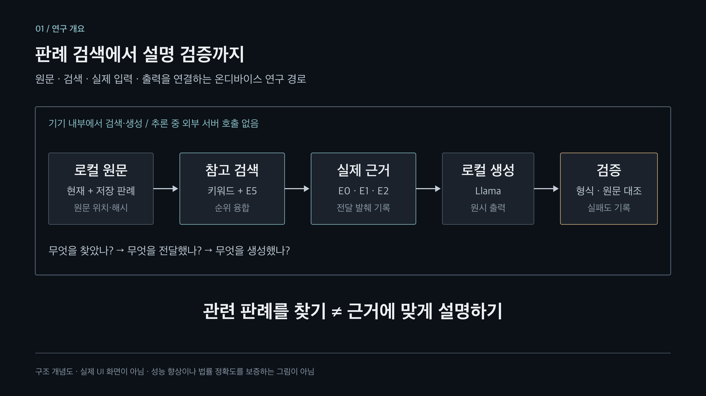
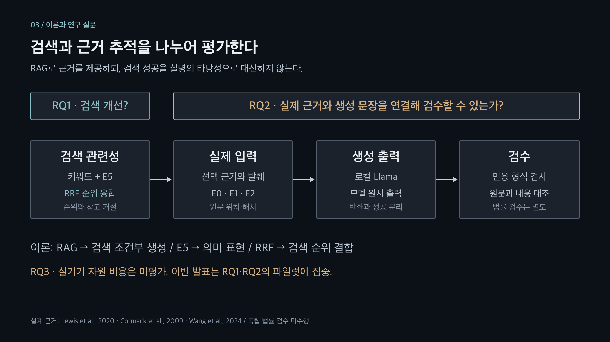
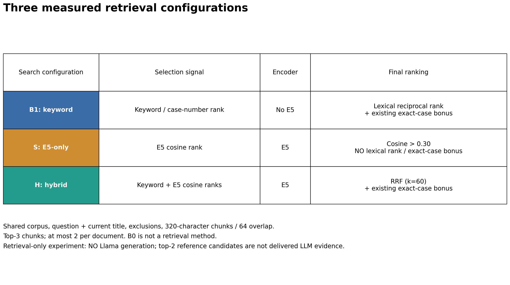
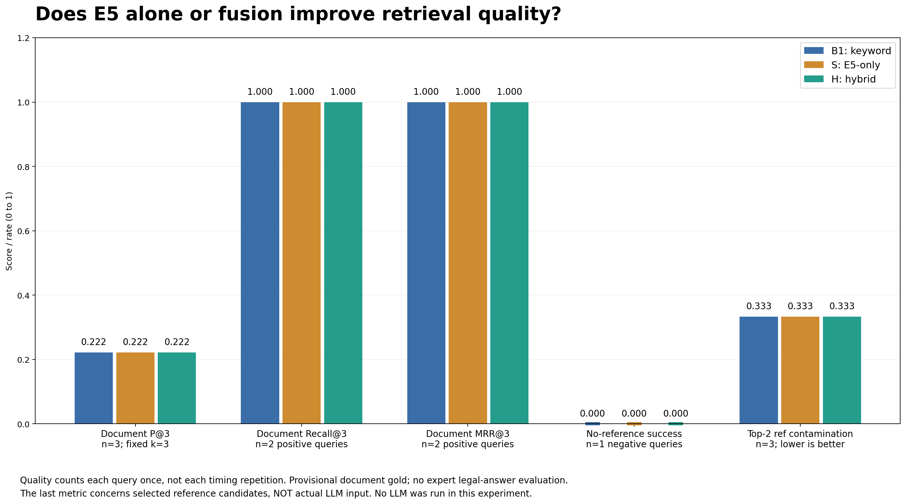
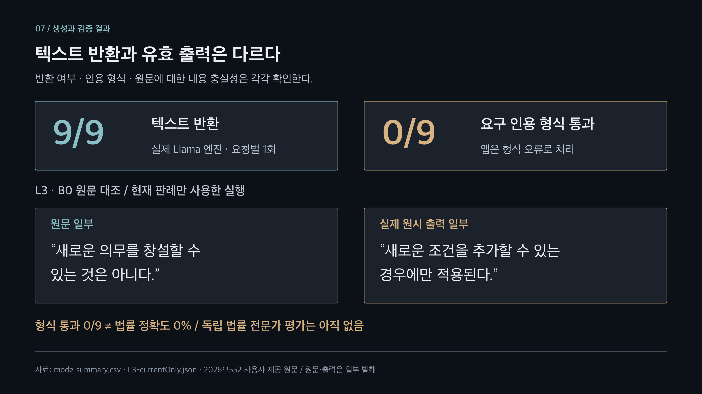
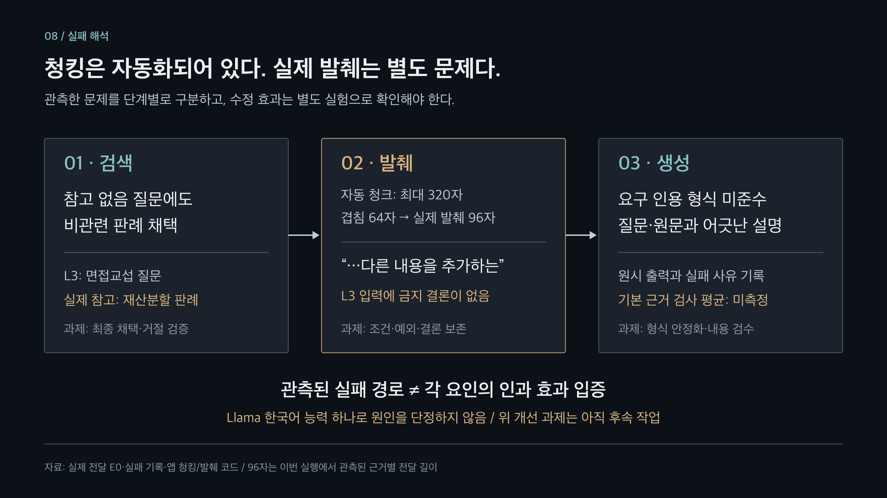
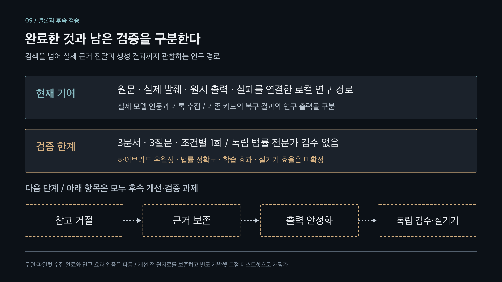

# STACK112 8분 논문 발표 자료 원고

> 발표 제목: 온디바이스 RAG 기반 한국어 판례 학습 시스템의 설계 및 탐색적 평가
>
> 작성 기준: 2026-11-03. 본문 9장, 발표 목표 7분 40초, 화면 전환·호흡 여유 20초. 질의응답 별도.
>
> 성격: PowerPoint·Keynote 제작에 사용할 슬라이드 문구, 시각자료 배치안, 발표 대본, 질의응답 자료. 완성된 PPTX 파일은 아니다.
>
> 근거: [실행·출력 품질 분석 보고서 14절](Execution_Log_Performance_Analysis_2026-11-03.md), [연구 논리 흐름](STACK112_Research_Narrative.md), [고정 실험 조건](legal-case-pilot-2026-11-03/experiment.json).

## 1. 사용 방법과 발표의 중심 주장

- 각 장의 **슬라이드 문구**는 화면에 복사하는 내용이다. 발표 대본과 제작 메모는 화면이 아닌 발표자 노트에 넣는다.
- **시각자료 배치**는 실제 제작 시 사용할 표·흐름도·이미지와 배치 방법이다. 표와 이미지를 모두 채우기보다 해당 장의 핵심 시각자료 하나를 우선한다.
- 각 장의 **시각자료 배치** 아래에 해당 장용 이미지를 직접 삽입했다. PNG는 발표 자료에 바로 넣고, SVG는 확대·편집할 때 사용한다. 1·3·5·6·7·8·9장은 신규 도식, 2·4장은 기존 설명 이미지를 활용한다.
- **발표 대본**은 처음부터 끝까지 이어서 읽을 수 있는 초안이다. 시간은 배정 목표이며 실제 낭독으로 검증한 길이가 아니다. 리허설에서 사건번호를 읽는 시간과 그림을 가리키는 시간을 포함해 조절한다.
- 발표자 이름·소속은 표지 제작 시 입력한다. 실험 수치·출력 인용·실험 한계는 임의로 바꾸지 않는다.
- 본 발표는 **설계와 소규모 파일럿 평가**다. 성능 향상, 법률 정확도, 사용자 학습 효과를 입증한 최종 효과 검증 발표로 표현하지 않는다.

### 약어와 실험 표기 읽는 법

L 계열은 **질문**, B0·B1·H는 **비교 조건**, E 계열은 **한 번의 생성에 사용하는 근거**다. 서로 다른 분류이며 숫자가 난이도·성능 순위·벡터 차원을 나타내지는 않는다.

| 표기 | 뜻 | 이 발표에서 읽는 방법 |
| --- | --- | --- |
| L1 | 첫 번째 파일럿 질문 ID | 재산분할의 액수·방법을 정할 때 기여도와 쌍방 사정을 어떻게 고려하는지 묻는 질문 |
| L2 | 두 번째 파일럿 질문 ID | 인용 사건번호 97므1486을 명시하고 두 판례의 공통 기준을 묻는 질문 |
| L3 | 세 번째 파일럿 질문 ID | 면접교섭 이행명령으로 새 조건을 추가할 수 있는지 묻는 질문. 관련 참고 없음이 기대값 |
| B0 | 기준 조건 · `currentOnly` | 현재 판례 근거 E0만 사용. 참고 검색은 하지 않지만 원문 근거는 있음 |
| B1 | 비교 조건 · `keyword` | 현재 판례 + 키워드·사건번호 검색 참고 |
| S | Semantic-only · `semantic` | 후속 검색 전용 실험의 E5 단독 조건. 키워드·사건번호 가산·RRF 없음 |
| H | Hybrid, 제안 하이브리드 조건 · `hybrid` | 현재 판례 + 키워드·다국어 E5 의미 검색의 순위 융합 참고. 별도 생성 LLM 이름이 아님 |
| B2 | 사용하지 않는 표기 | 기존 생성 파일럿은 B0/B1/H, 후속 검색 전용 실험은 B1/S/H다. B2라는 별도 실행은 없음 |
| E0 | Evidence 0, 현재 근거 | 현재 판례에서 선택해 실제 생성에 전달한 원문 발췌 |
| E1 | Evidence 1, 첫 참고 근거 | 검색으로 선택한 첫 번째 참고 청크의 전달 발췌 |
| E2 | Evidence 2, 두 번째 참고 근거 | 검색으로 선택한 두 번째 참고 청크의 전달 발췌. E1과 같은 판례의 다른 부분일 수 있음 |
| A·B·C | 그림·표의 문서 별칭 | A: 2024므16033, 16040 / B: 97므1486, 1493 / C: 2026으552. B 문서와 B0·B1 조건은 다른 분류 |
| RQ1·RQ2·RQ3 | Research Question, 연구 질문 | 검색 개선 / 근거 연결·검수 / 실기기 자원 비용. L1~L3 개별 평가 질문과 다름 |
| RAG | Retrieval-Augmented Generation, 검색 증강 생성 | 검색한 원문 근거를 생성 모델 입력에 결합하는 방법 |
| LLM | Large Language Model, 대규모 언어모델 | 여기서는 답변 생성용 Llama. 검색 임베딩 모델 E5와 구분 |
| E5 | 검색 임베딩 모델의 고유 이름 | 실제 사용 모델은 multilingual-e5-base. E0·E1·E2에 이어지는 ‘다섯 번째 근거’가 아님 |
| RRF | Reciprocal Rank Fusion, 역순위 융합 | 키워드 검색 순위와 의미 검색 순위를 결합하는 방법 |
| GGUF / Q4_K_M·Q8_0 | 모델 저장 형식 / 가중치 양자화 방식 표기 | 생성 Llama는 Q4_K_M, 검색 E5는 Q8_0. 질문·근거 ID가 아님 |
| OCR / E2E | Optical Character Recognition / End-to-End | 이미지 문자 인식 / 정해진 시작부터 끝까지의 경로 검사. 이번 파일럿은 OCR·저장·UI 전체 여정 E2E가 아님 |
| PNG / SVG | 래스터 이미지 / 벡터 이미지 형식 | PNG는 바로 삽입, SVG는 확대·편집용 |

**E는 임베딩(Embedding)이 아니라 근거(Evidence)의 약자다.** 임베딩은 검색에 쓰는 숫자 벡터이고, E0·E1·E2는 모델에 전달할 텍스트에 붙이는 인용 ID다. ID는 실행마다 새로 붙으며 같은 판례의 영구 번호가 아니다. B0에는 E0만 있고, 참고가 없거나 예산이 작으면 E1·E2가 모두 존재하지 않을 수 있다.

표를 읽는 예: **L1·H**는 ‘첫 번째 질문을 하이브리드 조건으로 실행’했다는 뜻이다. 그 실행의 **[E0,E1]**은 ‘현재 근거와 첫 참고 근거를 인용’한다는 표시이지, 두 벡터나 정답 인증을 뜻하지 않는다.

### 슬라이드에 표시할 짧은 범례

- 3장: `RQ = 연구 질문 / RAG = 검색 증강 생성 / RRF = 검색 순위 융합`
- 4장: `E0 = 현재 판례 발췌 / E1·E2 = 참고 발췌 / E = Evidence(근거)`
- 5장: `B0 = 현재만 / B1 = 키워드 / H = 하이브리드 / B2 조건 없음`
- 6장: `L1·L2 = 재산분할 질문 / L3 = 면접교섭 질문 / A·B·C = 판례 별칭`
- 7장: `L3·B0 = 면접교섭 질문을 현재 판례만으로 실행`

이미지 안의 영문·숫자 표기는 위 범례와 함께 설명한다. 범례는 기존 슬라이드 안에 작게 넣고 별도 발표 장을 추가하지 않으므로 9장·8분 구성을 유지한다.

### 청중에게 남길 한 문장

> 관련 판례를 찾는 것과, 그 판례를 근거로 정확하게 설명하는 것은 다르다. 본 연구는 이 과정을 기기 내부에 구현하고 단계별로 검증했다.

### 논리적 연결

```text
연구 문제
긴 판례를 설명하되, 설명의 근거까지 확인할 수 있어야 한다.
    ↓
이론적 근거
RAG로 외부 근거를 제공하고, 키워드·의미 검색을 결합한다.
단, 검색 결과가 있다는 사실만으로 답변의 타당성이 보장되지는 않는다.
    ↓
제안 방법
로컬 검색·생성에 실제 발췌·원문 위치·실패 기록을 연결한다.
    ↓
실험
같은 생성 모델에서 현재 판례만 / 키워드 / 하이브리드를 비교한다.
    ↓
검증
검색, 실제 근거 전달, 출력 형식, 원문 대조를 구분한다.
    ↓
결론
구현과 관찰 경로는 확보했지만, 신뢰성 확보를 위한 개선·재평가가 필요하다.
```

## 2. 전체 구성과 시간표

| 장 | 발표 구간 | 배정 | 화면 제목 | 역할 |
| --- | --- | --- | --- | --- |
| 1 | 0:00–0:20 | 20초 | 온디바이스 RAG 기반 한국어 판례 학습 시스템 | 연구 주제·핵심 질문 |
| 2 | 0:20–1:00 | 40초 | 판례 학습에는 요약을 넘어 근거 확인이 필요하다 | 연구 문제 |
| 3 | 1:00–1:50 | 50초 | 검색 성능과 설명의 신뢰성은 분리해서 검증해야 한다 | 이론·연구 질문 |
| 4 | 1:50–2:55 | 65초 | 원문부터 생성 결과까지 추적 가능한 로컬 파이프라인 | 제안 방법 |
| 5 | 2:55–3:55 | 60초 | 같은 생성 모델에서 검색 방식만 바꾸어 비교했다 | 실험 설계 |
| 6 | 3:55–5:00 | 65초 | 관련 선례는 찾았지만, 비관련 참고는 거르지 못했다 | 검색 결과 |
| 7 | 5:00–6:15 | 75초 | 텍스트 반환이 답변 품질의 성공을 의미하지는 않았다 | 생성·검증 결과 |
| 8 | 6:15–7:05 | 50초 | 검색·발췌·생성을 나누어 실패를 해석해야 한다 | 해석·개선 방향 |
| 9 | 7:05–7:40 | 35초 | 구현 가능성을 확인하고, 신뢰성 확보 과제를 구체화했다 | 기여·한계·결론 |
| 여유 | 7:40–8:00 | 20초 | 화면 전환·호흡·예상 지연 | 대본을 추가하지 않음 |

## 3. 슬라이드별 완성 원고

### 슬라이드 1. 표지와 연구 질문

#### 1장 슬라이드 문구

##### 온디바이스 RAG 기반 한국어 판례 학습 시스템

설계 및 탐색적 평가

> 관련 판례를 찾는 기능은, 근거에 맞는 설명으로 이어지는가?

STACK112 · 발표자 / 소속

#### 1장 시각자료 배치

- 제목을 화면 중앙 또는 왼쪽에 크게 배치한다.
- 하단에 `로컬 검색 → 근거 전달 → 로컬 생성 → 검증` 네 단어만 작게 연결한다.
- 표지에서 앱 기능 목록이나 결과 수치를 나열하지 않는다.



[발표 삽입용 PNG](../images/presentation/8minute/01-research-overview.png) · [편집용 SVG](../images/presentation/8minute/01-research-overview.svg)

그림 설명: 시스템의 개념적 연구 경로다. 실제 앱 화면이나 정확도 향상 결과를 표현한 그림이 아니다.

#### 1장 발표 대본

안녕하세요. 온디바이스 RAG 기반 한국어 판례 학습 시스템의 설계와 탐색적 평가를 발표하겠습니다. 핵심 질문은 관련 판례를 찾는 기능이, 근거에 맞는 설명으로 이어지는가입니다.

#### 1장 제작 메모

발표의 성격은 구현과 파일럿 평가다. 제목에 ‘정확도 향상 입증’, ‘최고 성능’, ‘법률 전문가 수준’을 사용하지 않는다.

### 슬라이드 2. 연구 문제

#### 2장 슬라이드 문구

##### 판례 학습에는 요약을 넘어 근거 확인이 필요하다

- 긴 판결문: 쟁점·판단·조건·예외를 함께 이해해야 한다.
- 자연스러운 설명이라도 원문에 근거했는지는 별도로 확인해야 한다.
- 온디바이스 환경에서는 긴 원문과 참고 판례를 모두 입력하기 어렵다.

> 연구 목표: 설명의 재료가 된 원문을 추적할 수 있는 판례 학습 경로를 만든다.

#### 2장 시각자료 배치

화면 왼쪽에 다음 학습 장면을 단순하게 배치한다.

```text
판례 선택·스캔 → 요약·질문 → 근거 확인 → 학습
```

오른쪽에는 `원문 전체 ≠ 실제 모델 입력`을 강조한다. 아래 사용자 로드맵은 판례 학습 중 어디에서 근거 확인이 필요한지 설명하는 보조 그림으로 사용한다. 전체 앱 기능을 설명하느라 시간을 쓰지 않는다.


[발표 삽입용 PNG](../images/presentation/stack112-user-roadmap.png) · [편집용 SVG](../images/presentation/stack112-user-roadmap.svg)

그림 설명: 기존 학습 흐름의 개념도다. 이번 파일럿에서 스캔·저장·학습 전체 사용자 여정을 시험했다는 뜻은 아니다. 이미지 내부의 01 표기는 기존 이미지 세트의 그림 번호다.

#### 2장 발표 대본

판례 학습에서는 결론을 외우는 것뿐 아니라, 어떤 조건과 이유로 그 판단이 나왔는지 이해해야 합니다. 그런데 설명이 자연스럽다고 해서 원문에 충실한 것은 아닙니다. 관련 판례를 참고했다면 어떤 문장이 사용됐는지도 확인할 수 있어야 합니다. 특히 온디바이스 환경에서는 모델의 문맥과 메모리에 제약이 있어 긴 원문을 모두 넣기 어렵습니다. 그래서 이 연구는 요약을 더 많이 만드는 것보다, 설명에 사용된 근거를 확인할 수 있는 경로에 초점을 맞췄습니다.

#### 2장 제작 메모

이 설명은 연구 동기다. 원문 연결이 실제 사용자 학습 효과를 높였다는 실험 결과는 아직 없다.

### 슬라이드 3. 이론적 근거와 연구 질문

#### 3장 슬라이드 문구

##### 검색 성능과 설명의 신뢰성은 분리해서 검증해야 한다

| 설계 근거 | 적용 이유 |
| --- | --- |
| RAG [1] | 모델의 기억에만 의존하지 않고 검색한 원문을 생성 입력으로 제공 |
| 키워드 + 다국어 E5 [3] | 사건번호·용어 일치와 의미 유사성을 함께 활용 |
| RRF [2] | 단위가 다른 검색 점수를 직접 합산하지 않고 순위를 결합 |

**RQ1. 의미 검색을 결합하면 참고 근거 검색이 개선되는가?**

**RQ2. 실제 입력 근거와 생성 문장을 연결해 검수할 수 있는가?**

하단: 이번 발표는 RQ1·RQ2의 파일럿에 집중. RQ3인 실기기 자원 비용은 후속 과제.

#### 3장 시각자료 배치

상단에 `검색 관련성 → 실제 근거 전달 → 생성 출력 → 검수` 네 단계 화살표를 배치하고, 아래에 연구 질문 두 개를 둔다. 지면이 부족하면 설계 근거 표는 발표자 노트로 옮기고 `RAG / E5 / RRF`만 표시한다. 참고문헌 [1]–[3]의 전체 서지는 문서 끝에 있다.



[발표 삽입용 PNG](../images/presentation/8minute/03-research-questions.png) · [편집용 SVG](../images/presentation/8minute/03-research-questions.svg)

그림 설명: 연구 질문과 관찰 단계를 연결한 개념도다. RQ1의 성능 개선이나 RQ2의 내용 타당성이 입증됐다는 뜻은 아니다.

#### 3장 발표 대본

RAG는 검색한 문서를 생성 입력으로 제공하는 접근입니다. 사건번호와 법률 용어에는 키워드 검색이 유리하고, 표현이 다른 유사 쟁점에는 의미 검색이 도움이 될 수 있습니다. 이 연구에서는 다국어 E5를 사용하고, 서로 다른 검색 점수 대신 순위를 RRF로 결합했습니다. 다만 근거를 검색했다는 사실이 답변의 타당성을 보장하지는 않습니다. 따라서 의미 검색이 참고 근거 검색을 개선하는지, 실제 입력과 생성 문장을 연결해 검수할 수 있는지를 구분해 확인했습니다. 실기기 비용에 관한 연구 질문은 이번 파일럿과 분리했습니다.

#### 3장 제작 메모

- E5를 한국 법률 자료로 추가 학습한 연구가 아니다.
- RAG 원 논문의 검색기·생성기 공동학습을 재현한 것은 아니다.
- ‘의미 검색이 도움이 될 수 있다’는 설계 가설이며, 이번 결과로 개선이 입증됐다는 뜻은 아니다.
- 연구 질문의 전체 정의는 [연구 논리 흐름](STACK112_Research_Narrative.md)에 있다.

### 슬라이드 4. 제안 방법

#### 4장 슬라이드 문구

##### 원문부터 생성 결과까지 추적 가능한 로컬 파이프라인

```text
현재 판례 + 저장된 판례
          ↓
원문 보존·자동 청킹
          ↓
키워드 검색 + E5 의미 검색
          ↓
RRF 순위 융합·참고 근거 선택
          ↓
현재 근거 E0 + 참고 근거 E1/E2
          ↓
로컬 Llama 생성
          ↓
인용 형식 검사·원문 대조
```

강조 문구:

- 추론 중 외부 서버 호출 없이 검색·생성을 수행
- 실제 전달 발췌·원문 위치·원시 출력·실패 사유를 기록
- 기존 학습 카드와 분리된 연구용 근거 분석 경로

#### 4장 시각자료 배치

위 텍스트 흐름도는 전체 경로를 설명하는 제작용 원자료다. 실제 화면에는 아래의 근거 전달·생성·검수 그림을 크게 사용하고, 자동 청킹·검색은 앞부분의 연결 단계로 짧게 설명한다. 검색 과정의 상세 설명이 필요하면 [검색 흐름도](../images/presentation/stack112-rag-retrieval.png)를 부록으로 사용한다.


[발표 삽입용 PNG](../images/presentation/stack112-grounded-generation.png) · [편집용 SVG](../images/presentation/stack112-grounded-generation.svg)

그림 설명: 인용·형식 검사와 법률적 내용 검수는 별개다. 이미지에는 앱의 OX 초안 기능도 표시되어 있지만, 이번 9개 요청은 분석 작업이며 OX 생성 실험은 아니다.

#### 4장 발표 대본

제안한 방법은 기존 학습 카드를 유지하면서, 별도의 근거 분석 경로를 추가하는 것입니다. 먼저 원문을 보존하고 자동으로 청크를 구성합니다. 현재 판례와 중복된 문서는 참고 후보에서 제외하고, 키워드와 E5 의미 검색의 순위를 결합합니다. 현재 판례에서 선택한 근거를 E0으로, 참고 근거를 E1과 E2로 구분해 로컬 Llama에 제공합니다. 중요한 점은 검색한 청크 전체가 그대로 전달되는 것은 아니라는 점입니다. 실제 토큰 예산에 맞춘 발췌를 기록하고 원문 위치와 연결합니다. 생성 후에는 인용 형식을 검사하며, 실패를 기존 카드의 복구 문구로 덮어 연구 성공으로 처리하지 않습니다. 따라서 검색 결과와 실제 모델 입력, 원시 출력을 나누어 살펴볼 수 있습니다.

#### 4장 제작 메모

- 자동 청킹: 최대 320자, 64자 겹침. 문장 경계를 우선한다.
- 참고 검색: 상위 3청크, 문서당 최대 2청크. 생성에 사용하는 참고는 최대 2청크다.
- 청크와 벡터를 모두 영속 벡터 DB에 저장하는 구조가 아니다. 원문은 저장하고 청크는 재구성하며 벡터는 메모리에 캐시한다.
- 원문 추적과 인용 형식 검사는 법률 타당성을 자동 인증하는 장치가 아니다.
- 앱의 전체 사용자 흐름과 달리, 이번 파일럿은 OCR·저장·재실행·UI 조작을 포함하지 않았다.

### 슬라이드 5. 실험 설계

#### 5장 슬라이드 문구

##### 기존 생성 파일럿과 후속 검색 전용 비교를 구분했다

**기존 생성 파일럿:** 세 문서·세 질문을 아래 조건에서 한 번씩 실행한 9개 생성 요청이다.

| 조건 | 생성에 사용하는 근거 | 비교 목적 |
| --- | --- | --- |
| B0 · 현재 판례만 | 현재 판례 E0 | 참고 검색 없는 기준 조건 |
| B1 · 키워드 RAG | E0 + 키워드 검색 참고 | 문자 기반 검색 조건 |
| H · 하이브리드 RAG | E0 + 키워드·의미 검색 참고 | 의미 검색 추가 조건 |

**후속 검색 전용 비교:** 같은 세 문서·질문에서 B1/S/H의 검색만 36회 실행했다. 아래 표에서 생성 모델의 차이가 아니라 검색 신호의 차이를 비교한다.

| 구성 요소 | B1 · 키워드 | S · E5 단독 | H · 하이브리드 |
| --- | --- | --- | --- |
| 질의·후보·청킹 | 질문 + 현재 제목, 같은 제외·청킹 규칙 | 동일 | 동일 |
| 키워드·사건번호 검색 | 사용 | 사용하지 않음 | 사용 |
| E5 의미 검색 | 없음 | 사용 | 사용 |
| 최종 정렬 | 키워드 역순위 + 조건부 사건번호 가산 | 코사인만 사용 | RRF + 같은 가산 정책 |
| 상위 청크 | 상위 3청크, 문서당 최대 2개 | 동일 | 동일 |

```text
B1: 키워드 순위 ──────────────────→ 상위 청크 → 검색 품질·시간 평가
S : E5 코사인 순위 ────────────────→ 상위 청크 → 검색 품질·시간 평가
H : 키워드 순위 + E5 의미 순위 → RRF → 상위 청크 → 검색 품질·시간 평가
```

화면에서는 아래 matplotlib 검색 구성도를 사용하고 위 상세표는 발표자 노트로 옮긴다. 후속 실험은 **생성 LLM을 호출하지 않았다.** E5 단독 S는 구현·실행한 조건이며 근거 ID E1과 다르다.

평가 코퍼스 **3문서** · 기존 **9개 생성 요청** · 후속 **9회 최초 검색 + 27회 warm 검색 = 36회**

후속 warm은 문서 벡터를 유지하되 질문 벡터만 제거해 새 질문 인코딩 비용을 포함한다. 검색 품질의 표본은 구성당 서로 다른 3질문이지 36질문이 아니다.

하단 기존 생성 파일럿 조건:

- 생성: Llama-3.2-1B-Instruct Q4_K_M
- 임베딩: multilingual-e5-base Q8_0
- iPhone 16 Simulator / iOS 26.1 · 생성 문맥 512토큰
- 시뮬레이터 파일럿이며 실기기 성능 비교가 아님

#### 5장 시각자료 배치

상단에는 다음 세 문서를 작은 노드로 표시한다.

| 기호 | 문서 | 실험에서의 역할 |
| --- | --- | --- |
| A | 2024므16033, 16040 | 비상장주식 재산분할 판결 |
| B | 97므1486, 1493 | 기여도·쌍방 사정을 고려하는 재산분할 일반 법리 선례 |
| C | 2026으552 | 면접교섭 이행명령 결정 |

`L1·L2: 현재 A, 참고 B 기대 / L3: 현재 C, 참고 없음 기대`를 표시한다. 화면이 복잡하면 문서 노드 대신 이 한 줄만 사용하고, 문서 표는 부록으로 옮긴다.



[발표 삽입용 PNG](retrieval-ablation-2026-11-03/01-configurations.png) · [확대용 SVG](retrieval-ablation-2026-11-03/01-configurations.svg) · [기존 9요청 설계 그림](../images/presentation/8minute/05-experiment-design.png)

그림 설명: 같은 후보·청킹·반환 제한에서 B1은 키워드, S는 E5 코사인만, H는 두 순위를 융합한다. 이 검색 전용 실험과 B0/B1/H의 기존 생성 파일럿을 섞지 않는다.

#### 5장 발표 대본

두 실험을 구분했습니다. 먼저 같은 Llama에서 현재 판례만, 키워드 참고, 하이브리드 참고를 사용해 아홉 개의 생성 출력을 확보했습니다. 다음에는 검색 자체를 비교하기 위해 키워드 B1, E5 단독 S, 결합 방식 H를 따로 측정했습니다. 같은 세 문서와 세 질문, 같은 청킹과 반환 제한을 사용했습니다. 구성마다 최초 검색 한 번과 문서 벡터 준비 후 세 번을 측정해 총 서른여섯 번입니다. 후자는 질문 벡터만 지워 새 질문 인코딩 비용을 포함했습니다. 이때 LLM은 실행하지 않았습니다. 품질 표본은 여전히 세 질문이며, 한 질문은 사건번호를 명시한 쉬운 조건입니다.

#### 5장 제작 메모

- 문서 3건은 코퍼스 크기다. `3문서 × 3질문 × 3조건 = 27회`로 계산하지 않는다.
- 생성 작업은 분석이다. OX 생성 실험 결과를 섞지 않는다.
- 질문별로 B0 → B1 → H 순서로 실행했으며 seed 고정·순서 무작위화·반복은 없다.
- 위 순서는 기존 생성 파일럿이다. 후속 검색 전용 실험의 모드 순서는 질문별로 회전했고, 최초 1회·warm 3회로 분리했다. OS 파일 캐시는 초기화하지 않았다.
- 동일 생성 모델을 고정한 검색 구성 비교이지, 서로 다른 생성 LLM 3개의 비교가 아니다.
- 관련성·정답 초안은 사용자 제시 관계에 기반한 AI 초안이다. 독립 법률 전문가 정답셋이 아니다.
- 질문별 원문은 [고정 manifest](datasets/family-law-retrieval-v1/manifest.json)에 있고, 실험 환경·모델 해시는 [실험 조건](legal-case-pilot-2026-11-03/experiment.json)에 있다.

### 슬라이드 6. 검색 결과

#### 6장 슬라이드 문구

##### 관련 선례는 찾았지만, 비관련 참고는 거르지 못했다

두 개의 핵심 수치:

- **관련 선례 1위: 양성 질문 2/2** — B1·S·H 각각
- **참고 없음 판정 성공: 음성 질문 0/1** — B1·S·H 각각

**기존 생성 파일럿의 실제 입력 확인 표:** S는 후속 검색만 실행했으므로 아래 실제 입력 표에는 포함하지 않는다. 본문 화면에서는 뒤의 최신 세 구성 그래프를 우선 사용한다.

| 질문 | 기대한 참고 | B1·H의 문서 1위 | 실제 생성에 전달된 참고 문서 |
| --- | --- | --- | --- |
| L1 · 재산분할 일반 기준 | B | B | B |
| L2 · 인용 선례와 공통 기준 | B | B | B |
| L3 · 면접교섭 새 조건 부가 | 없음 | A | A |

> 후속 B1·S·H의 다섯 지표는 모두 같았다. 관련 문서를 찾았지만 참고 없음 판정은 세 구성 모두 실패했다.

**문서는 같아도 선택한 청크는 달라졌다.**

| 질문 | 상위 3청크 중 B1·H 공통 청크 | 실제 생성 근거의 차이 |
| --- | --- | --- |
| L1 | 1/3 | E2 발췌가 달라짐 |
| L2 | 2/3 | E0·E1·E2 모두 같음. 바뀐 3위 청크는 전달 안 됨 |
| L3 | 2/3 | E2 발췌가 달라짐. 두 구성 모두 비관련 판례 사용 |

위 비율과 실제 E2 변화는 **기존 B1/H 생성 파일럿**의 관측이며 검색 정답률이 아니다. 후속 S/H의 공통 상위 청크는 L1 2/3, L2 1/3, L3 1/3으로 역시 달랐다. 하지만 B1/S/H 모두 P@3 약 0.222, 양성 Recall·MRR 1.000, 참고 없음 성공 0/1이었다. 후속 실험은 생성하지 않아 실제 입력 변화로 평가하지 않는다. 자세한 범위·위치는 [후속 실험 보고서](retrieval-ablation-2026-11-03/README.md)에 있다.

하단 주석: L1·L2의 검색 상위 3청크에는 C도 섞였지만, 실제 생성에는 B의 상위 2청크만 전달됐다. L3에서는 비관련 A가 실제 입력에도 포함됐다.

#### 6장 시각자료 배치

아래 matplotlib 막대그래프를 본문 중심에 놓아 **B1·S·H의 구성별 지표를 직접 비교**한다. 문서 순위·청크 차이 표는 발표자 노트 또는 부록에 두고 한 화면에 모두 넣지 않는다. 범례는 파랑 B1·주황 S·초록 H이며 마지막 비관련 참고 후보 포함률만 낮을수록 좋다.

[기존 검색 문서 집합 그래프](legal-case-pilot-2026-11-03/01-reference-selection.png)와 [기존 결과 설명도](../images/presentation/8minute/06-retrieval-results.png)는 보조 자료로 보존한다. [세 구성의 초기/warm 검색 시간 그래프](retrieval-ablation-2026-11-03/03-search-cost.png)는 캐시·실행 순서 설명이 필요하므로 부록에서 사용한다.



[발표 삽입용 PNG](retrieval-ablation-2026-11-03/02-quality-comparison.png) · [확대용 SVG](retrieval-ablation-2026-11-03/02-quality-comparison.svg) · [구성별 지표 CSV](retrieval-ablation-2026-11-03/quality_summary.csv)

그림 설명: 다섯 지표에서 B1/S/H 차이는 모두 0이다. P@3·비관련 참고 후보 포함 비율은 전체 3질문, Recall·MRR는 양성 2질문, 참고 없음 성공률은 음성 1질문이다. 마지막 지표는 생성 입력이 아니라 참고 후보의 비율이다.

#### 6장 발표 대본

파랑은 키워드, 주황은 E5 단독, 초록은 결합 검색입니다. 다섯 지표에서 세 막대의 높이가 같습니다. E5만 사용해도 두 양성 질문의 관련 문서를 일 위로 찾았지만, 참고가 없는 질문에서는 세 구성 모두 거절에 실패했습니다. 결합은 선택 청크를 바꾸었으나 측정한 품질을 높이지는 않았습니다. 문서 벡터를 재사용하고 질문은 다시 계산한 경우에도 B1의 검색 시간이 가장 짧았습니다. 따라서 이번 파일럿에서는 추가 비용에 상응하는 이득이 없었고 B1이 더 효율적이었습니다. 다만 세 질문뿐이므로 모든 의미 질의에서도 같다고 일반화하지는 않습니다.

#### 6장 제작 메모

- `2/2`는 양성 질문 두 개에서 관련 문서가 1위였다는 뜻이다. 전체 검색 정확도 100%가 아니다.
- L2는 사건번호가 명시돼 있다. 두 질문을 모두 순수 의미 검색 성공으로 해석하지 않는다.
- B0는 원래 참고 검색을 하지 않는다. L3에서 참고가 없었다고 자동 거절에 성공한 것으로 평가하지 않는다.
- 문서 집합·문서 순서가 같다는 것이 선택 청크까지 모두 같다는 뜻은 아니다.
- ‘비관련’은 해당 질문의 직접 근거 여부다. 가사 분야 전체에서 무관한 문서라는 뜻이 아니다.

### 슬라이드 7. 생성과 검증 결과

#### 7장 슬라이드 문구

##### 텍스트 반환이 답변 품질의 성공을 의미하지는 않았다

| 관측 지표 | 전체 결과 |
| --- | --- |
| 텍스트 반환 | **9/9** |
| 요구 인용 형식 통과 | **0/9** |

##### L3 · B0 원문 대조 사례

| 구분 | 내용 |
| --- | --- |
| 원문 | “새로운 의무를 창설할 수 있는 것은 아니다.” |
| 실제 생성 | “새로운 조건을 추가할 수 있는 경우에만 적용된다.” |

> 반환 여부, 인용 형식, 원문에 대한 내용 충실성은 별도 지표다.

하단 주석: 두 인용은 각각 원문과 원시 출력의 일부다. 앱은 9개 출력을 인용 형식 실패로 처리했다. 0/9는 법률 정답률이 아니다.

#### 7장 시각자료 배치

상단에 `반환 9/9`와 `형식 통과 0/9`를 같은 크기로 병렬 배치한다. 하단에는 실제 출력 사례 한 개만 넣어 원문과 반대 방향의 표현을 강조한다.

입력 누락 분석은 다음 장에서 다룬다. 이 장에서 실패 전부를 모델의 한국어 능력 문제라고 설명하지 않는다.



[발표 삽입용 PNG](../images/presentation/8minute/07-generation-quality.png) · [편집용 SVG](../images/presentation/8minute/07-generation-quality.svg)

그림 설명: 원문과 실제 원시 출력의 일부를 직접 대조한 그림이다. 형식 통과 0/9를 법률 정확도 0%로 해석하지 않는다.

#### 7장 발표 대본

생성 단계에서는 아홉 요청 모두 텍스트가 반환됐습니다. 하지만 요구한 인용 형식을 통과한 출력은 없었습니다. 따라서 텍스트가 나왔다는 사실과 학습에 사용할 수 있는 출력이 나왔다는 사실을 구분해야 합니다. 실제 내용에서도 문제가 관측됐습니다. 화면의 면접교섭 사례는 현재 판례만 입력한 B0 결과입니다. 원문은 새로운 의무를 창설할 수 없다는 취지인데, 출력은 새로운 조건을 추가할 수 있는 경우에 적용된다는 반대 방향으로 설명했습니다. 별도의 하이브리드 실행에서는 면접교섭 질문에 재산분할 판례의 내용으로 답하기도 했습니다. 다만 형식 통과 영 건을 법률 정확도 영 퍼센트라고 바꿔 말하지는 않습니다. 내용 평가는 별도이며, 현재 원문 대조도 독립 법률 전문가 평가가 아닌 AI 검수입니다.

#### 7장 제작 메모

- 원문 발췌는 [C 전문](datasets/family-law-retrieval-v1/distractor-2026eu552.txt), 생성 발췌는 [L3·B0 원시 출력](legal-case-pilot-2026-11-03/raw/L3-currentOnly.json)과 대응한다.
- B0의 인용 출력 실패는 참고 검색 때문이라고 설명할 수 없다. B0는 참고를 사용하지 않았다.
- H에서 재산분할 내용을 답한 사례는 [L3·H 원시 출력](legal-case-pilot-2026-11-03/raw/L3-hybrid.json)에 있다.
- AI 원문 대조는 부분 충족 2건·오류 7건이며, 전체 답변을 정답으로 승인한 건은 없다. 이는 독립 전문가 정답률 통계가 아니다.
- 형식 실패로 문장별 기초 근거 검사 평균은 미측정이다. 이를 근거성 0%로 표시하지 않는다.
- 원시 출력은 실패를 설명하기 위한 자료이며, 실제 앱이 이 답변들을 정상 학습 결과로 승인했다는 뜻이 아니다.

### 슬라이드 8. 실패 해석과 개선 방향

#### 8장 슬라이드 문구

##### 검색·발췌·생성을 나누어 실패를 해석해야 한다

| 단계 | 관측한 사실 | 다음 검증 과제 |
| --- | --- | --- |
| 검색 | 관련 참고가 없는 질문에도 비관련 판례 채택 | 최종 참고 채택·거절 기준 |
| 발췌 | 근거당 96자 전달, L3의 핵심 금지 결론 누락 | 조건·예외·결론을 보존하는 발췌 |
| 생성 | 요구 인용 형식 미준수, 질문·원문과 어긋난 설명 | 형식 안정화와 내용 검수 |

> 자동 청킹은 이미 있다. 문제는 청킹 이후 실제로 전달한 근거의 충분성까지 확인해야 한다는 점이다.

하단 주석: 위 표는 관측과 후속 검증 과제를 연결한 것이다. 각 요인의 인과 효과는 분리 실험으로 확인해야 한다.

#### 8장 시각자료 배치

세 단계 표를 사용하거나, `검색 → 발췌 → 생성` 아래에 단계별 문제를 하나씩 붙인다.

발췌 문제의 보조 설명:

```text
자동 청킹: 최대 320자 · 64자 겹침
                  ↓
생성용 발췌: 이번 실행에서 근거당 96자
                  ↓
L3의 실제 E0 끝: “…다른 내용을 추가하는”
                  ↓
허용 불가라는 핵심 결론은 입력에 없음
```

위 발췌는 원문 전체가 아니라 [실제 전달 E0](legal-case-pilot-2026-11-03/raw/L3-currentOnly.json)의 끝부분이다. 화면에는 아래 이미지를 우선 사용하고, 단계 표와 보조 설명은 발표자 노트 또는 추가 설명 자료로 둔다.



[발표 삽입용 PNG](../images/presentation/8minute/08-failure-analysis.png) · [편집용 SVG](../images/presentation/8minute/08-failure-analysis.svg)

그림 설명: 확인된 관측과 후속 검증 과제를 연결했다. 각 요인의 인과 효과나 개선 완료를 주장하는 그림이 아니다.

#### 8장 발표 대본

실패 원인을 해석할 때는 검색, 발췌, 생성을 나눠 봐야 합니다. 검색에서는 비관련 참고를 최종적으로 거절하지 못했습니다. 발췌에서는 자동 청킹이 없었던 것이 아니라, 청킹 이후 전달한 텍스트가 충분하지 않았습니다. 이번 실행은 근거마다 구십육 자를 사용했고, 면접교섭 사례의 현재 근거는 제목 중간에서 끝나 금지 결론이 빠져 있었습니다. 생성 단계에서는 인용 형식과 질문 적합성도 지켜지지 않았습니다. 그렇다고 어느 하나가 모든 실패의 원인이라고 단정할 수는 없습니다. 다음 실험에서는 참고 거절, 결론을 보존하는 발췌, 생성 형식을 따로 개선해 어떤 변화가 결과에 영향을 주는지 확인해야 합니다.

#### 8장 제작 메모

- 생성용 발췌는 선택 청크 앞부분을 제한하는 방식이다. 자동 청킹 320자와 생성 입력 96자를 같은 단계의 수치로 설명하지 않는다.
- 실제 생성 문맥 512토큰도 제약 조건이다. 문맥을 늘리면 모든 문제가 해결된다고 단정하지 않는다.
- 코사인 0.30은 검증된 법률 관련성 임계값이 아니다. 키워드 후보도 별도로 채택되므로 이 값만 올리는 것으로 최종 거절을 보장할 수 없다.
- 이번 파일럿은 기존 설정의 관찰이다. 표의 개선 과제를 이미 수정·검증한 것으로 발표하지 않는다.

### 슬라이드 9. 결론

#### 9장 슬라이드 문구

##### 구현 가능성을 확인하고, 신뢰성 확보 과제를 구체화했다

- **기여:** 로컬 검색·생성에 실제 발췌·원문 위치·실패 기록을 연결한 연구 경로 구현
- **한계:** 3문서·3질문·조건별 1회. 하이브리드 우월성·법률 정확도·학습 효과·실기기 효율 미확정
- **다음 단계:** 참고 거절 → 근거 보존 → 출력 안정화 → 독립 검수·반복·실기기 재평가

> 관련 판례 검색을 넘어, 실제 근거 전달과 생성 결과까지 검증해야 한다.

#### 9장 시각자료 배치

기여·한계·다음 단계 세 영역을 같은 크기로 배치한다. 하단 핵심 문장을 가장 눈에 띄게 놓는다. ‘감사합니다’만 있는 별도 장은 만들지 않고 이 화면으로 질의응답을 받는다.



[발표 삽입용 PNG](../images/presentation/8minute/09-conclusion-roadmap.png) · [편집용 SVG](../images/presentation/8minute/09-conclusion-roadmap.svg)

그림 설명: 하단 점선 상자는 아직 수행하지 않은 후속 과제다. 법률 정확도·학습 효과·실기기 효율이 검증됐다는 뜻이 아니다.

#### 9장 발표 대본

정리하면, 원문 추적과 실패 기록을 연결한 로컬 검색·생성 경로를 구현했습니다. 관련 선례는 일부 찾았지만, 참고 거절과 충분한 근거 전달, 안정적인 생성은 해결하지 못했습니다. 이 결과를 법률 정확도나 실기기 효율로 일반화하지 않겠습니다. 이후 단계별 개선과 독립 검수·반복 실험으로 재평가하겠습니다. 핵심은 검색을 넘어 실제 입력 근거와 생성 결과까지 검증해야 한다는 점입니다. 감사합니다.

#### 9장 제작 메모

여기서의 구현 가능성은 기능·통합 경로를 확인했다는 뜻이다. 물리 iPhone의 실용적 응답 속도·메모리·발열·배터리까지 확인했다는 뜻은 아니다.

## 4. 그림·표 삽입 자료

각 장 본문에 이미지를 직접 삽입했다. 아래 표에서 원본을 열어 PPT·Keynote에 넣을 수 있다. 1~4·7~9장의 기존 설명도는 16:9의 **3840×2160 PNG**, **1280×720 좌표의 SVG**다. 5·6장은 검색 구성을 직접 비교하는 **matplotlib PNG·벡터 SVG**로 교체했으며, 글꼴 모양을 SVG 경로로 보존했다. 원래 5·6장 그림은 보조 자료로 유지한다.

| 장 | 이미지 | 바로 삽입할 파일 | 편집·확대용 파일 |
| --- | --- | --- | --- |
| 1 | 연구 개요·핵심 질문 | [PNG](../images/presentation/8minute/01-research-overview.png) | [SVG](../images/presentation/8minute/01-research-overview.svg) |
| 2 | 사용자 학습 로드맵 | [PNG](../images/presentation/stack112-user-roadmap.png) | [SVG](../images/presentation/stack112-user-roadmap.svg) |
| 3 | 이론·연구 질문·평가 단계 | [PNG](../images/presentation/8minute/03-research-questions.png) | [SVG](../images/presentation/8minute/03-research-questions.svg) |
| 4 | 실제 근거 전달·생성·검수 | [PNG](../images/presentation/stack112-grounded-generation.png) | [SVG](../images/presentation/stack112-grounded-generation.svg) |
| 5 | B1·E5 단독 S·H 검색 구성 | [PNG](retrieval-ablation-2026-11-03/01-configurations.png) | [SVG](retrieval-ablation-2026-11-03/01-configurations.svg) |
| 6 | B1·S·H 구성별 검색 품질 비교 | [PNG](retrieval-ablation-2026-11-03/02-quality-comparison.png) | [SVG](retrieval-ablation-2026-11-03/02-quality-comparison.svg) |
| 7 | 텍스트 반환·형식 검사·원문 대조 | [PNG](../images/presentation/8minute/07-generation-quality.png) | [SVG](../images/presentation/8minute/07-generation-quality.svg) |
| 8 | 검색·발췌·생성의 실패 해석 | [PNG](../images/presentation/8minute/08-failure-analysis.png) | [SVG](../images/presentation/8minute/08-failure-analysis.svg) |
| 9 | 기여·한계·후속 검증 로드맵 | [PNG](../images/presentation/8minute/09-conclusion-roadmap.png) | [SVG](../images/presentation/8minute/09-conclusion-roadmap.svg) |

### 추가 부록 그림

| 자료 | 용도 | PNG | SVG |
| --- | --- | --- | --- |
| RAG 검색 상세 | 청킹·키워드·E5·RRF 질의응답 | [PNG](../images/presentation/stack112-rag-retrieval.png) | [SVG](../images/presentation/stack112-rag-retrieval.svg) |
| 검색 문서 집합 비교 | 검색 집합과 잠정 정답 집합의 일치 | [PNG](legal-case-pilot-2026-11-03/01-reference-selection.png) | [SVG](legal-case-pilot-2026-11-03/01-reference-selection.svg) |
| 실제 E5 코사인 분포 | 관련성 기준 질의응답 | [PNG](legal-case-pilot-2026-11-03/02-actual-chunk-cosines.png) | [SVG](legal-case-pilot-2026-11-03/02-actual-chunk-cosines.svg) |
| 후속 세 구성의 초기/warm 시간 | 동일 후보·질문 캐시 제거·warm 3회, 로그 축 | [PNG](retrieval-ablation-2026-11-03/03-search-cost.png) | [SVG](retrieval-ablation-2026-11-03/03-search-cost.svg) |
| 기존 생성 파일럿의 검색 시간 | 캐시 상태가 섞인 과거 단일 관측, 후속과 합쳐 평균 내지 않음 | [PNG](legal-case-pilot-2026-11-03/06-retrieval-latency.png) | [SVG](legal-case-pilot-2026-11-03/06-retrieval-latency.svg) |
| 기존 실험 설계 설명도 | 세 문서·세 질문·세 조건의 실행 범위 | [PNG](../images/presentation/8minute/05-experiment-design.png) | [SVG](../images/presentation/8minute/05-experiment-design.svg) |
| 기존 검색 결과 설명도 | 양성·음성 질문의 사례 설명 | [PNG](../images/presentation/8minute/06-retrieval-results.png) | [SVG](../images/presentation/8minute/06-retrieval-results.svg) |

### 그림 설명에 사용할 문구

- 사용자 로드맵: “기존 판례 학습 흐름에 선택적 근거 분석 경로를 추가했다.”
- 검색 흐름: “원문 청크의 키워드·의미 검색 순위를 결합하고, 중복된 현재 사건은 참고 후보에서 제외한다.”
- 생성 흐름: “검색 후보 전체가 아니라 실제 토큰 예산에 맞춰 전달된 발췌를 기록한다.”
- 검색 결과 그래프: “색은 검색 문서 집합과 잠정 정답 집합의 일치 여부이며, 생성 답변의 정확도가 아니다.”
- 코사인 그래프: “관련·비관련 청크 점수 분포가 겹쳤으며, 127개 질문-청크 관측 모두 현재 기준 0.30을 넘었다.”
- 구성별 품질 그래프: “B1·E5 단독·H의 지표는 같았으며, 다른 청크를 선택했다는 사실과 품질 향상은 구분한다.”
- 후속 검색 시간 그래프: “새 provider의 초기 비용과 문서 벡터 준비 후 새 질문 인코딩 비용을 구분했고, warm도 B1이 가장 짧았다. 실기기·대규모 질의 성능으로 일반화하지 않는다.”

코사인 0.8을 관련성 80%라고 설명하지 않는다. 127개 청크 관측을 127개의 독립 법률 질문으로 계산하지 않는다.

## 5. 부록용 자료

아래 내용은 8분 본문 대본에 포함하지 않는다. 질문에 답하거나 출처를 확인할 때 사용한다.

### 부록 A. 실제 질문과 잠정 관련 문서

| 질문 | 실행 전에 고정한 질문 원문 | 현재 문서 | 기대 참고 |
| --- | --- | --- | --- |
| L1 | 재산분할의 액수와 방법을 정할 때 재산 형성 기여도와 당사자들의 사정을 어떻게 참작해야 하는가? | A | B |
| L2 | 이 판결이 인용한 97므1486 판례와 공통되는 재산분할의 기본 판단 기준을 설명하라. | A | B |
| L3 | 면접교섭 허용 의무에 대한 이행명령으로 확정된 판결에 없던 새로운 조건을 추가할 수 있는가? | C | 없음 |

출처: [manifest.json](datasets/family-law-retrieval-v1/manifest.json). 잠정 관련성·정답 초안은 독립 전문가 미검수이며, 정답 초안은 모델에 제공하지 않았다.

### 부록 B. 모드별 출력 결과

| 항목 | B0 | B1 | H |
| --- | --- | --- | --- |
| 요청 수 | 3 | 3 | 3 |
| 텍스트 반환 | 3/3 | 3/3 | 3/3 |
| 요구 인용 형식 통과 | 0/3 | 0/3 | 0/3 |
| AI 원문 대조: 부분 충족 | 1/3 | 0/3 | 1/3 |
| AI 원문 대조: 전체 답변 정답 승인 | 0/3 | 0/3 | 0/3 |

출처: [분석 보고서](Execution_Log_Performance_Analysis_2026-11-03.md), [모드 집계](legal-case-pilot-2026-11-03/mode_summary.csv), [출력 해시 연계 AI 검수](legal-case-pilot-2026-11-03/quality_reviews.csv).

‘전체 답변 정답 승인 0/3’은 위 AI 원문 대조의 판정 결과다. 전문가 법률 정답률 또는 미측정 기초 근거 검사 수치로 이름을 바꾸지 않는다.

### 부록 C. 원자료와 재현 근거

| 확인할 내용 | 근거 |
| --- | --- |
| 고정 실험 조건·모델 식별 | [experiment.json](legal-case-pilot-2026-11-03/experiment.json) |
| 입력·코드 해시 | [frozen_source_sha256.txt](legal-case-pilot-2026-11-03/frozen_source_sha256.txt) |
| 질문·실제 전달 근거·원시 출력·실패 | [전체 실행 JSON](legal-case-pilot-2026-11-03/raw/report.json) |
| 생성·검색 경로의 실제 실험 코드 | [LegalCasePilotTests.swift](../../code/ios/AISYSAppTests/LegalCasePilotTests.swift) |
| pandas 분석 코드 | [analyze_legal_case_pilot.py](../../scripts/analyze_legal_case_pilot.py) |
| 검색 구성별 품질·표본 수 | [retrieval_mode_summary.csv](legal-case-pilot-2026-11-03/retrieval_mode_summary.csv) |
| 검색 시간·E5 캐시 상태 | [retrieval_timings.csv](legal-case-pilot-2026-11-03/retrieval_timings.csv) |
| 후속 검색 전용 B1/S/H 결과 | [독립 보고서](retrieval-ablation-2026-11-03/README.md) · [원자료](retrieval-ablation-2026-11-03/raw/report.json) |
| 후속 구성별 품질·시간 | [품질 CSV](retrieval-ablation-2026-11-03/quality_summary.csv) · [시간 CSV](retrieval-ablation-2026-11-03/timing_summary.csv) |
| 실제 모델 검사 완료 | [native_test_summary.txt](legal-case-pilot-2026-11-03/native_test_summary.txt) |
| 전체 해석·제한·재현 절차 | [분석 보고서 14절](Execution_Log_Performance_Analysis_2026-11-03.md) |

XCTest 약 1219.988초, 약 20.3분은 모델 로드·검색·9개 생성·후속 코사인 진단을 포함한 복합 검사 시간이다. 이를 1회 응답 지연이나 물리 iPhone의 처리 속도로 표시하지 않는다.

### 부록 D. 데이터 출처와 적용 범위

- A인 2024므16033, 16040은 [공식 판결문 URL](https://lx.scourt.go.kr/search/detail/precedent/0/2026000041679)을 확인했다.
- B·C 전문은 사용자 제공 전사를 보존한 것이며, 개별 공식 URL을 아직 대조하지 않았다.
- 출처·선정 기준·제한은 [데이터 안내](datasets/family-law-retrieval-v1/README.md)에 있다.
- 코퍼스의 관련성은 질문 단위로 정의했다. 같은 가사 분야라고 모든 질문에 직접 근거가 되는 것은 아니다.
- 기존 단일 판례의 별도 10질문 자료와, 이번에 실행한 3질문 파일럿을 합쳐 ‘13질문 실행’이라고 보고하지 않는다. [단일 판례 10질문 자료](datasets/sc-2024me16033-v1/README.md)는 미실행 상태다.
- 시뮬레이터에서 실제 GGUF 모델을 실행한 결과이며, OCR·SwiftData 저장·재실행·UI 등록까지 포함하는 전체 사용자 여정 실험은 아니다.

### 부록 E. 검색 시간과 품질을 함께 읽는 법

| 질문 | B1 검색(초) | H 검색(초) | H 캐시 적중/미스 |
| --- | --- | --- | --- |
| L1 | 0.033251 | 80.510091 | 2 / 41 |
| L2 | 0.031964 | 0.860417 | 42 / 1 |
| L3 | 0.027228 | 48.777424 | 17 / 27 |

[matplotlib 시간 그래프](legal-case-pilot-2026-11-03/06-retrieval-latency.png)는 로그 축이다. L1은 검색 전 E5 미준비, L2는 대부분 벡터 재사용, L3는 새 청크 캐시 미스가 많다. `warmBeforeSearch=true`를 모든 벡터가 준비됐다는 뜻으로 해석하지 않는다. 시간은 `retrievalMS`이며 태스크 디스패치를 포함하고 이후 Llama 준비·생성은 제외한다.

이번 실행에서는 H의 검색 시간이 더 컸고 문서 품질 지표는 같았다. 하지만 각 조건 1회·고정 순서·시뮬레이터이므로 평균 성능, 일반적인 속도 배수, 실기기 응답성으로 확장하지 않는다. 이 표와 그래프는 **새 실험이 아니라 기존 로그의 재시각화**다.

### 부록 F. E5 단독을 추가한 후속 검색 전용 비교

부록 E는 과거 생성 파일럿의 시간 기록이고 아래는 **별도로 새로 실행한 검색 전용 측정**이다. 서로 합쳐 평균 내지 않는다.

| 질문 | B1 warm 중앙값(초) | S · E5 단독 warm 중앙값(초) | H warm 중앙값(초) |
| --- | --- | --- | --- |
| L1 | 0.062458 | 0.711322 | 0.741826 |
| L2 | 0.024940 | 0.808611 | 0.839862 |
| L3 | 0.022734 | 0.525825 | 0.545408 |

문서 벡터는 유지하고 질문 벡터만 제거한 뒤 3회 측정했다. 상위 참고 후보의 비관련 포함 비율은 세 구성 모두 1/3이며 실제 생성 입력을 측정한 값이 아니다.

**질의응답 결론:** E5 단독은 두 양성 질문에서 관련 문서를 찾을 수 있었으나 참고 없음 거절에 실패했다. 결합은 선택 청크를 바꾸었지만 측정 품질을 개선하지 않았다. 이번 표본에서는 B1 대비 추가 시간에 상응하는 이득이 없었다.

[초기/warm 비용 그래프](retrieval-ablation-2026-11-03/03-search-cost.png) · [전체 방법·초기 비용·청크 위치·제한](retrieval-ablation-2026-11-03/README.md). 검색 전용 native 측정 36회, 관련 검사 22개 통과이며 생성 LLM은 실행하지 않았다. 법률 질문은 36개가 아니라 3개다.

## 6. 예상 질의응답

### Q1. 그래서 하이브리드가 키워드보다 좋은가?

E5 단독 S까지 추가해 실제 비교했지만 이번 세 질문의 문서 품질 지표는 B1/S/H가 같았습니다. 문서 벡터를 준비하고 질문을 다시 계산해도 B1의 관측 시간이 가장 짧아, 현재 파일럿에서는 B1이 더 효율적이었습니다. E5 단독도 관련 문서를 찾았지만 참고 없음 거절에는 실패했고, H의 결합이 추가 품질 이득을 주지는 않았습니다. 다만 사건번호 없는 다양한 질의와 청크 충분성·실기기 반복 측정 없이 모든 상황의 우열로 확장하지 않습니다.

### Q2. 출력이 모두 형식 실패라면 RAG가 실패한 것 아닌가?

현재 구성은 이번 파일럿에서 안정적인 근거 설명 생성까지 통과하지 못했습니다. 다만 관련 선례 검색, 비관련 참고 거절, 실제 근거 전달, 생성 형식은 서로 다른 단계입니다. 이번 결과로 RAG 일반의 무효를 주장하지 않고, 현재 구현의 어느 단계에서 문제가 관측됐는지 구분했습니다.

### Q3. 청크 분할이 자동화되지 않아서 생긴 문제인가?

자동 청킹은 최대 320자·64자 겹침으로 이미 동작합니다. 이번에 확인한 문제는 그 뒤에 근거를 96자로 발췌해 전달하면서 핵심 결론이 빠진 경우입니다. 자동 청킹의 존재와 충분한 생성 입력의 확보는 별도로 봐야 합니다.

### Q4. 코사인 기준을 높이면 비관련 판례를 제거할 수 있지 않은가?

이번 자료에서 관련·비관련 점수 분포가 겹쳤고, 키워드 후보는 별도 경로로도 채택됩니다. 따라서 코사인 기준만 올리는 것으로 최종 거절이 보장되지 않습니다. 별도 개발셋에서 채택·거절 기준을 정하고 고정 테스트셋으로 검증해야 합니다.

### Q5. Llama의 한국어 능력 부족이 원인 아닌가?

그 가능성을 검토할 수 있지만 이번 실험만으로 분리하지 못했습니다. 한국어 표현 문제 외에도 불완전한 발췌, 작은 문맥, 지시문 해석, 비관련 참고가 함께 작용할 수 있습니다. 동일하고 충분한 근거를 제공하는 통제 조건과 별도 생성 모델 비교가 필요합니다.

### Q6. 실제 스마트폰에서도 빠르고 안정적으로 동작하는가?

이번 결과는 시뮬레이터의 기능·출력 품질 파일럿입니다. 물리 iPhone의 지연·메모리·발열·배터리 효율은 확인하지 않았습니다. 모델 최초 준비와 재사용을 구분하고, 메모리 비교는 새 앱 세션에서 조건별로 측정할 계획입니다.

### Q7. 정답 판정은 누가 했으며 법률적으로 신뢰할 수 있는가?

관련성·정답은 사용자 제시 관계를 바탕으로 실행 전에 구성한 잠정 초안이고, 출력 검수는 AI의 원문 대조입니다. 독립 법률 전문가 검수가 아니므로 법률 정확도 인증으로 제시하지 않습니다. 후속 평가에서 독립 검수와 불일치 조정이 필요합니다.

### Q8. 기존의 요약 카드와 무엇이 다른가?

기존 카드는 학습 UX를 위한 원문 우선 후처리·복구 경로를 유지합니다. 이번 연구 경로는 그것과 분리해 실제 생성 결과, 전달 발췌, 실패를 관찰합니다. 후처리로 보존된 원문을 모델이 정확히 생성한 것처럼 평가하지 않기 위한 구분입니다.

### Q9. 연구의 기여는 새 모델이나 새로운 RAG 알고리즘인가?

아닙니다. 새로운 모델을 학습하거나 RRF 자체를 제안한 연구는 아닙니다. 기존 온디바이스 학습 앱에 원문 추적, 하이브리드 검색, 실제 입력 기록, 생성·검수·계측을 연결한 시스템 구현과 탐색적 평가가 현재 기여입니다.

## 7. 발표 표현과 리허설 점검

### 피해야 할 주장과 대체 표현

| 피할 표현 | 사용할 표현 |
| --- | --- |
| 하이브리드 RAG의 정확도가 향상됐다 | 이번 표본에서 B1·H의 우열은 확인하지 못했다 |
| 검색 정확도 100% | 두 양성 질문에서 관련 선례를 문서 1위로 검색했다 |
| 생성 성공률 100% | 텍스트 반환 9/9, 요구 인용 형식 통과 0/9 |
| 법률 정확도·근거성 0% | 형식 검사와 AI 원문 대조 결과를 별도로 보고한다 |
| 9개의 독립 질문에서 검증했다 | 3질문을 3조건에서 실행해 출력 9건을 확보했다 |
| 코사인 0.8이므로 관련성 80% | 임베딩 코사인 값이며 확률로 해석할 수 없다 |
| 약 20분의 응답 시간이 걸렸다 | 전체 복합 검사에 약 20.3분이 걸렸으며 1회 지연이 아니다 |
| 실기기 성능이 검증됐다 | 시뮬레이터 파일럿이며 실기기 성능은 후속 과제다 |
| 청킹이 없어 근거가 누락됐다 | 자동 청킹 이후 생성용 발췌에서 핵심 결론이 누락됐다 |
| 실패 원인은 Llama의 한국어 능력이다 | 여러 요인이 있어 통제 실험으로 분리해야 한다 |
| 학습 효과가 높아졌다 | 학습 지원을 목표로 구현했으나 사용자 효과는 미평가다 |

### 최종 점검표

- [ ] 9장 본문만으로 리허설하고 질의응답·부록 시간은 제외한다.
- [ ] 3분 55초 전에 실험 설계 설명을 끝내고 검색 결과로 넘어간다.
- [ ] 결과·해석 구간을 줄이기보다, 시간이 부족하면 2장의 앱 소개와 4장의 세부 구현 설명을 줄인다.
- [ ] 표지와 결론을 제외한 각 장의 핵심 시각자료를 하나로 정한다.
- [ ] 사건번호 전체를 매번 읽지 않고 5장에서 A·B·C의 의미를 설명한 뒤 일관되게 사용한다.
- [ ] B1·H의 동일 문서 순서, 양성 질문 수, 음성 질문 수를 구분한다.
- [ ] 실제 출력 인용과 설명용 요약을 시각적으로 구분한다.
- [ ] AI 원문 대조와 독립 전문가 법률 평가를 혼동하지 않는다.
- [ ] 개선 과제는 아직 검증하지 않은 후속 작업으로 표시한다.
- [ ] 본문 종료 목표는 7분 40초이며, 실제 리허설 결과에 따라 대본을 조절한다.

## 8. 참고문헌

발표 본문의 [1]–[3]은 다음 문헌과 대응한다. 서지·적용 범위는 [연구 논리 흐름](STACK112_Research_Narrative.md)의 참고문헌을 따른다.

1. Lewis et al. (2020). [Retrieval-Augmented Generation for Knowledge-Intensive NLP Tasks](https://arxiv.org/abs/2005.11401).
2. Cormack, Clarke, Buettcher (2009). [Reciprocal rank fusion outperforms condorcet and individual rank learning methods](https://doi.org/10.1145/1571941.1572114). SIGIR, 758–759.
3. Wang et al. (2024). [Multilingual E5 Text Embeddings: A Technical Report](https://arxiv.org/abs/2402.05672). 실제 사용 모델은 [intfloat/multilingual-e5-base](https://huggingface.co/intfloat/multilingual-e5-base)의 Q8_0 GGUF 변환본이며, 변환·모델 해시는 [실험 조건](legal-case-pilot-2026-11-03/experiment.json)에 기록되어 있다.

논문의 일반적인 RAG·검색 효과를 본 프로젝트의 효과 검증 결과로 대체하지 않는다. 프로젝트의 실제 관측치는 [분석 보고서](Execution_Log_Performance_Analysis_2026-11-03.md)와 [원시 실행 자료](legal-case-pilot-2026-11-03/raw/report.json)로 제시한다.
