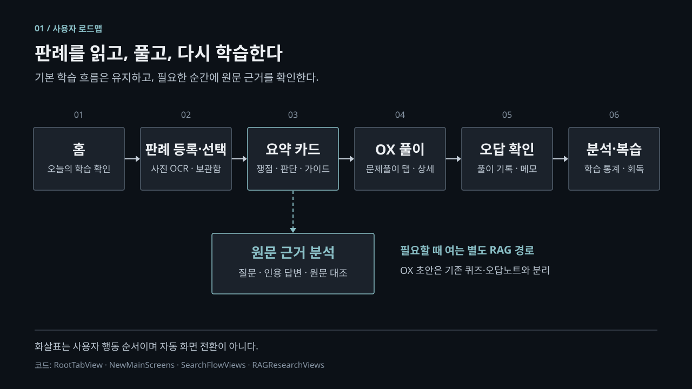
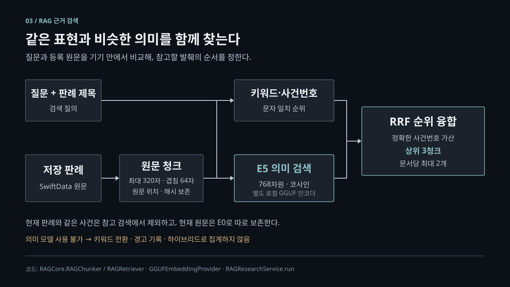
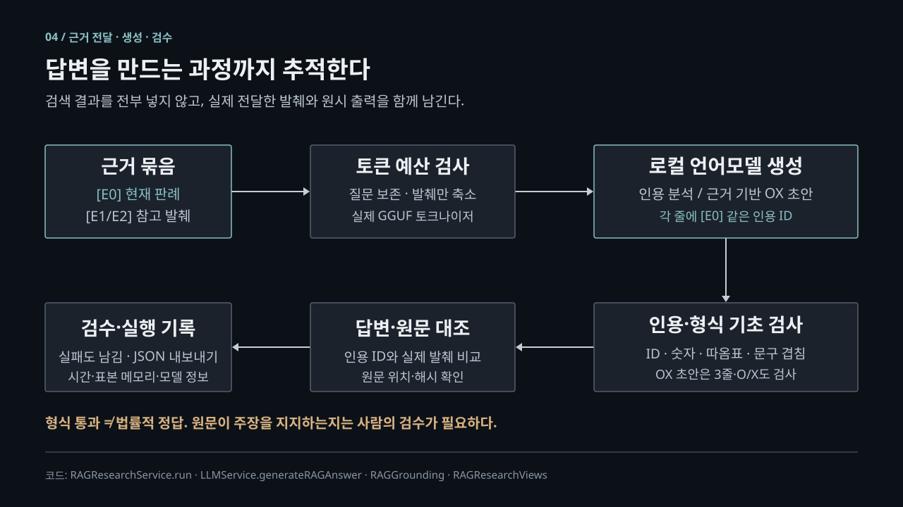

# RAG와 온디바이스 언어모델을 활용한 근거 기반 판례 학습 시스템

> 연구 문제 → 이론적 근거 → 제안 방법론 → 실험 → 검증 → 결론
>
> 대상: STACK112의 현재 iOS 온디바이스 구현. 작성 기준: 2026-11-02.
> 상태: 시스템 확장과 기능 검증 완료. 실제 판례 기반 효과 검증 및 실기기 성능 실험은 미완료.

## 1. 연구 문제: 요약을 제공하는 것과 근거를 확인할 수 있는 것은 다르다

판례 학습자는 긴 판결문에서 쟁점과 판단을 파악하고, 문제에 적용한 뒤 틀린 이유를 복습해야 한다. STACK112는 이를 위해 판례 스캔, 요약 카드, OX 문제풀이, 오답 기록, 학습 통계를 제공한다. 그러나 요약이 자연스럽다는 이유만으로 그 내용이 원문에 근거했다고 판단할 수는 없다. 참고 판례가 있어도 어떤 문장이 실제 생성에 사용되었는지 추적할 수 없다면, 사용자는 설명을 검증하기 어렵다.

이 문제는 온디바이스 환경에서 더 까다롭다. 작은 언어모델의 문맥 길이와 메모리에는 제약이 있고, 긴 원문과 여러 참고 자료를 모두 입력할 수 없다. 외부 서버를 사용하지 않는 설계에서는 관련 문서를 고르는 검색, 입력 예산 관리, 생성 실패 처리까지 기기 내부에서 수행해야 한다.

기존 앱의 카드 경로는 학습 UX를 보호하기 위해 원문 필드를 우선하는 후처리와 규칙 기반 복구를 사용한다. 이는 서비스 연속성에는 유용하지만, 최종 카드만 평가하면 **언어모델이 생성한 결과와 후처리로 보존된 원문을 구별하기 어렵다.** 따라서 연구용 분석은 기존 카드와 분리하고 원시 생성 결과·근거·실패를 관찰할 수 있어야 한다.

### 1.1 연구 질문

| 연구 질문 | 확인할 내용 | 판단 근거 |
| --- | --- | --- |
| RQ1. 의미 검색을 결합하면 참고 근거 검색이 개선되는가? | 사건번호·용어 일치와 표현이 다른 유사 쟁점을 함께 찾을 수 있는가 | 실제 판례 정답셋의 키워드/하이브리드 P@3, Recall@3, MRR@3 |
| RQ2. 생성 내용을 원문과 연결해 검수할 수 있는가? | 실제 전달 발췌, 인용 ID, 원문 위치를 추적하고 지지 여부를 판정할 수 있는가 | 인용 형식 검사, 기초 근거 검사, 법률 검수자의 문장별 판정 |
| RQ3. 이러한 처리가 대상 iPhone에서 감당 가능한가? | 검색·모델 준비·생성 비용과 실패를 구분해 측정할 수 있는가 | 실기기 지연 분포, 프로세스 표본 메모리, 출력 성공률 |

RQ1과 실제 법률 자료에 대한 RQ2, 실기기 비용에 대한 RQ3는 **아직 답이 확정되지 않은 연구 질문**이다. 현재 완료된 것은 이를 시험할 수 있는 구현과 기능 검증이다.

### 1.2 연구의 범위

- 서버·외부 벡터 DB 없이, 등록한 판례 원문을 기기 내에서 검색하고 생성한다.
- 기존 학습 카드와 퀴즈를 유지하며 별도 근거 분석 경로를 추가한다.
- 법률 전문가를 대신하는 정답 판정기, 전국 판례 통합 검색 서비스, 새 법률 모델 학습을 목표로 하지 않는다.
- 사용자 열람용 외부 출처 링크와 사용자가 수행하는 JSON 공유는 로컬 추론과 구분한다.

## 2. 이론적 근거: 왜 검색·근거 연결·비용 측정을 함께 설계하는가

### 2.1 RAG: 모델의 기억 대신 검색한 문서를 생성 입력으로 제공한다

RAG는 검색 결과를 생성 입력에 결합하는 접근이다[1]. 이 프로젝트에서는 현재 판례와 관련 원문 발췌를 로컬 언어모델에 제공하여, 답변의 재료가 된 텍스트를 확인할 수 있게 한다.

다만 검색 결과를 넣었다는 사실이 답변의 진실성을 보장하지는 않는다. 무관한 근거를 검색하거나, 관련 문장을 잘못 해석하거나, 인용 ID만 붙인 잘못된 답변이 나올 수 있다. 따라서 **검색 관련성 → 실제 근거 전달 → 생성 출력 → 사람 검수**를 분리해서 평가한다. 원 논문의 검색기·생성기 공동학습을 재현한 시스템은 아니며, 검색 조건부 생성이라는 설계 원리를 적용했다.

### 2.2 하이브리드 검색: 사건번호 일치와 의미 유사성은 역할이 다르다

사건번호와 법률 용어는 문자 기반 검색에 유리하다. 반면 같은 쟁점도 서로 다른 표현으로 작성될 수 있어, 문자 일치만으로는 놓치는 근거가 생길 수 있다. 다국어 E5는 질문과 문서를 벡터로 표현해 이러한 의미 유사성을 보완하는 후보 모델이다[3]. 이 프로젝트가 E5를 법률 자료로 추가 학습한 것은 아니다.

키워드 점수와 코사인 점수는 단위가 다르므로 그대로 더하지 않고, 순위에 기반한 RRF를 사용한다[2]. 현재 코드의 점수 구성은 다음과 같다.

```text
score(chunk)
  = 1 / (60 + keywordRank)       # 해당 순위가 있을 때
  + 1 / (60 + semanticRank)      # 실제 의미 검색을 사용할 때
  + exactCaseNumberBonus        # 정확한 사건번호 일치 시 1
```

코사인 0.30은 현재의 초기 설정일 뿐, 관련성 확률이나 검증된 법률 임계값이 아니다. 실제 개발셋으로 보정하고 별도 테스트셋에서 평가해야 한다.

### 2.3 출처 추적: 인용 가능성과 법률적 타당성은 별개의 조건이다

각 근거에 ID를 부여하고 원문 해시와 위치를 남기면 “무슨 텍스트를 입력했는가”를 추적할 수 있다. 인용 ID, 숫자, 따옴표 문구, 문자 겹침 검사는 빠른 이상 탐지에 유용하지만, 법률적 함의나 반대 판례의 구별 사유까지 증명하지는 못한다.

따라서 자동 검사는 **표면적 근거성 proxy**로 정의하고, 실제 지지 여부는 사람의 검수 결과로 별도 기록한다. 형식이 맞는 출력의 비율을 법률 정답률이라고 부르지 않는다.

### 2.4 온디바이스 설계: 입력과 자원에 한계를 두되, 실패를 숨기지 않는다

긴 원문 전체 대신 질문 관련 청크를 선택하고, 실제 생성 토크나이저로 입력 예산을 확인한다. 저장 원문은 보존하고 생성 입력만 축소한다. 임베딩 또는 생성 모델을 사용할 수 없는 경우에는 경고·실제 실행 모드·실패를 남겨야 한다. 그렇지 않으면 규칙 기반 복구나 키워드 전환을 모델의 성공으로 오인하게 된다.

## 3. 제안 방법론: 학습 경로는 유지하고 근거 분석을 분리한다

### 3.1 사용자 관점의 전체 흐름

현재 앱의 주요 흐름은 **홈 → 판례 스캔·선택 → 요약 카드 → OX 풀이 → 오답 확인 → 분석·복습**이다. 첨부 예시의 “판례 검색”을 그대로 사용하지 않은 이유는, 활성 메인 탭의 실제 진입점이 외부 판례 DB 검색이 아니라 판례 스캔과 저장 문서 선택이기 때문이다.



요약 상세에서 사용자가 **원문 근거 분석 · RAG**를 선택하면 별도 분석 경로로 이동한다. 사용자는 질문·검색 방식·생성 작업을 선택하고 인용 결과와 원문을 대조한다. 근거 기반 OX는 검수 전 초안이며 기존 퀴즈나 오답노트로 자동 저장되지 않는다.

학습 순환은 [그림 2](../images/presentation/stack112-learning-loop.svg)에 따로 표현했다. 화살표는 사용자 행동의 순서이며 모든 화면이 자동으로 이어진다는 의미가 아니다. “AI분석”의 통계와 회독 문구는 누적 기록에 대한 규칙·집계이며, RAG가 개인화 추천을 학습하는 구조가 아니다.

### 3.2 원문 저장과 검색 단위 구성

1. OCR 등으로 등록한 판례의 원문과 메타데이터를 SwiftData에 저장한다.
2. 루트 화면은 원문 전체와 추출 필드 변경을 감지해 검색 코퍼스를 갱신한다.
3. 검색 시 원문을 최대 320자, 64자 겹침으로 청킹한다. 문장 경계를 우선하므로 모든 청크가 정확히 320자인 것은 아니다.
4. 청크에 문서 ID, 원문 SHA-256, UTF-16 시작·끝 위치, 출처 정보를 연결한다.
5. 원문은 영속 저장하지만 청크는 재구성하고 벡터는 메모리에 캐시한다. 영속 벡터 DB를 구축한 것은 아니다.

### 3.3 참고 근거 검색



검색 질의는 사용자 질문과 현재 판례 제목으로 구성한다. 현재 판례 자체와 동일 사건·논리적 중복은 참고 후보에서 제외한다. 키워드·사건번호 순위와 의미 순위를 융합한 뒤 상위 3청크를 반환하며, 한 문서가 차지하는 청크는 최대 2개로 제한한다.

의미 검색은 별도 multilingual-e5-base Q8_0 GGUF를 사용한다. `query:` / `passage:` 접두사, mean pooling, 768차원 벡터의 L2 정규화와 코사인 점수를 적용한다. 모델 해시와 토크나이저 메타데이터를 확인하며, 512토큰을 초과한 입력은 몰래 잘라 벡터화하지 않는다.

의미 모델을 사용할 수 없으면 키워드로 전환하고 실제 모드와 경고를 기록한다. 이를 성공한 하이브리드 실험으로 집계하지 않는다. 가중치는 빌드 준비 때 설치하며 검색·추론 중 다운로드하지 않는다.

### 3.4 실제 근거 전달과 로컬 생성



현재 판례에서 질문과 관련된 청크 하나를 E0으로 선택하고, 참고 검색 결과 최대 2개를 E1/E2로 추가한다. **검색 상위 3청크와 실제 생성 입력의 참고 최대 2청크는 서로 다른 수량**이다.

생성기는 전체 채팅 템플릿을 실제 GGUF 토크나이저로 검사한다. 질문은 유지하고 근거 발췌를 단계적으로 줄이며, 작은 예산에서는 현재 판례와 참고 1개까지 남긴다. 참고가 있었는데 최소 참고도 보존할 수 없으면 명시적으로 실패한다. 화면과 실행 기록에는 축소 전 후보가 아니라 실제 전달한 발췌와 조정된 원문 범위를 남긴다. 모델에 전달하지 못한 경우에는 후보 근거임을 구분해 표시한다.

분석 출력은 각 줄에 `[E0]` 또는 `[E0,E1]` 같은 인용을 요구한다. OX 초안에는 인용된 문항·O/X 정답·해설의 3줄 구조를 추가로 요구한다. 생성 실패·형식 오류·알 수 없는 인용을 성공으로 처리하지 않는다. 기존 카드의 원문 우선 후처리나 규칙 기반 답변으로 연구 출력을 대체하지 않는다.

### 3.5 관찰 가능한 실행 기록

검색 시간, 모델 준비 시간, 실제 생성 시도 시간, 전체 시간, 프로세스 메모리 표본, 요청/실제 검색 모드, 원시 출력, 실패 사유를 기록한다. 모델·데이터·출력 해시와 실제 발췌는 재검토를 위한 단서다. 사용자는 검수자 식별자와 지지 문장 수를 기록하고 JSON으로 내보낼 수 있다. 이는 검수자 신원을 인증하는 기능은 아니다.

## 4. 실험: 구현 확인과 연구 효과 검증을 분리한다

### 4.1 실험 A — 완료된 구현·통합 검증

합성 8문서·3질문과 자동 테스트로 원문 보존, 검색, 실제 모델 연결, 실패 처리, 지표 계산, 내보내기를 확인했다. 이 자료는 직접 작성한 가상 규칙으로 구성되며 실제 판례나 법률 정답 자료가 아니다.

한국어 의미 검색 검사에서는 관련 문서가 무관한 음식 문서보다 높은 점수를 갖는지 실제 가중치로 확인했다. 최초 소형 변환본은 이 검사를 통과하지 못했고 원본과 맞지 않는 토크나이저 메타데이터도 확인되어 제외했다. 기준을 완화하지 않고 호환 토크나이저를 가진 base 변환본으로 교체했다. 이는 소형 원본 E5 전체의 성능 열위를 입증하는 실험은 아니다.

### 4.2 실험 B — 실제 판례에서의 비교 평가: 미수행

| 조건 | 입력 근거 | 비교 목적 |
| --- | --- | --- |
| 현재 판례만 | E0 | 참고 검색 없이 생성한 기준 조건 |
| 키워드 | E0 + 문자 기반 참고 발췌 | 키워드 검색의 기여 |
| 하이브리드 | E0 + 키워드·의미 융합 참고 발췌 | 의미 검색 추가의 기여 |

모든 조건에서 질문, 현재 판례, 생성 모델, 생성 작업과 출력 토큰 상한을 동일하게 유지한다. 분석과 OX 초안을 섞어 집계하지 않는다. “현재 판례만”은 참고 검색을 수행하지 않으므로 검색 정확도의 우열 비교 대상이 아니라 생성·비용의 기준 조건으로 해석한다.

실제 데이터는 이용권한을 확인하고 비식별화한다. 질문과 정답은 생성 결과와 독립적으로 작성한다. 표현이 다른 유사 쟁점, 반대 결론, 사건번호 질의, 무관련 질문, OCR 오류, 긴 판결문을 포함한다. 개발셋에서 설정을 정한 후 최종 테스트셋은 수정·조정에 사용하지 않는다.

최소 2인의 법률 검수자가 관련 문서와 생성 문장의 지지 여부를 독립적으로 판정하고 불일치를 조정하는 절차를 권장한다. 평가셋의 최종 규모·분포·반복 수는 아직 확정하지 않았으며, 논문에는 실제 사용한 수와 선정 근거를 보고해야 한다.

### 4.3 실험 C — 실기기 자원 비용: 미수행

대상 iPhone별로 OS, 빌드, 두 모델의 해시, 라이브러리 revision, 평가셋 버전과 환경을 고정한다. 생성 모델과 임베딩 모델의 cold/warm 상태 및 캐시 적중을 분리한다. 임베딩을 사용한 뒤 같은 프로세스에서 기준 조건을 측정하면 임베딩 가중치가 남아 있으므로, **독립 메모리 비교는 새 앱 세션에서 단일 모드로 실행**한다.

순서 편향을 줄이도록 반복별 시작 모드를 회전하되, 독립 메모리 실험과 공유 프로세스 배치 실험을 혼합하지 않는다. 시뮬레이터 시간은 실기기 결과로 사용하지 않는다. 4GB 기기에서는 두 모델의 동시 상주, 메모리 종료, 발열과 반복 실행 안정성을 별도로 확인해야 한다.

## 5. 검증: 무엇이 확인되었고 무엇은 아직 주장할 수 없는가

### 5.1 다섯 평가 항목의 판정 기준

| 항목 | 측정 정의 | 잘못 해석하면 안 되는 점 |
| --- | --- | --- |
| 검색 관련성 | 검색 청크의 문서 ID를 중복 제거해 P@3, Recall@3, MRR@3 계산 | P@3 분모는 3. 정답 집합이 비면 Recall/MRR는 미측정. 검색하지 않는 기준 조건과 검색 성능을 직접 비교하지 않음 |
| 생성 근거성 | 인용·숫자·인용문·문자 겹침 proxy와 사람의 지지 문장 비율 | 자동 값은 법률 정답률이 아님. 미검수 비율과 출력 성공률을 함께 보고 |
| 추론 시간 | 실제 primary generate 호출 시간의 합; 실패 시도 포함 | 로드·복구는 별도. 검색·준비·생성·전체 시간을 혼동하지 않음 |
| 메모리 | 50ms 간격의 앱 프로세스 `phys_footprint` 시작/끝/표본 최대 | 모델 전용 메모리나 절대 피크가 아님. 긴 동기 구간의 피크를 놓칠 수 있음 |
| 출력 성공률 | 비어 있지 않고 모든 줄의 형식·인용 ID가 유효한 실행 / 전체 요청 실행 | 형식 성공과 법률적 타당성은 다름. 예산·모델·파싱 실패도 분모에 포함 |

실기기이며 요청/실제 검색 모드가 일치한 표본만 성능 집계에 사용한다. 하이브리드가 키워드로 전환된 실행을 하이브리드의 검색·근거성 평균에 섞지 않는다. 다만 전체 요청의 출력 성공률에서는 실패를 제거하지 않는다. 중단된 미완료 배치는 완성된 평가 보고서로 내보내지 않는다.

### 5.2 확인된 기능 검증 결과

| 실행 | 결과 | 증명 범위 |
| --- | --- | --- |
| 최신 회귀 배치 | 기존 14 + 연구 17 + 실제 임베딩 5 = 36개 통과 | 원문 동기화·범위, 검색, 모델 역할·해시, 캐시, 실패, 지표·JSON |
| 실제 검색→생성 E2E | 실제 E5 → 실제 번들 GGUF → 인용 출력 1개 통과 | 가상 표식 문서에서 실제 하이브리드와 생성 엔진 연결, 인용 출력·전달 근거 확인 |
| 최종 UI·계측 수정 후 재검사 | 연구 경로 17개 재통과 | 근거 후보/실제 전달 표시와 주 엔진 준비 상태 관련 수정 후 회귀 |
| 앞선 실제 생성 런타임 검사 | 토크나이저·2회 연속 추론 1개 통과 | 실제 토큰 예산과 반복 네이티브 호출 |

여러 실행에 걸쳐 서로 다른 테스트 38개를 확인했다. **38개를 한 배치에서 실행했다는 의미가 아니며, 테스트 수는 연구 평가셋 크기나 법률 정확도의 분모가 아니다.** 모든 모델 기능 검사는 시뮬레이터에서 수행했고 성능 실험으로 해석하지 않는다.

### 5.3 타당성의 한계

- 기능 테스트의 통과는 실제 법률 정확도나 학습 효과 향상의 증거가 아니다.
- 합성 자료의 작은 규모와 단순성 때문에 실제 판례로 일반화할 수 없다.
- 코사인 임계값과 짧은 발췌가 검색·생성 품질에 미치는 영향은 추가 검증이 필요하다.
- 현재 자동 검사로 부정문, 예외, 판례 변경이나 법률적 함의를 완전히 판별할 수 없다.
- 약 289.1 MiB의 임베딩 파일 추가와 두 모델 상주의 실기기 비용을 아직 평가하지 않았다.
- 학습 통계는 진입 경로에 따라 다르다. 문제풀이 탭은 `StudyStore.recordAnswer`를 호출하지만, 상세의 독립 `OXQuizView`는 현재 `ReviewStore`에 풀이 기록을 남긴다. 모든 OX 경로가 같은 일일 통계를 갱신한다고 서술하지 않는다.
- 오답노트 저장소는 정·오답 풀이 기록을 보관하고 화면에서 구분한다. 이름만 보고 오답만 저장한다고 해석하지 않는다.
- 사용자 실험이나 OCR 정답 전사가 없으므로 학습 효율·만족도·OCR CER 향상은 검증하지 않았다.

## 6. 결론: 근거를 추적하고 비용과 실패를 측정할 수 있는 시스템을 구현했다

본 프로젝트의 현재 기여는 새로운 언어모델을 학습하거나 법률 정확도 향상을 입증한 것이 아니다. **기존 온디바이스 판례 학습 앱을 보존하면서, 원문 위치를 추적하는 하이브리드 검색·인용 생성·검수·계측을 연결한 별도 연구 경로를 구현한 것**이다.

기능 검증에서는 실제 임베딩과 실제 생성 모델을 연결해 근거가 포함된 출력을 확인했고, 모델 부재·형식 오류·예산 실패를 성공과 구분할 수 있는 장치를 확인했다. 이는 RQ2의 추적 가능성과 RQ3의 측정 가능성에 대한 구현 근거이지만, 실제 자료에서의 지지 정확도와 실기기 실용성에 대한 최종 답은 아니다.

이후 연구는 이용 가능한 실제 판례·독립 정답·법률 검수·물리 iPhone 반복 실험으로 RQ1~RQ3를 평가해야 한다. 그 결과가 확보되어야 “하이브리드가 검색을 개선했다”, “답변의 근거성이 높아졌다”, “대상 기기에서 실용적이다”라는 결론을 데이터와 함께 제시할 수 있다.

발표에서는 다음과 같이 요약할 수 있다.

> 판례를 요약하는 앱에서 출발해, 어떤 원문을 찾아 어떤 발췌를 모델에 전달했는지 확인하고 답변과 비용을 검증할 수 있는 온디바이스 연구 시스템으로 확장했다. 구현은 기능 검사로 확인했으며, 실제 법률 정확도와 실기기 성능에 대한 결론은 후속 실험에서 검증한다.

## 부록 A. 발표용 이미지

첨부 예시의 어두운 배경·사각 노드·명확한 화살표를 사용했다. 전체 발표 덱이 아니라 삽입용 독립 이미지다. PNG는 바로 삽입하고, SVG는 확대하거나 문구를 수정할 때 사용한다.

| 그림 | 용도 | PNG | SVG |
| --- | --- | --- | --- |
| 1. 사용자 로드맵 | 앱 소개: 기본 학습 경로와 선택적 RAG 분기 | [3840×2160](../images/presentation/stack112-user-roadmap.png) | [벡터 원본](../images/presentation/stack112-user-roadmap.svg) |
| 2. 학습 순환 | 사용자 설명: 풀이·기록·분석·재학습 | [1536×2304](../images/presentation/stack112-learning-loop.png) | [벡터 원본](../images/presentation/stack112-learning-loop.svg) |
| 3. RAG 검색 | 방법론: 원문 청크·키워드/E5·순위 융합 | [3840×2160](../images/presentation/stack112-rag-retrieval.png) | [벡터 원본](../images/presentation/stack112-rag-retrieval.svg) |
| 4. 근거 생성 | 방법론: E0/E1/E2·토큰 예산·생성·검수 | [3840×2160](../images/presentation/stack112-grounded-generation.png) | [벡터 원본](../images/presentation/stack112-grounded-generation.svg) |

## 부록 B. 그림과 실제 코드의 대응

| 그림 구간 | 실제 구현 |
| --- | --- |
| 홈·5개 탭·스캔·보관 판례 선택 | [RootTabView](../../code/ios/AISYSApp/Sources/RootTabView.swift), [HomeView / CaseCardsView](../../code/ios/AISYSApp/Sources/NewMainScreens.swift), [OCRView](../../code/ios/AISYSApp/Sources/OCRView.swift) |
| 요약 카드·기존 OX | [CaseSummaryView / OXQuizView](../../code/ios/AISYSApp/Sources/SearchFlowViews.swift), [CaseSummaryViewModel](../../code/ios/AISYSApp/Sources/CaseSummaryViewModel.swift) |
| 풀이·오답·분석·회독 | [PracticeView / WrongNoteView / AIAnalysisView](../../code/ios/AISYSApp/Sources/NewMainScreens.swift), [ReviewStore](../../code/ios/AISYSApp/Sources/Models.swift), [StudyStore](../../code/ios/AISYSApp/Sources/StudyStore.swift) |
| 원문 코퍼스와 갱신 | [ScannedCase](../../code/ios/AISYSApp/Sources/ScannedCase.swift), [RootTabView](../../code/ios/AISYSApp/Sources/RootTabView.swift), [LocalCaseStore](../../code/ios/AISYSApp/Sources/LocalCaseStore.swift) |
| 청크·키워드/E5 융합 | [RAGChunker / RAGRetriever](../../code/ios/AISYSApp/Sources/RAGCore.swift), [LocalCaseSearchEngine](../../code/ios/AISYSApp/Sources/LocalCaseSearchEngine.swift), [GGUFEmbeddingProvider](../../code/ios/AISYSApp/Sources/GGUFEmbeddingProvider.swift) |
| E0/E1/E2·토큰 예산·생성 | [RAGResearchService.run](../../code/ios/AISYSApp/Sources/RAGResearch.swift), [LLMService.generateRAGAnswer](../../code/ios/AISYSApp/Sources/LLMService.swift), [LlamaCppEngine](../../code/ios/AISYSApp/Sources/LocalLLMEngines.swift) |
| 기초 검사·OX 형식·원문 대조 | [RAGGrounding / RAGQuizDraft](../../code/ios/AISYSApp/Sources/RAGCore.swift), [RAGAnalysisView](../../code/ios/AISYSApp/Sources/RAGResearchViews.swift) |
| 지표·실기기 표본·JSON | [RAGEvaluator / RAGMemorySampler / RAGRunRecord](../../code/ios/AISYSApp/Sources/RAGResearch.swift), [RAGEvaluationView](../../code/ios/AISYSApp/Sources/RAGResearchViews.swift) |

세부 스키마·지표 분모·실기기 운영 절차는 [기존 평가 프로토콜](OnDevice_RAG_Protocol.md)을 참조한다. 코드 탐색용 상세 지도는 [온디바이스 RAG 동작 지도](../architecture/OnDevice_RAG_Map_2026-11-02.html)에 유지한다.

## 참고문헌

1. Lewis et al. (2020). [Retrieval-Augmented Generation for Knowledge-Intensive NLP Tasks](https://arxiv.org/abs/2005.11401).
2. Cormack, Clarke, Buettcher (2009). [Reciprocal rank fusion outperforms condorcet and individual rank learning methods](https://doi.org/10.1145/1571941.1572114). SIGIR, 758–759. 서지 정보는 Crossref로 확인.
3. Wang et al. (2024). [Multilingual E5 Text Embeddings: A Technical Report](https://arxiv.org/abs/2402.05672). 실제 모델 설정은 [E5-base 모델 카드](https://huggingface.co/intfloat/multilingual-e5-base)와 [번들 manifest](../../code/ios/AISYSApp/Resources/rag_embedding_model.json)를 함께 참조.
