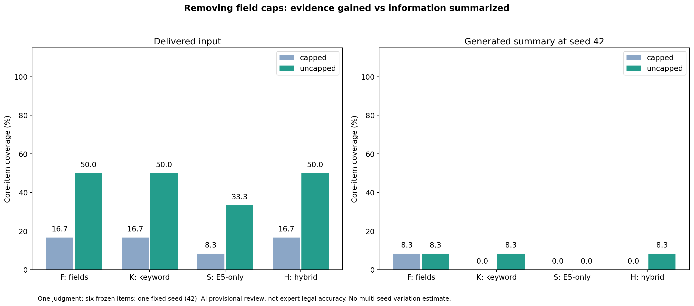
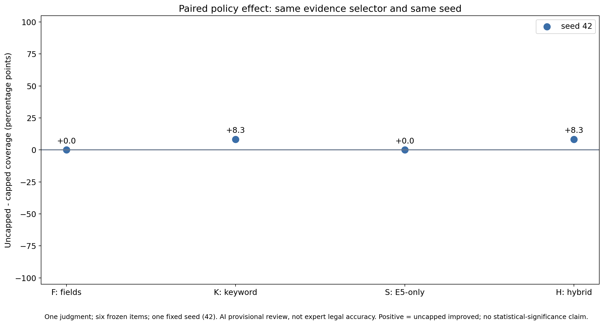
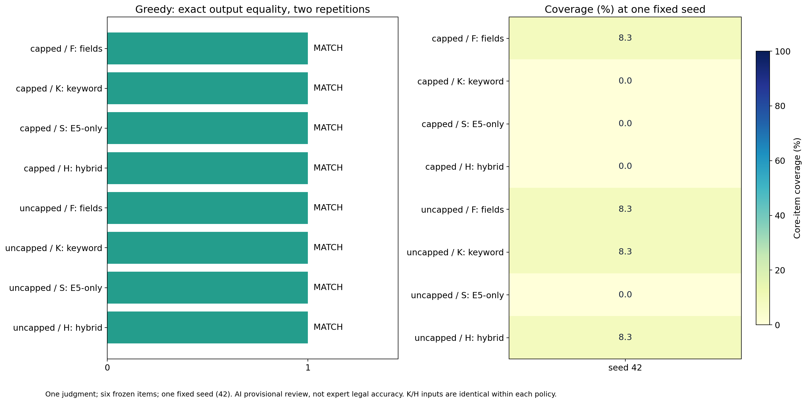
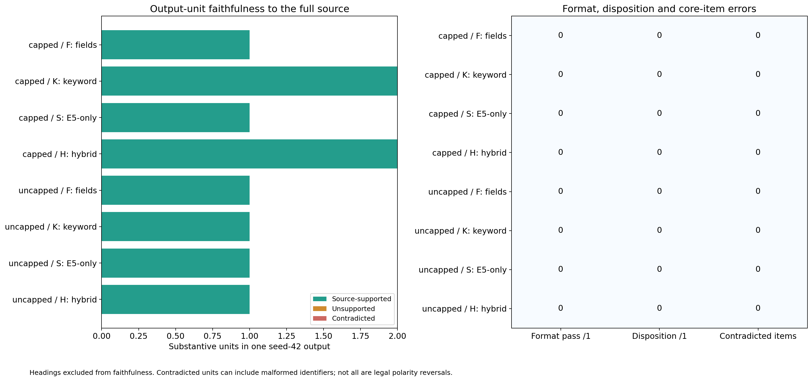
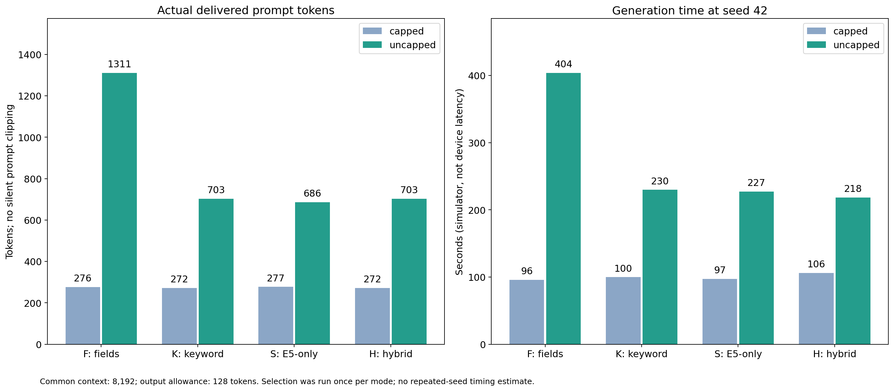

# 판례 C 문자 제한·생성 통제 실험 결과

## 1. 결론

**사용자 승인에 따라 40회 계획을 24개 완료 출력으로 축소했다.**
기존 제한/제한 없음 × F/K/S/H × greedy 두 번·seed 42 한 번이다.
원래의 [40회 사전 계획](README.md)은 그대로 보존하고
[범위 변경 이유와 실행 방식](AMENDMENT.md)을 별도로 기록했다.

- **입력 손실은 줄었다.** 문자 제한을 제거하면 핵심 정보 포함률이
  F/K/H 16.7% → 50.0%, S 8.3% → 33.3%로 증가했다.
- **요약 품질의 일관된 개선은 확인하지 못했다.** seed 42에서는 K/H만 +8.3%p였지만
  greedy에서는 같은 K/H가 −8.3%p였다. F/S는 두 디코더에서 정책별 점수가 같았다.
- **재현성은 확인했다.** greedy 여덟 쌍 모두 출력 문자열이 같았다.
  동일 입력인 K/H도 같은 디코더·seed를 적용하면 출력이 같았다.
- **비용은 늘었다.** seed 42의 생성 시간은 제한 제거 후 약 2.1–4.2배였다.
  이 조건에서 문자 제한 해제만으로 실용적인 품질 개선을 입증했다고 보기 어렵다.

**판례는 한 건이며, 점수는 원문 대조 AI 예비검수다.**
법률 전문가 정답률·통계적 유의성·실기기 성능으로 일반화하지 않는다.
단일 seed로 축소했으므로 seed 간 평균·표준편차·생성 변동은 평가하지 않았다.

## 2. 실제 실행 조건

| 항목 | 조건 |
| --- | --- |
| 원문 | 판례 C, 2026으552, 기존 데이터셋 `sc-2026eu552` |
| F | JudgmentParser의 쟁점·판결·법령 필드 |
| K / S / H | 동일 판례 내부 키워드 / E5 단독 / 키워드·E5 RRF |
| 정책 | 기존 96자 시작 정책 / 선택된 필드의 문자 제한 없음 |
| 공통 예산 | 컨텍스트 8,192토큰, 출력 상한 128토큰 |
| 생성 | greedy 두 번 / temperature 0.4·top-k 40·top-p 0.9·seed 42 한 번 |
| 공통 반복 억제 | repetition penalty 1.1, 최근 64토큰; 기존 sample/accept 순서 유지 |
| 생성 모델 | Llama-3.2-1B-Instruct-Q4_K_M, SHA는 원시 manifest에 기록 |
| 임베딩 | multilingual-e5-base Q8_0, 모델 SHA와 실제 scoring을 검증 |
| 환경 | Xcode 26.1.1, iOS 26.1 iPhone 16 Simulator, CPU 실행 |

검색 선택은 구성마다 한 번 수행해 두 문자 정책과 세 생성에 재사용했다.
원문 외 참고 판례, OCR, UI 후처리·정규화, 규칙 기반 fallback은 사용하지 않았다.
매 요청 KV 메모리와 평가 sampler를 초기화했고 실제 sampler seed를 확인했다.
모든 완료 요청에서 원래 입력 토큰 수와 실제 전달 토큰 수가 같았다.

**uncapped는 파서/선택 청크 필드 전체이지 판례 전문 전체가 아니다.**
필드 선택에서 빠진 정보는 문자 제한을 없애도 생기지 않는다.
앱 기본 문자 제한·컨텍스트·자동 seed 정책은 변경하지 않았다.
이번 capped도 확대 컨텍스트를 사용하므로 이전 파일럿과의 차이를 문자 정책 효과로 계산하지 않는다.

## 3. 입력과 출력의 핵심 정보 포함률

이전 생성 전에 고정한 [C1–C6 여섯 항목](../long-summary-evaluation-2026-11-03/gold.json)을 재사용했다.
full=1, partial=0.5, absent/contradicted=0을 합해 6으로 나눈다.
**8.3%는 여섯 항목 중 하나를 부분 보존한 점수**이며 8.3%의 판례를 맞혔다는 뜻이 아니다.
입력 검수와 출력 검수의 상세 근거·해석 기준도 공개한다.

| 구성 | 입력: 제한 있음 → 없음 | seed 42 출력: 제한 있음 → 없음 | seed 42 차이 |
| --- | ---: | ---: | ---: |
| F · 파서 필드 | 16.7% → 50.0% | 8.3% → 8.3% | 0.0%p |
| K · 키워드 | 16.7% → 50.0% | 0.0% → 8.3% | +8.3%p |
| S · E5 단독 | 8.3% → 33.3% | 0.0% → 0.0% | 0.0%p |
| H · 하이브리드 | 16.7% → 50.0% | 0.0% → 8.3% | +8.3%p |



F는 제한 해제 후 변경·창설 금지, 권리/집행권원 효력, 별도 가사비송 절차가 입력에 보존됐다.
그러나 seed 42 출력은 미이행 일부 의무에 관한 일반 설명만 남겼다.
K/H는 입력에 파기환송까지 들어왔지만 출력에는 추가 조건의 제64조 범위 초과라는 부분 정보만 남았다.
S 역시 파기환송이 입력에 들어왔으나 출력에서는 빠졌다.



네 점은 동일 seed의 네 구성 비교이지 네 개의 독립 판례가 아니다.
K/H는 입력까지 같으므로 두 번의 독립적인 개선 증거로 세지 않는다.

## 4. Greedy 재현성과 품질을 분리한다

여덟 조건에서 두 번씩 실행한 greedy 출력은 **8/8쌍 완전히 일치**했다.
이것은 이번 모델·CPU 환경·초기화 절차에서의 관측이며 모든 기기에서의 보장은 아니다.
동일 출력이 반복된다고 법률적으로 올바른 것은 아니다.

| 구성 | Greedy 출력: 제한 있음 → 없음 | 차이 |
| --- | ---: | ---: |
| F | 16.7% → 16.7% | 0.0%p |
| K | 16.7% → 8.3% | −8.3%p |
| S | 0.0% → 0.0% | 0.0%p |
| H | 16.7% → 8.3% | −8.3%p |

F는 같은 점수라도 보존한 항목이 달랐다. capped는 변경·창설 금지 C1,
uncapped는 면접교섭 제한·변경 절차 C3를 보존했다.
K/H의 정책 효과는 greedy와 seed 42에서 방향이 반대였다.
따라서 단일 seed의 작은 증가만으로 제한 해제가 안정적으로 우수하다고 결론 내리지 않는다.
greedy 두 회를 seed 표본에 합쳐 평균·변동을 계산하지 않았다.



## 5. 동일 프롬프트 그룹

실제 래핑 프롬프트 SHA-256을 비교한 결과 다음 두 그룹이 존재했다.

| 정책 | 동일 입력 구성 | 같은 디코더·seed에서 출력 |
| --- | --- | --- |
| capped | K = H | greedy 1회차·2회차·seed 42 모두 일치 |
| uncapped | K = H | greedy 1회차·2회차·seed 42 모두 일치 |

총 여섯 교차 구성 비교가 모두 일치했다.
해시와 비교 결과는 [analysis_summary.json](analysis_summary.json)에 있다.
이 조건에서 K/H의 품질을 검색 우열로 구분할 수 없다.
이전 파일럿의 동일 프롬프트·다른 출력도 검색 이득으로 해석해서는 안 된다는 판단을 뒷받침한다.

## 6. 형식·주문·근거성

- 원시 출력의 엄격한 네 필드 형식 통과: **0/24**.
- 파기환송 주문 완전 보존: **0/24**.
- seed 42의 핵심 항목 완전 보존: **0/48**; 관측된 점수는 부분 보존에서만 나왔다.
- 출력 단위 28개를 모두 검수했다. 비실질 단위 2개를 제외하면
  원문 지지 22개, 미지지 4개, 명시적 반대 진술 0개다.
- 미지지 4개는 F greedy의 두 정책·두 반복이다.
  capped에는 “자녀 시험포인트를 지급” 같은 근거 없는 내용을 덧붙였다.
  uncapped는 제64조 이행명령과 별도 권리변경 심판을 연결하여 적어 절차 구분이 불분명했다.
  후자는 명시적 반대 결론으로 단정하지 않고 보수적으로 미지지 단위로 판정했다.

줄/문장 단위에 맞는 서두와 미지지 뒷절이 섞이면 단위 전체는 미지지로 처리했다.
핵심 항목 점수는 별도로 계산하므로 “일부 항목 보존”과 “혼합 문장 미지지”가 함께 나타날 수 있다.
질문형 쟁점·판례 식별 정보도 출력 단위에 포함한다.
불완전하지만 원문에 어긋나지 않는 일반 문구는 근거성이 높아도 내용 포함률은 낮을 수 있다.
**실제로 seed 42의 원문 근거성은 모두 100%지만, 핵심 포함률은 0–8.3%다.**
이를 요약 정확도 100%라고 표현하면 안 된다.



128토큰 상한에 도달한 출력은 F greedy의 네 개다.
나머지 20개는 상한 전에 EOG로 종료했다. 특히 seed 42의 여덟 출력은 모두 EOG 종료였다.
출력 예산이 품질을 제한할 가능성은 남지만, 모든 누락을 출력 잘림으로 설명할 수는 없다.
이전 자동 seed 파일럿에서 관측한 법률 극성 반전이 이번 24개에서 똑같이 나와야 하는 것도 아니다.
명시적 반대 진술 0건이 법률적 무오류를 의미하지 않는다.

## 7. 입력량과 관측 비용

| 구성 | 입력 토큰: 제한 있음 → 없음 | seed 42 생성 초: 제한 있음 → 없음 | 시간 비 |
| --- | ---: | ---: | ---: |
| F | 276 → 1,311 | 95.71 → 403.89 | 4.22배 |
| K | 272 → 703 | 99.79 → 229.80 | 2.30배 |
| S | 277 → 686 | 97.21 → 227.31 | 2.34배 |
| H | 272 → 703 | 106.17 → 218.50 | 2.06배 |



생성 시간에는 KV/sampler 초기화, 토큰화, prefill, 토큰 생성이 포함된다.
조건당 seed 42 한 회의 값으로 중앙값·평균 지연이나 일반적인 속도 배수로 주장하지 않는다.
생성 모델 로딩과 공통 검색 선택 비용은 이 표에서 제외했다.
선택 비용은 한 번 측정한 F 0.001초, K 0.062초, S 82.473초, H 62.755초다.
S/H는 새 provider의 cold 비용을 포함하며 이전 warm 검색 지표와 섞지 않는다.

완료된 24개 생성의 시간 합계는 **4,654.111초, 약 77.6분**이다.
사전 검증·빌드·회귀 검사 시간은 별도다.
사전 검증 모델 로딩은 55.629초였지만 본실험 모델 로딩 시간은 최종 native report 전 중단되어
미측정이다. 그 값을 사전 검증 수치로 대체하지 않았다.

## 8. 실행 상태와 검증

원래 40회 바이너리는 24번째 원자적 체크포인트 저장 후 사용자 승인에 따라 종료했다.
원래 XCTest 전체 결과는 **의도적 중단으로 exit 65**이며 40회 통과로 표시하지 않는다.
종료 신호 이전 다음 요청이 시작되었을 가능성은 남지만 완료·분석 출력은 정확히 24개다.
분석용 report는 원본 체크포인트에서 조립한 schema 2이고, 로딩 시간은 null이다.

- 사전검증 3개 통과: 기본 템플릿 보존·명시적 평가 opt-in·실제 토큰 예산/초과 입력 거절.
- 원래 실행 중 기존 앱·RAG 기능 검사 **35개 통과**.
  실제 기본 토크나이저·연속 추론 검사도 포함한다.
- 24회로 줄인 재현용 Swift 실행기를 다시 빌드하고 템플릿·opt-in 검사 2개 통과.
  추가 장문 생성은 하지 않았다.
- Python 분석 회귀 **13개 통과**: 정확한 24개 격자, 실제 seed, 입력 잘림, 예산,
  누락·중복·검수 인용, 단일 seed에서 변동 지표 미산출, 다섯 그래프를 검사했다.
- 원래 계획·정답·manifest·측정 소스·범위 변경·입력 검수 해시와
  24개 체크포인트/조립 report 일치를 확인했다.

측정 바이너리의 원래 40회 실행기 소스는
[measured/ControlledSummaryEvaluationTests.swift](measured/ControlledSummaryEvaluationTests.swift)에 보존했다.
현재 [재현용 실행기](../../../code/ios/AISYSAppTests/ControlledSummaryEvaluationTests.swift)는
같은 순서의 첫 24회만 실행한다. 두 버전의 해시를 별도로 보존한다.
[native 검증 요약](native_test_summary.txt)과 [종료 상태](execution_status.json)도 확인할 수 있다.

## 9. 산출물과 재현

| 자료 | 파일 |
| --- | --- |
| 사전 입력·선택 청크·실제 프롬프트 | [raw/manifest.json](raw/manifest.json) |
| 완료 24개 원시 응답 집계 | [raw/report.json](raw/report.json) |
| 입력 항목 검수·세부 기준 | [input_review.json](input_review.json) |
| 고유 입력/출력 쌍별 출력 검수 | [review.json](review.json) |
| 생성별 점수·토큰·시간 | [samples.csv](samples.csv) |
| 144개 항목 판정 | [items.csv](items.csv) |
| 28개 출력 단위 판정 | [claims.csv](claims.csv) |
| 단일 seed 구성별 점수 | [seed_summary.csv](seed_summary.csv) |
| 동일 seed 정책별 차이 | [paired_seeds.csv](paired_seeds.csv) |
| Greedy 쌍 재현성 | [greedy_reproducibility.csv](greedy_reproducibility.csv) |

각 그림은 같은 이름의 SVG도 함께 저장했다.
분석 재현은 저장된 결과를 사용하므로 느린 모델 생성을 다시 실행하지 않는다.

```bash
/usr/local/bin/python3 -m unittest discover -s scripts -p 'test_analyze_*summaries.py' -v
/usr/local/bin/python3 scripts/analyze_controlled_summaries.py
```

새 native 배치는 새 전용 시뮬레이터에서
`testPreflightControlledSummaryPrompts` 후 `testRunControlledSummaryComparison`을 실행한다.
기존 manifest/체크포인트는 덮어쓰지 않는다.
새 배치의 입력·해시는 다시 고정하고 이번 동결 자료를 새 결과로 교체하지 않는다.

**운영 판단:** 문자 제한 제거는 입력 손실을 줄이는 데 효과가 있었지만,
현재 1B 생성기의 불완전 요약·핵심 결론 누락까지 해결하지 못했다.
입력 분배·주문 보존·생성 지시 및 모델 품질을 함께 개선하기 전,
이번 결과만으로 앱 기본 제한을 전면 해제할 근거는 부족하다.
