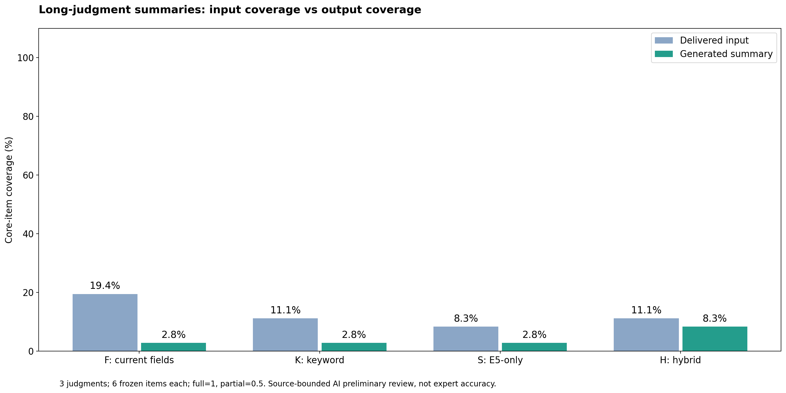
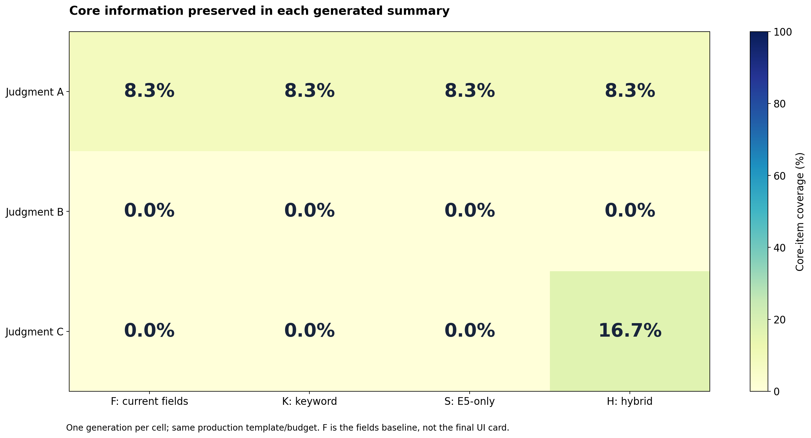
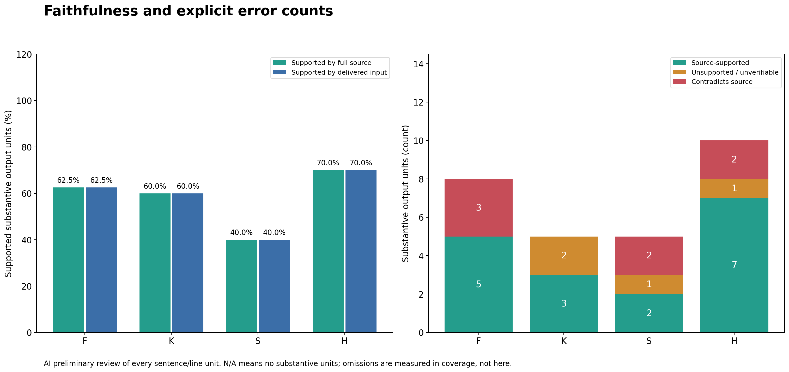
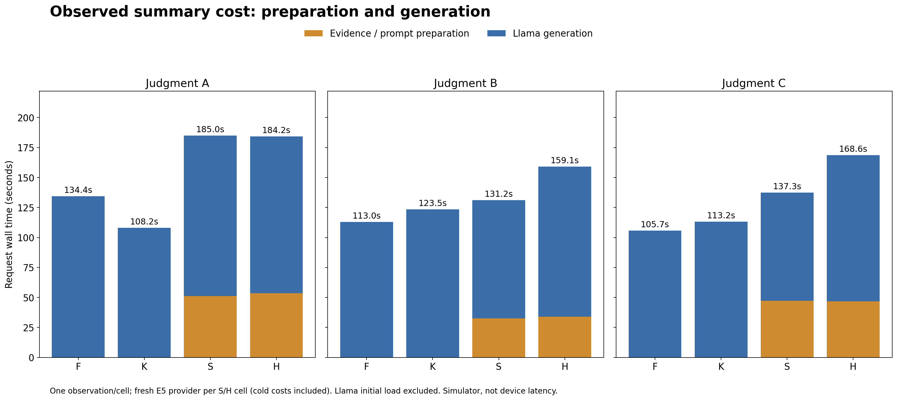

# 장문 판례 요약 실측 결과

## 1. 결론

2026-11-03, 세 장문 판례와 네 입력 구성으로 실제 로컬 Llama 요약을 **12회 생성**했다. 단순 검색 순위가 아니라 **원문의 핵심 정보가 생성 입력과 출력에 얼마나 남았는지**를 평가했다.

**현재의 작은 입력·출력 예산으로는 충실한 장문 요약 성능을 확보하지 못했다.** 입력 핵심 포함률은 구성별 8.3~19.4%, 출력은 2.8~8.3%였다. 전부를 충족한 핵심 항목은 없었고, 실제 주문을 온전히 보존한 요약도 없었다. 이는 아래에 공개한 원문 대조 **AI 예비검수**이며 독립적인 법률 전문가 정확도가 아니다.

H의 출력 포함률이 숫자로는 높았지만 **H의 검색 효과라고 해석할 수 없다.** 차이가 난 판례 C에서 K와 H의 실제 전달 프롬프트가 완전히 같았다. 단 한 번씩의 비고정 seed 생성 결과 차이를 검색 구성의 인과적 우월성으로 바꾸어 읽지 않는다.

## 2. 표기·대상·실행

| 표기 | 뜻 |
| --- | --- |
| F · fields | 현행 요약 템플릿·예산에 기존 파서의 구조화 필드를 넣는 기준 조건 |
| K · keyword | 현재 판례 내부의 키워드 검색으로 근거를 선택 |
| S · semantic | 같은 문서 내부에서 E5 의미 검색 단독으로 선택 |
| H · hybrid | 같은 문서 내부에서 키워드와 E5 순위를 RRF로 결합 |
| E5 | multilingual-e5-base 임베딩 모델. 요약 생성기나 근거 ID가 아님 |
| RRF | Reciprocal Rank Fusion, 역순위 융합 |
| 핵심 포함률 | 사전 고정 핵심 항목의 충족 정도. full=1, partial=0.5, absent/contradicted=0 |
| 원문 근거성 | 실질 출력 단위 중 전체 원문이 지지하는 비율. 완전성·전문가 정확도와 다름 |

여기서 K/S/H는 **같은 판례 내부의 근거 선택**이며, 이전 B1/S/H의 **다른 참고 판례 검색** 실험과 다르다. F도 외부 참고·UI 후처리를 제외한 통제 기준이므로 실제 화면에 표시되는 최종 카드 전체의 점수가 아니다.

| 판례 | 원문 길이 | 주제 | 사전 핵심 항목 |
| --- | ---: | --- | ---: |
| A · 2024므16033, 16040 | 5,786자 | 비상장주식의 재산분할 방법 | 6 |
| B · 97므1486, 1493 | 3,465자 | 특유재산·채무·기여도와 재산분할 | 6 |
| C · 2026으552 | 5,382자 | 면접교섭 이행명령의 한계 | 6 |

원문은 [기존 출처 안내](../datasets/family-law-retrieval-v1/README.md)를 따른다. A의 공식 출처는 확인했으며 B/C의 사용자 제공 전사는 공식 전문과 독립 대조하지 않았다.

세 판례 × 네 구성 × 셀당 1회다. 생성 모델은 Llama-3.2-1B-Instruct Q4_K_M, 의미 검색은 multilingual-e5-base Q8_0다. 기존 생성 템플릿·필드 제한·토큰 검증·샘플링을 바꾸지 않았다. 설정상 생성 컨텍스트는 호스트 메모리에 따라 256~512토큰이며 출력에도 별도 하드캡이 있다. 원문 전체를 한 번에 입력한 장문 모델 벤치마크가 아니다.

[방법](README.md)과 [18개 원문 근거 항목](gold.json)은 출력 관찰 전에 고정했다. [사전 해시](pre_generation_sha256.txt)와 [측정 소스 해시](frozen_source_sha256.txt)를 보존했다. 실제 입력·출력·검색 결과는 [원자료](raw/report.json)에 있다.

## 3. 핵심 정보 보존



[PNG](01-core-coverage.png) · [SVG](01-core-coverage.svg)

| 구성 | 입력 핵심 포함률 | 출력 핵심 포함률 | 완전 보존 항목 | 부분 보존 항목 | 주문 완전 보존 |
| --- | ---: | ---: | ---: | ---: | ---: |
| F | 19.4% | 2.8% | 0/18 | 1/18 | 0/3 |
| K | 11.1% | 2.8% | 0/18 | 1/18 | 0/3 |
| S | 8.3% | 2.8% | 0/18 | 1/18 | 0/3 |
| H | 11.1% | 8.3% | 0/18 | 3/18 | 0/3 |

각 구성의 분모는 6항목 × 3판례 = 18이다. 부분 보존 1개는 0.5점이므로 0.5/18 = 2.8%다. **2.8%를 질문 정답률이나 모델의 일반적인 법률 정확도로 읽으면 안 된다.** 쟁점 제목만 남고 그 답인 원칙·예외·결론이 빠진 경우를 구별했다.

F는 3.5/18, K/H는 각각 2/18, S는 1.5/18의 핵심 정보를 입력에 제공했다. 필드별 최대 96자, 포인트 최대 32자라는 기존 정책이 선택 청크의 뒤쪽 결론을 다시 잘라냈다. 예를 들어 판례 A는 주문 근처의 청크를 골라도 최종 파기환송 문장 전에 발췌가 끝났다. S의 판례 B 입력은 참조판례·표제 위주여서 핵심 규범을 전달하지 못했다.



[PNG](02-per-judgment-quality.png) · [SVG](02-per-judgment-quality.svg)

| 판례 | F | K | S | H |
| --- | ---: | ---: | ---: | ---: |
| A | 8.3% | 8.3% | 8.3% | 8.3% |
| B | 0.0% | 0.0% | 0.0% | 0.0% |
| C | 0.0% | 0.0% | 0.0% | 16.7% |

H의 판례 C 16.7%도 핵심 항목 2개의 **부분 보존**이다. 비혈족 여성 동석 금지라는 실제 조건, 별도 변경 절차, 파기환송 주문까지 완성한 요약이 아니다.

## 4. 근거성과 오류를 완전성과 구분



[PNG](03-faithfulness-errors.png) · [SVG](03-faithfulness-errors.svg)

| 구성 | 원문 지지 단위/실질 출력 단위 | 원문 근거성 | 검증 불가·근거 없음 | 원문 모순 단위 |
| --- | ---: | ---: | ---: | ---: |
| F | 5/8 | 62.5% | 0 | 3 |
| K | 3/5 | 60.0% | 2 | 0 |
| S | 2/5 | 40.0% | 1 | 2 |
| H | 7/10 | 70.0% | 1 | 2 |

입력 근거성은 이번 주석에서 원문 근거성과 같았다. 문장/줄 단위를 사용하며 사건명·사건번호·인용 정보도 사실 주장에 포함했다. 빈 표제·의미를 확정할 수 없는 단편은 실질 단위에서 제외하되 [CSV](samples.csv)에 별도 수를 기록했다. 불명확한 반복 문장은 검증 불가로 분류했다.

**원문 모순 7개 단위가 모두 법률 결론 오류라는 뜻은 아니다.** 6개는 사건부호 삭제·변형 같은 식별정보 오류이며, F/C의 1개는 중요한 법률적 부정 판단 반전이다.

| F/C 단계 | 실제 내용 |
| --- | --- |
| 원문 | 이행명령으로 기존 의무를 변경하거나 새로운 의무를 창설할 수 없음 |
| 전달 입력 | 변경·창설할 수 있는지 여부 **(소극)** |
| 생성 출력 | 제64조에 따라 금전 지급·유아 인도 등의 내용을 **“변경할 수 있다.”** |

이 사례에서는 올바른 부정 근거가 입력에 있었는데도 모델이 반대로 생성했다. 따라서 **모든 실패를 입력 잘림만으로 설명할 수 없다.** 반대로 올바른 사건명이나 일반 법리를 썼다는 이유만으로 충실한 장문 요약이라고 할 수도 없다.

모든 원시 생성은 텍스트를 반환했지만 네 필드 형식의 엄격 파싱은 **0/12**였다. UI 후처리·규칙 기반 폴백 결과를 평가하지 않았으므로 이를 앱 화면 전체의 실패율로 확대하지 않는다. [항목별 판단](items.csv) · [모든 출력 단위 검수](claims.csv) · [검수 원자료](review.json)를 공개한다.

## 5. H의 숫자상 차이를 검색 이득으로 볼 수 없는 이유

판례 C의 **K와 H는 chat wrapper를 포함한 실제 전달 프롬프트가 바이트 수준에서 같았다.** 공통 SHA-256은 다음과 같다.

```text
bccd35009cc2b3324f7bcef1b1a2efbe0840fe4f0f8aada144f17539a0d45c4a
```

그런데 K는 불명확한 근거라는 다른 내용을 생성했고 H는 추가 조건의 범위 초과를 일부 보존했다. 이는 이번 차이를 H의 더 좋은 근거 선택 때문이라고 설명할 수 없다는 직접 증거다.

기존 temperature 0.4와 기본 seed 정책을 유지했고, 조건별 seed 고정·여러 번의 생성 반복은 하지 않았다. 차이는 관측하되 샘플링·실행 변동과 검색 효과를 분리했다고 주장하지 않는다. 동일 입력 그룹과 출력 해시는 [분석 메타데이터](analysis_summary.json)의 `identicalPromptGroups`에서 재확인할 수 있다.

## 6. 시간 비용



[PNG](04-summary-cost.png) · [SVG](04-summary-cost.svg)

| 구성 | 세 판례 총 요청 시간 중앙값 | 포함 범위 |
| --- | ---: | --- |
| F | 113.0초 | 필드 프롬프트 준비 + 생성 |
| K | 113.2초 | 문서 내부 키워드 선택 + 프롬프트 + 생성 |
| S | 137.3초 | 새 E5 provider의 로드·문서 벡터·세 질문 검색 + 프롬프트 + 생성 |
| H | 168.6초 | 같은 초기 E5 비용 + 융합 검색 + 프롬프트 + 생성 |

각 중앙값은 서로 다른 세 판례의 관측을 요약한 것이지 동일 질문의 시간 반복 통계가 아니다. S/H의 근거 준비는 약 32.6~53.5초, 생성 자체는 전체 셀에서 약 90.1~134.4초였다. 원시 생성 길이·확률적 출력·실행 순서도 달라 **H가 일반적으로 이만큼 느리다**고 단정하지 않는다.

생성 모델 최초 로드 42.702초는 별도이며 셀 시간에서 제외했다. S/H는 셀마다 새 provider를 사용했으므로 이전 검색 전용 실험의 warm 비용과 섞지 않는다. 시뮬레이터 CPU 결과이며 iPhone 실기기 지연·메모리·배터리 측정이 아니다.

## 7. 해석과 다음 개선 우선순위

1. **근거 선택만 바꾸기 전에 입력 예산·발췌 정책을 개선해야 한다.** 현재는 좋은 청크를 찾아도 뒷부분의 판단·조건·주문을 잃을 수 있다.
2. **장문 전체 요약은 상위 청크 몇 개로 보장되지 않는다.** 쟁점별 충분한 근거와 문서 전 구간의 결론 보존을 검증해야 한다. 계층적 요약·더 긴 컨텍스트는 후속 후보이며 이번에 구현·측정한 것으로 표시하지 않는다.
3. **생성기의 부정·조건 보존도 별도 문제다.** F/C처럼 근거가 전달된 상태의 반대 생성이 있어 모델·프롬프트·출력 검증을 함께 점검해야 한다.
4. **검색 효과를 분리하려면 반복·seed 통제가 필요하다.** 동일 프롬프트의 출력 변동부터 측정한 뒤 입력 선택 차이를 비교해야 한다.
5. **후속 점수는 전문가 검수로 보강해야 한다.** 이번 18개 항목과 부분 점수는 AI 잠정 주석이다. 검수자 간 일치도·통계적 일반화·대규모 장문 성능을 입증하지 않았다.

앱 기본 요약·검색 동작과 기존 생성/검색 실험 원자료는 변경하지 않았다. 이번 문서 내부 검색 진입점은 평가에서 사용하며 기본 UI에 자동 적용하지 않는다.

## 8. 재현·검증

[native 검사](../../../code/ios/AISYSAppTests/LongSummaryEvaluationTests.swift)는 1706.981초에 완료되었고, 관련 회귀를 포함한 **native 21개 검사가 모두 통과**했다. 검사 통과는 수집·동작 검증이지 요약 품질 합격을 뜻하지 않는다. [검사 완료 기록](native_test_summary.txt) · [원본 로그 해시](native_log_sha256.txt)를 보존했다.

실제 모델 검사는 기존과 같이 XcodeGen으로 프로젝트를 생성한 뒤 다음과 같이 실행한다. `$SIMULATOR_UDID`는 자신이 준비한 시뮬레이터 ID다.

```bash
xcodegen generate --spec code/ios/project.yml
xcodebuild test -project code/ios/AISYS.xcodeproj -scheme AISYSApp \
  -destination "platform=iOS Simulator,id=$SIMULATOR_UDID" \
  -only-testing:AISYSAppTests/LongSummaryEvaluationTests/testRealLongJudgmentSummaryComparison \
  -only-testing:AISYSAppTests/RAGResearchTests \
  -parallel-testing-enabled NO -disableAutomaticPackageResolution -skipPackageUpdates \
  -test-timeouts-enabled YES -default-test-execution-time-allowance 1800 \
  -maximum-test-execution-time-allowance 1800 \
  CODE_SIGNING_ALLOWED=NO CODE_SIGNING_REQUIRED=NO
```

앱 Documents의 `long-summary-evaluation-v1`에서 전체 보고서와 12개 체크포인트를 내보낸다. 재실행 출력이 달라지면 기존 [review.json](review.json)을 그대로 재사용하지 않고 원문과 실제 전달 입력을 다시 대조해야 한다.

보존된 원자료의 지표·그림을 재생성한다.

```bash
/usr/local/bin/python3 scripts/analyze_long_summaries.py \
  --directory docs/research/long-summary-evaluation-2026-11-03
/usr/local/bin/python3 -m unittest discover -s scripts \
  -p 'test_analyze_long_summaries.py' -v
```

분석 환경은 Python 3.12.2, pandas 2.3.0, matplotlib 3.9.2다. [분석기](../../../scripts/analyze_long_summaries.py)와 [회귀 검사](../../../scripts/test_analyze_long_summaries.py)는 불완전한 셀·근거 변조·검수 누락·입력 불일치·0개 주장·숫자 날짜 분절을 검사한다. 네 PNG/SVG 쌍과 CSV는 실제 원자료·검수 JSON에서 생성하며 분석기·도우미·입력 해시를 메타데이터에 기록한다.
