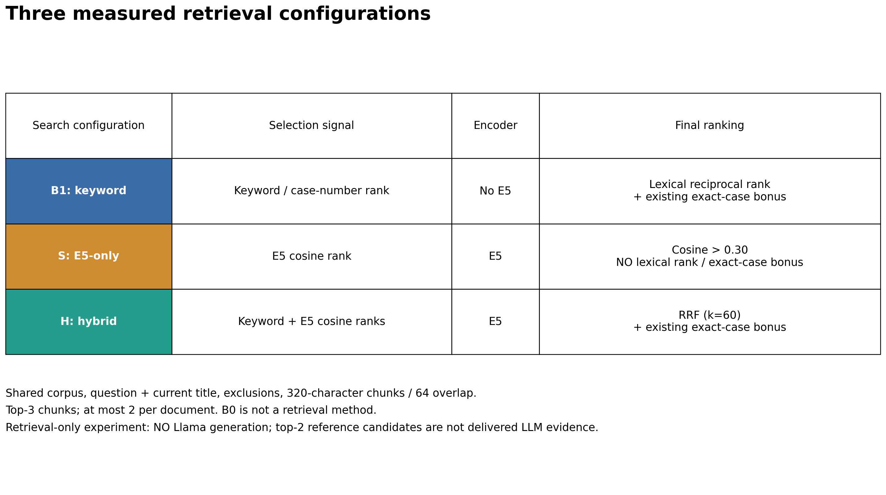
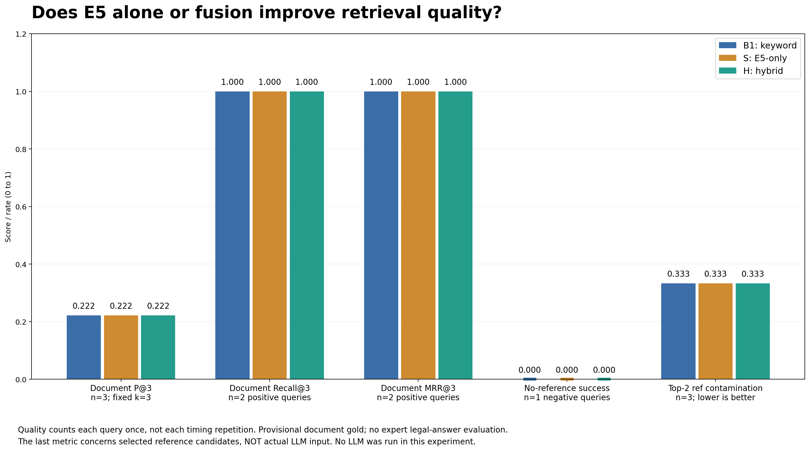
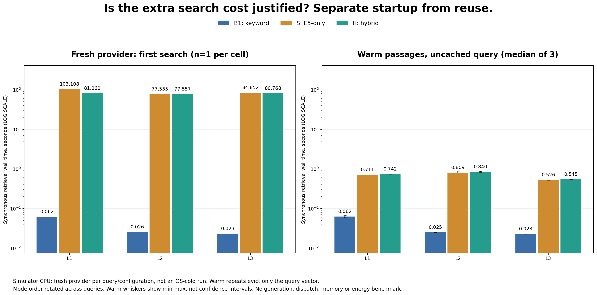

# B1·E5 단독·H 검색 분해 실험 결과

## 1. 목적과 실행 범위

다음 세 질문을 같은 코퍼스에서 확인했다.

1. **E5만 써도 되는가?**
2. **키워드와 E5의 결합이 실제로 도움이 되는가?**
3. **추가 검색 비용을 지불할 가치가 있는가?**

2026-11-03, iPhone 16 Simulator / iOS 26.1에서 실제 multilingual-e5-base Q8_0를 사용했다. **검색만 실행했으며 생성 LLM은 호출하지 않았다.** [기존 생성 파일럿](../legal-case-pilot-2026-11-03/raw/report.json)의 세 문서·세 질문·잠정 관련 정답을 그대로 사용했고, 기존 원자료와 다른 디렉터리에 보존했다.

| 표기 | 검색 구성 | 이번 실험의 선택 신호 |
| --- | --- | --- |
| B1 · `keyword` | 키워드 검색 단독 | 기존 문자 매칭 순위·사건번호 정책 |
| S · `semantic` | E5 의미 검색 단독 | 코사인 0.30 초과·코사인 내림차순. 키워드 점수·사건번호 가산·RRF 없음 |
| H · `hybrid` | 키워드 + E5 하이브리드 | 기존 두 순위의 RRF, 상수 60·기존 사건번호 정책 |

S는 Semantic-only의 조건 이름이다. E5는 임베딩 모델이며, E0·E1·E2 근거 ID와 다르다. B0는 참고 검색을 생략한 생성 기준 조건이므로 검색기 비교에서 제외했다.



[PNG](01-configurations.png) · [SVG](01-configurations.svg)

공통 설정은 `질문 + 현재 판례 제목`, 동일 문서·중복 제외, 최대 320자·64자 겹침, 상위 3청크·문서당 최대 2청크다. 코퍼스·질문은 [기존 데이터 안내](../datasets/family-law-retrieval-v1/README.md)를 따른다. L1·L2의 관련 정답은 재산분할 선례 B, L3의 관련 정답은 없다. L2는 사건번호를 명시한 쉬운 대조 조건이다.

## 2. 초기 비용과 재사용 비용의 분리

각 질문·검색 구성마다 provider를 새로 만들었다. 다음 두 상태를 구분했다.

| 측정 상태 | 횟수 | 포함하는 것 | 포함하지 않는 것 |
| --- | --- | --- | --- |
| `provider_cold` | 질문·구성당 최초 1회 | 새 provider의 모델 해시 확인·로드·문서/질문 벡터 구축·검색 | OS 파일 캐시 초기화, 생성 LLM |
| `warm_passages_uncached_query` | 같은 조건에서 3회 | 모델·문서 벡터 재사용, 질문 벡터 재계산·검색 | 이미 계산한 질문 벡터의 조회만으로 끝나는 완전 캐시 검색 |

S·H는 각 warm 측정 직전에 **질문 벡터만 제거**했다. 원자료에서 warm의 벡터 캐시 미스는 모두 1, 적중은 각 요청의 후보 청크 수 42·42·43과 일치했다. B1은 임베딩이 없으며 같은 검색을 반복했다.

실행 순서는 L1: B1→S→H, L2: S→H→B1, L3: H→B1→S였다. 각 구성에서는 최초 검색 후 warm 3회를 연속 실행했다. 완전한 무작위 실험이나 OS-cold 실험은 아니다.

**3질문 × 3검색 구성 × (최초 1회 + warm 3회) = 검색 36회**다. 검색 품질은 반복 시간을 중복 집계하지 않고 **구성당 서로 다른 3질문**으로 계산했다. 생성 텍스트·인용 형식·법률 답변 정답률은 이 실험에서 측정하지 않았다.

동기 `RAGRetriever.retrieve`의 벽시계 시간을 측정했다. 이전 파일럿의 `retrievalMS`와 달리 외부 Task 디스패치를 포함하지 않는다. 서로 다른 측정 경계를 합쳐 평균 내지 않는다.

## 3. 검색 품질: 세 구성의 측정 지표는 같았다

| 지표 | B1 | S · E5 단독 | H | 표본·단위 |
| --- | --- | --- | --- | --- |
| 문서 P@3 평균 | 0.222 | 0.222 | 0.222 | 전체 3질문, 분모 고정 3 |
| 문서 Recall@3 | 1.000 | 1.000 | 1.000 | 관련 정답이 있는 2질문 |
| 문서 MRR@3 | 1.000 | 1.000 | 1.000 | 관련 정답이 있는 2질문 |
| 참고 없음 판정 성공률 | 0/1 | 0/1 | 0/1 | 정답 참고가 없는 L3 |
| 상위 2참고 후보에 비관련 문서가 섞인 요청 비율 | 1/3 | 1/3 | 1/3 | 전체 3질문 |



[PNG](02-quality-comparison.png) · [SVG](02-quality-comparison.svg) · [품질 CSV](quality_summary.csv)

P@3는 반환된 고유 문서가 2개여도 분모가 3이다. L1·L2가 각각 1/3, L3가 0이므로 평균은 2/9다. Recall·MRR는 정답 집합이 빈 L3를 0으로 채우지 않는다.

마지막 지표는 **검색 상위 2청크를 참고로 쓴다면 비관련 문서가 포함되는 요청의 비율**이다. 생성하지 않았으므로 이를 실제 LLM 입력 오염률이라고 부르지 않는다.

S도 L1·L2의 관련 문서 B를 1위로 찾았다. L3에서는 B→A를 반환했고, B1/H는 A→B를 반환했다. 문서 순서가 달라도 L3는 모두 비관련 자료이므로 참고 없음 성공률은 같다. 점수·순위·벡터의 정확성과 법률적 관련성은 동일한 개념이 아니다.

## 4. 선택 청크는 같지 않았다

A = 2024므16033, 16040, B = 97므1486, 1493, C = 2026으552다. `[시작,끝)`은 원문 UTF-16 범위이며 끝은 제외한다.

| 질문 | 순위 | B1 | S · E5 단독 | H |
| --- | --- | --- | --- | --- |
| L1 | 1 | B[141,461) | B[141,461) | B[141,461) |
| L1 | 2 | B[1408,1682) | B[1618,1938) | B[1618,1938) |
| L1 | 3 | C[3958,4274) | C[2211,2477) | C[4418,4704) |
| L2 | 1 | B[0,205) | B[0,205) | B[0,205) |
| L2 | 2 | B[1874,2129) | B[141,461) | B[1874,2129) |
| L2 | 3 | C[2524,2783) | C[437,706) | C[4418,4704) |
| L3 | 1 | A[3675,3987) | B[815,1123) | A[3675,3987) |
| L3 | 2 | A[4693,4952) | A[1365,1646) | A[5567,5786) |
| L3 | 3 | B[0,205) | A[3675,3987) | B[0,205) |

B1·H의 선택은 기존 생성 파일럿의 청크 ID와 모두 일치했다. 각 질문·구성의 선택은 최초 검색과 세 번의 warm 검색에서 같았다. S와 H의 공통 상위 청크 수는 L1 2/3, L2 1/3, L3 1/3이다. **선택 변화는 관측했지만, 어떤 청크가 더 충분한 법률 근거인지 독립적으로 검수하지 않았다.**

전체 위치·텍스트·구성별 점수는 [hits.csv](hits.csv)에 있다. S의 점수는 코사인, B1/H는 역순위 기반 점수이므로 숫자 크기를 서로 품질로 비교하지 않는다.

## 5. 검색 비용: 문서 벡터 준비 후에도 B1이 가장 짧았다

### 새 provider의 최초 검색

| 질문 | B1(초) | S · E5 단독(초) | H(초) |
| --- | --- | --- | --- |
| L1 | 0.061815 | 103.107840 | 81.060135 |
| L2 | 0.025520 | 77.534636 | 77.556636 |
| L3 | 0.022925 | 84.851708 | 80.768329 |

### 문서 벡터 재사용 + 질문 벡터 재계산, 3회 중앙값

| 질문 | B1(초) | S · E5 단독(초) | H(초) |
| --- | --- | --- | --- |
| L1 | 0.062458 | 0.711322 | 0.741826 |
| L2 | 0.024940 | 0.808611 | 0.839862 |
| L3 | 0.022734 | 0.525825 | 0.545408 |



[PNG](03-search-cost.png) · [SVG](03-search-cost.svg) · [질문·상태별 시간 CSV](timing_summary.csv) · [36회 측정 CSV](samples.csv)

두 패널은 같은 초 단위 **로그 축**을 사용한다. warm 오차 막대는 세 측정의 최솟값·최댓값이지 신뢰구간이 아니다. 초기화·문서 인코딩이 warm 값으로 사라진 것이 아니라 최초 검색에서 먼저 지불된 비용이다.

S·H의 warm 검색은 최초 검색보다 크게 짧아졌다. 그러나 같은 질문의 벡터까지 캐시한 결과가 아니라 **질문 인코딩 1회를 포함한 비용**이며, 이 조건에서도 B1이 세 질문 모두 짧았다. H의 warm 중앙값은 S보다 각각 약 30.504ms·31.251ms·19.583ms 컸지만, 표본이 작고 시간 범위도 겹치므로 통계적 우열이나 고정 융합 비용으로 일반화하지 않는다. 최초 검색에서 H가 S보다 짧은 경우 역시 첫 측정 1회의 차이로서 융합이 더 빠르다는 증거가 아니다.

## 6. 세 질문에 대한 답

| 연구 질문 | 이번 관측의 답 | 아직 말할 수 없는 것 |
| --- | --- | --- |
| E5만 써도 되는가? | 관련 문서를 1위로 찾는 두 양성 질문에는 가능했다. 하지만 참고 없음 거절에 실패했으므로 신뢰할 수 있는 참고 선택 전체를 충족했다고 볼 수 없다. | 한국어 법률 질의 전반에서 E5 단독이면 충분하다는 결론 |
| 결합이 실제로 도움이 되는가? | S와 H의 청크 선택은 달랐지만 측정한 다섯 지표의 향상은 없었다. | 어떤 상황에서도 하이브리드가 무용하다는 결론, 법리·조건·예외의 근거 충분성 우열 |
| 추가 비용을 지불할 가치가 있는가? | 이번 지표에서는 B1 대비 S/H의 추가 시간에 상응하는 이득이 없었다. **현재 파일럿에서는 B1의 품질 대비 시간 효율이 가장 유리했다.** | 큰 코퍼스·다양한 의미 질의·실기기에서도 B1이 항상 최선이라는 결론 |

E5 비용의 대부분을 결합 방식의 문제로 설명하지 않는다. S와 H 모두 같은 인코더를 사용하므로 문서 벡터 구축과 질문 인코딩 비용을 공유한다. 앱의 기본 검색 방식은 이번 소규모 결과만으로 자동 변경하지 않았다.

## 7. 제한과 후속 검증

- 서로 다른 법률 질문은 3개뿐이고, 양성 2개 중 하나는 사건번호를 명시했다. 36회를 36개의 독립 품질 평가 질문으로 확대 해석하지 않는다.
- 질문·관련 정답은 기존 파일럿과 같으며 독립 법률 전문가 검수가 없다. 새로 만든 의미 검색 친화 질의를 사후 추가해 이득을 만들지 않았다.
- 문서 수준 지표는 청크의 법리·조건·예외 충족 여부를 구분하지 못한다. 청크가 달라졌는데 문서 지표가 같은 것은 실제 동작이 같다는 뜻이 아니다.
- 캐시 상태는 명시적으로 구분했지만 OS 파일 캐시·장비의 다른 부하·열 상태까지 통제하지 않았다. 초기 비용은 조건당 1회, warm은 3회다.
- 시뮬레이터 CPU 결과이며 메모리·배터리·발열·ANN 인덱스·대규모 코퍼스·실기기 성능은 미측정이다.
- 세 구성 모두 참고 없음 거절에 실패했다. 별도 개발셋에서 최종 채택/거절 기준을 정하고, 더 많은 고정 테스트 질문과 근거 충분성 주석으로 재평가해야 한다.

## 8. 재현과 원자료

[native 검사 요약](native_test_summary.txt): 검색 전용 검사 **518.674초**, 포함 회귀 검사 **22개 통과·0실패**. 전체 검사 시간 563.529초는 개별 검색 응답 시간이 아니다.

| 자료 | 위치 |
| --- | --- |
| 전체 native 결과·코퍼스·설정 | [raw/report.json](raw/report.json) |
| 36개 개별 체크포인트 | [raw/](raw/) |
| 소스·모델 manifest·패키지·입력 해시 | [frozen_source_sha256.txt](frozen_source_sha256.txt) |
| 원본 xcodebuild 로그 해시 | [native_log_sha256.txt](native_log_sha256.txt) |
| 분석 버전·환경·원자료 해시 | [analysis_summary.json](analysis_summary.json) |
| 실제 실험 코드 | [LegalCasePilotTests.swift](../../../code/ios/AISYSAppTests/LegalCasePilotTests.swift) |
| 분석·회귀 검사 | [analyze_retrieval_ablation.py](../../../scripts/analyze_retrieval_ablation.py) · [test_analyze_retrieval_ablation.py](../../../scripts/test_analyze_retrieval_ablation.py) |

저장소 루트에서 기존 원자료만 다시 집계한다. 모델 실행·다운로드는 하지 않는다.

```bash
python3 scripts/analyze_retrieval_ablation.py \
  --raw docs/research/retrieval-ablation-2026-11-03/raw \
  --output docs/research/retrieval-ablation-2026-11-03

python3 -m unittest discover -s scripts -p 'test_analyze*.py' -v
```

실제 모델 재실행은 iOS 프로젝트의 `AISYSAppTests/LegalCasePilotTests/testRetrievalOnlyKeywordSemanticHybridAblation`만 선택한다. 기존 생성 파일럿 검사와 구별한다. 전용 시뮬레이터의 로그와 xcresult는 로컬 세션에 보존했다.
